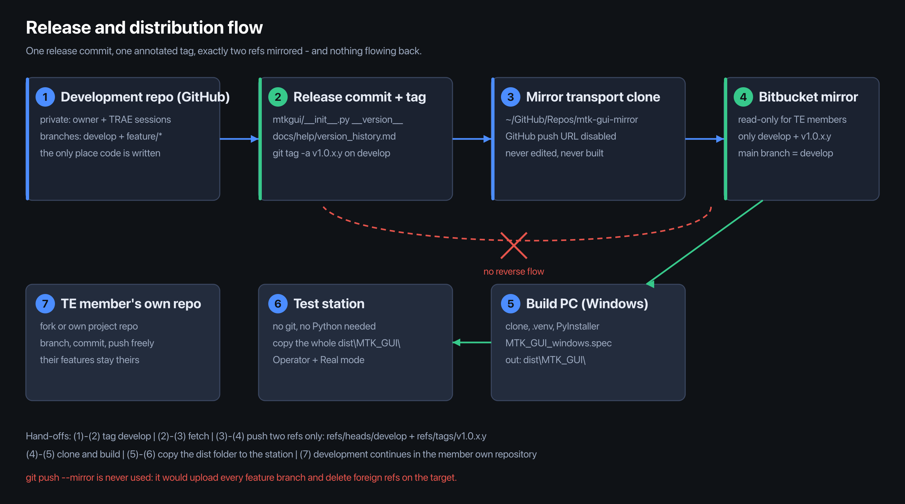

# MTK GUI — Windows Setup, Build & Station Deployment Guide

One self-contained document for a Windows PC: get the source, install the toolchain, build `MTK_GUI.exe`, prepare a test station, and deploy it.
Written for every TE member — whether you build on your own PC, run a station on the floor, or do both.
Run commands in **PowerShell** (CMD equivalents are noted where they matter).

## Start here — which path is yours

Two different jobs share this guide. Pick yours; you do not need the other half.

| Your situation | What you need on that machine | Read |
|---|---|---|
| **A. Your own Windows PC** — you build the exe yourself, or you develop features for your project | Python, Git, VC++ runtime, then a working `dist\MTK_GUI\` | sections 1–9, then section 12 once you change code |
| **B. A factory station PC** — it only runs tests | the finished `MTK_GUI\` folder copied onto it. No Git, no Python, no build tools | section 10 only |
| **Both** — you build on your PC and feed a station | A first, then the copy step in section 10 | 1–9, then 10 |

Path B never needs the source, and path A never needs the station. If you are on path B and the folder you were
given looks incomplete, the fix is to get a complete `dist\MTK_GUI\` from whoever built it (section 10), not to
install Python on the station.

**Document control**

| Field | Value |
|---|---|
| Document revision | **R2** |
| Last updated | 2026-11-07 22:40 CST |
| Applies to app version | `v1.0.0.0` — develop, pre-release baseline |
| Applies to code commit | `174000c` / `174000c1bba3cb77833b672327aed202de5d15c6` |
| Release tag | none yet — the first release will be `v1.0.0.1` |
| Canonical history | `git log --follow WINDOWS_DEPLOY_EN.md` in this repository |

## Contents

- [Start here — which path is yours](#start-here--which-path-is-yours)
- [0. What this repository is](#0-what-this-repository-is)
- [1. Access rules](#1-access-rules)
- [2. Build PC requirements](#2-build-pc-requirements)
- [3. Install the toolchain](#3-install-the-toolchain)
- [4. Configure Git for this repository](#4-configure-git-for-this-repository)
- [5. Clone and authenticate](#5-clone-and-authenticate)
- [6. Get the source and set up Python](#6-get-the-source-and-set-up-python)
- [7. Know the spec before building (no edits needed)](#7-know-the-spec-before-building-no-edits-needed)
- [8. Build the exe](#8-build-the-exe)
- [9. Verify the build](#9-verify-the-build)
- [10. Test station requirements and deployment](#10-test-station-requirements-and-deployment)
  - [10.1 Station PC hardware](#101-station-pc-hardware)
  - [10.2 Port and interface budget](#102-port-and-interface-budget)
  - [10.3 Software and drivers to install on the station](#103-software-and-drivers-to-install-on-the-station)
  - [10.4 Operational prerequisites](#104-operational-prerequisites)
  - [10.5 Roles and run modes](#105-roles-and-run-modes)
- [11. Troubleshooting](#11-troubleshooting)
- [12. If you need to develop](#12-if-you-need-to-develop)
  - [12.1 Point the clone at your own repository](#121-point-the-clone-at-your-own-repository)
  - [12.2 Branch freely](#122-branch-freely)
  - [12.3 Keep receiving releases](#123-keep-receiving-releases)
  - [12.4 Getting a change into the product](#124-getting-a-change-into-the-product)
- [13. Copy-paste end-to-end (fresh build PC)](#13-copy-paste-end-to-end-fresh-build-pc)
- [Appendix A. Document revision history](#appendix-a-document-revision-history)

---

## 0. What this repository is

This is the **release distribution repository** maintained by the MTK GUI tool owner. Each release is published here as a tag; there is no day-to-day development in it.

| Ref | Content | Stability |
|---|---|---|
| branch `develop` | the newest published release state | moves forward with each release |
| tag `v1.0.x.y` | one exact released build | immutable |

No feature branches, no pull requests, no CI. It is a distribution channel, not a workspace.



*Figure 1 — the one-way flow: one release commit, one tag, exactly two refs in the mirror, and nothing flowing back.*

### Machine roles

| Machine | Role | Needs |
|---|---|---|
| Upstream development repo | where the platform keeps growing: the MTK GUI architecture, the core test engine and several typical DUT templates are already built and adapted, and improvements continue here | nothing — each improvement reaches you as a release tag |
| **Build PC** (Windows) | clone, venv, PyInstaller → `dist\MTK_GUI\` | this guide, sections 1–9 |
| **Test station PC** (factory) | run only | nothing to install — copy the `dist\MTK_GUI\` folder (section 10) |
| **Your own repository** (optional) | where you develop the features **your project** needs: branch, commit and push as much as you like here | a fork or a repository under your account — section 12 |

---

## 1. Access rules

1. **Read and clone only.** Push, branch creation and pull requests are disabled for this repository by design. A `git push` fails with `403` or `pre-receive hook declined` — expected behaviour, not a broken setup.
2. **Need to change code? Use your own repository.** Fork or create one under your account, push to it freely, and build whatever feature your project needs there. This is the normal path, not an exception: the mirror stays read-only for everyone, and every TE member's own repository is where the work happens (section 12).
3. **One-way distribution.** Nothing is merged back into the upstream development repository from this side.
4. **Do not build your daily workspace here.** Build from it and keep it clean; do your edits in your own repo, otherwise every new release is a merge conflict.

---

## 2. Build PC requirements

| Item | Minimum | Recommended | Why |
|---|---|---|---|
| OS | Windows 10 64-bit | **Windows 11 Pro x64** — the reference configuration the tool is validated on | Qt 6 / WebEngine support, `netsh` output format |
| CPU | 4 cores | 6+ cores | PyInstaller is the slow part; runtime is light |
| RAM | 8 GB | 16 GB | PySide6 + QtWebEngine + large ICT plans |
| Disk | SSD, 50 GB free | SSD, 100 GB+ free | `dist\` bundles, report PDFs and DAQ CSVs accumulate |
| Display | 1400 px width | 1920×1080 or wider | the GUI layout assumes ≥ 1400 px; wide tables need the room |

Nothing here is a hard gate except the OS: the tool parses English `netsh` / `ping` output, so run an **English Windows locale**.

---

## 3. Install the toolchain

| Software | Why | How |
|---|---|---|
| **Git for Windows** | clone / tag / pull | https://git-scm.com/download/win — accept all defaults |
| **Python 3.12** | run and package the app | https://www.python.org/downloads/ — **tick "Add Python to PATH"**, the most common failure |
| **PyInstaller** | produce the exe | **do not install separately** — pinned in `requirements.txt` (`pyinstaller>=6.0`), comes in with section 6 |
| VC++ Redistributable x64 | only if a stripped-down image reports a missing DLL | https://aka.ms/vs/17/release/vc_redist.x64.exe |

Open a **new** terminal after installing (PATH changes do not reach open windows), then verify:

```powershell
git --version
python --version
```

If `python` opens the Microsoft Store instead of the interpreter, the PATH entry is missing — reinstall with "Add Python to PATH" ticked, or disable the Store alias under Settings → Apps → App execution aliases.

---

## 4. Configure Git for this repository

```powershell
git config --global core.autocrlf false
git config --global core.longpaths true
```

- **`core.autocrlf false`** — the code is developed on macOS. With automatic CRLF conversion every text file shows as modified right after cloning, and the build drifts from the source you thought you built. If you cloned before setting this, delete the folder and clone again.
- **`core.longpaths true`** — the project uses deep resource, report and project-asset paths beyond the legacy 260-character limit.

Keep the clone **outside** OneDrive / Dropbox / network-synced folders: sync clients and antivirus lock files under `.git` and cause phantom `index.lock` and "unable to write" errors.

---

## 5. Clone and authenticate

**Option A — HTTPS with an access token (recommended)**

```powershell
git clone https://<your-account>@<BITBUCKET_URL>/mtk-gui.git
```

Git prompts for a password — paste an **HTTP access token / app password** issued for your account, never your domain password. Windows Credential Manager stores it after the first successful prompt.

**Option B — SSH**

```powershell
ssh-keygen -t ed25519 -C "mtk-gui-build"
# upload ~/.ssh/id_ed25519.pub to your account, then:
git clone ssh://git@<BITBUCKET_HOST>:7999/<PROJECT>/mtk-gui.git
```

If port 7999 is blocked on your network path, fall back to Option A.

> **Building the release on the owner's machine?** The release build PC clones the private GitHub repository instead
> (`git clone git@github.com:Seapol/MTK-GUI.git`, branch `develop`); every step after the clone is identical. That URL is
> private and is not handed out — TE members always use the mirror.

---

## 6. Get the source and set up Python

```powershell
# pick a working directory not synced to a cloud drive
D:
cd \work

git clone https://<your-account>@<BITBUCKET_URL>/mtk-gui.git
cd mtk-gui
git switch develop

python -m venv .venv
.venv\Scripts\activate

python -m pip install --upgrade pip
pip install -r requirements.txt
```

> **Building a specific release?** `git switch --detach v1.0.x.y` before creating the venv. A detached HEAD is intended here — it pins you to an immutable tag.

> **`pyinstaller` not found later?** You are in the wrong environment — section 8 covers the two competing venv folder names in this repo.

> **`pip install` slow or blocked?** It pulls PySide6 (~200 MB). On a restricted network point pip at your organization's mirror, e.g. `pip config set global.index-url https://<internal-pypi>/simple`, or use the proxy.

Every new terminal needs `.venv\Scripts\activate` again; the prompt then shows `(.venv)`.

---

## 7. Know the spec before building (no edits needed)

`MTK_GUI_windows.spec` in the repo root is already configured correctly:

| Setting | Effect | Do not change |
|---|---|---|
| `EXE(name='MTK_GUI')` | output file `MTK_GUI.exe` | — |
| `COLLECT(name='MTK_GUI')` | output folder `dist\MTK_GUI\` | — |
| `icon='resources/app_icon.ico'` | exe / taskbar icon, ships inside `resources` | — |
| `upx=False` | **mandatory.** UPX-compressed DLLs are decompressed and scanned by Defender on every launch, which once cost 1+ minutes to reach the main window after login | never switch to `upx=True` |
| `hiddenimports` incl. `PySide6.QtWebEngineWidgets` / `QtWebEngineCore` | pulls in `QtWebEngineProcess.exe` and the `qtwebengine_*` resources needed by the SharePoint sign-in window | never add these two to `excludes` |

There is no rename step and no `version.json` step. Build straight from a source checkout.

---

## 8. Build the exe

Pick **one** method and stay with it.

### Method A — PyInstaller directly (recommended, deterministic)

```powershell
# repo root = the directory holding MTK_GUI_windows.spec
.venv\Scripts\activate
pyinstaller --noconfirm MTK_GUI_windows.spec
```

### Method B — `build_windows.ps1` (adds verification output and options)

```powershell
.\build_windows.ps1                              # → dist\MTK_GUI\
.\build_windows.ps1 -OutDir D:\release\v1.0.0.1   # package elsewhere
.\build_windows.ps1 -SkipProjects                # leave project data out
.\build_windows.ps1 -KeepRunning                 # never force-stop a running GUI
```

It prints the resulting exe size and confirms the bundled `projects\` and `assets\` payloads.

> **Close the GUI normally before building.** The script's default path runs `Stop-Process -Force` on any running `MTK_GUI.exe` so PyInstaller can replace the locked onedir bundle. If a session is open, exit through the application's own close path — or pass `-KeepRunning` and close it yourself first. Forcibly killing the process is acceptable only when no session worth preserving exists.

### Method C — `scripts\build_windows.bat` (legacy one-shot, also zips the result)

```bat
scripts\build_windows.bat
```

Produces `dist\MTK_GUI\` plus `dist\MTK_GUI_win64.zip` ready for a USB stick.

> **All three methods share one environment.** Both `build_windows.bat` and `build_windows.ps1` use `.venv\`, the same one section 6 creates, so you can switch methods without re-creating anything. Method C is the legacy convenience path: it creates the venv, installs the requirements, builds and then zips `dist\MTK_GUI_win64.zip` for a USB stick.

### Output

```
dist\MTK_GUI\MTK_GUI.exe      <- main program, double-click to run
dist\MTK_GUI\_internal\       <- every dependency; must stay next to the exe
```

### Post-build checks (2 minutes, saves a support ticket)

```powershell
# 1. helper process required by the SharePoint sign-in window
Test-Path dist\MTK_GUI\_internal\QtWebEngineProcess.exe     # must be True

# 2. identity of what you just built
Select-String -Path mtkgui\__init__.py -Pattern '__version__'
git describe --tags --always
```

`__version__` must equal the release tag you checked out. If it does not, you built from the wrong ref.

---

## 9. Verify the build

Double-click `dist\MTK_GUI\MTK_GUI.exe` — GUI app, no console window.

- Log in (Supervisor / Operator) and confirm the status bar version matches the tag you built.
- `Help → About` shows the branch and commit the build came from — quote both when reporting anything.
- Every launch writes `_startup_timing.log` next to the exe (plain text, negligible; handy for start-up complaints).
- Large ICT plans (e.g. ~517 KB) load through a staged chain: the status-bar progress bar tracks stages, Run Control and double-click table editing are disabled during the load and restored automatically; switching projects closes the previous one first.

---

## 10. Test station requirements and deployment

Station PCs need **neither Git nor Python**. Copy the whole folder — never the exe alone:

```
MTK_GUI\
├── MTK_GUI.exe        <- double-click
└── _internal\         <- all dependencies; separating it breaks the app
```

**How the folder reaches the station**

- Build it on a build PC (sections 1–9) and copy it over the network — the normal route when the two machines can see each other.
- Or carry it on a USB stick prepared by whoever built it. Either way copy the whole `MTK_GUI\` folder; copying `MTK_GUI.exe` by itself produces an application that cannot start.
- Record the version the folder carries before copying (`Help → About` shows `__version__` and the build facts). A station has no git history, so the version inside the folder is the only identity the installation has.
- Replacing a station already in use: exit MTK_GUI normally first (`File → Exit`, then wait until the process is gone). Copying over a running exe fails with a file-in-use error, and force-killing the GUI can leave a half-written report in `DUT Report\`.

### 10.1 Station PC hardware

| Item | Minimum | Recommended | Note |
|---|---|---|---|
| OS | Windows 10 64-bit | **Windows 11 Pro x64** | reference configuration; English locale required for `netsh` / `ping` parsing |
| CPU | 4 cores | 6+ cores | measurement loops are I/O-bound, not CPU-bound |
| RAM | 8 GB | 16 GB | QtWebEngine + large plans + concurrent serial consoles |
| Disk | SSD, 100 GB free | SSD, 250 GB free | `DUT Report\` keeps every DUT's CSV + certificate PDF |
| Display | 1400 px width | 1920×1080 or wider | GUI layout assumes ≥ 1400 px |
| LAN | 1 port | **2 ports** (one dedicated to instruments/router) | keeps instrument traffic off the office network |
| WLAN adapter | 802.11n, 2.4 GHz | **802.11ac, 2.4 + 5 GHz, able to scan while associated** | host-side Wi-Fi scan / connect / throughput; must be a radio of its own — never the NIC used by the instruments |
| Wi-Fi router / test AP | — | dedicated 2.4 + 5 GHz AP, own SSID, fixed channel, isolated from the office network | **optional, not required** — the standard flow uses the DUT as the access point (see note) |
| Bluetooth | BLE 4.0 capable | **BLE 5.x adapter (onboard or USB)** | host-side BT test reads **BLE advertisements only**; a classic-Bluetooth-only dongle cannot run it |
| USB | 3 free ports | 5+ free ports, powered hub if needed | U2355A + DUT serial + flash probe |
| Serial | 1 COM port per DUT channel | USB-to-serial adapter per channel | console tests |

> The **WLAN** and **Bluetooth** rows are mandatory only when the plan contains `Wifi_Scan` / `BT_RSSI` steps — the rest of the station runs without them. Two constraints are easy to miss: the host-side Bluetooth test scans BLE **advertisements** through the Windows WinRT API, so the radio must support BLE (classic BR/EDR alone is not enough) and Bluetooth has to be switched on (Airplane mode or a disabled radio silently yields zero results). The Wi-Fi test drives `netsh wlan`, which needs the **WLAN AutoConfig** service running.

> **When a router is worth having (it is never required).** The standard Wi-Fi step configures the **DUT as the access point** and the host adapter associates to it, so no external AP is involved. A station AP only helps in three cases: (a) a plan where the DUT joins an external SSID instead of broadcasting one — then the host must sit on the same SSID; (b) throughput runs where you want a known, stable channel rather than the DUT's own radio as the AP; (c) bring-up checks — associate the host to a known good AP first, and if RSSI looks wrong there, the host radio is the suspect, not the DUT. Note that the application's own Virtual-mode notice lists "Wi-Fi router" among the real RF hardware, so a station running full FCT RF plans is usually expected to have one. If you do install one, give it its own SSID and a fixed channel, keep it off the office network, and plug it into the instrument-side NIC.

### 10.2 Port and interface budget

| Instrument / peripheral | Interface | Count |
|---|---|---|
| DAQ973A mainframe (with DAQM908A ×2, DAQM907A) | GPIB, or LAN / USB | 1 |
| U2355A analog capture | USB | 1 |
| N5747A DC power supply | LAN (LXI) | 1 |
| Router / test AP (**optional**) | LAN | 0 or 1 |
| DUT console | USB-to-serial, one COM per channel | 1 per channel |
| Flash / debug probe (J-Link, PE Micro, Trace32, CMSIS-DAP, MCU-LINK, OpenSDA) | USB | as needed |
| Host WLAN radio (Wi-Fi RF steps) | PCIe / USB, 2.4 + 5 GHz | 1 |
| Host Bluetooth radio (BT RF steps) | onboard or USB, BLE 4.0+ | 1 |


*Figure 2 — one station in one picture: what plugs into the host PC, on which bus, and how much of it there is.*

If the PC has no GPIB card, use a **USB-to-GPIB adapter** (e.g. Keysight 82357B) — it requires the IO Libraries Suite below.

### 10.3 Software and drivers to install on the station

| Component | Needed when | How |
|---|---|---|
| **Keysight IO Libraries Suite** (includes Keysight VISA + **Connection Expert** + GPIB/USB drivers) | any GPIB or USB instrument — **recommended on every station** | install **before** plugging the instruments in, so the drivers bind on first enumeration. Then open Connection Expert, confirm each instrument is listed, and query `*IDN?` on every one. This is the fastest way to prove the instrument layer works before blaming the test plan. |
| USB-to-serial driver | DUT connected through a USB-serial cable | FTDI / CP210x install themselves on Win10/11; CH340-family usually needs a manual driver |
| VC++ Redistributable x64 | double-clicking the exe reports a missing DLL (few stripped-down images) | install once |
| `iperf3.exe` | a Wi-Fi throughput step is enabled (`iperf3 -c` host-side, or `-s` as server) | drop next to `MTK_GUI.exe` or into `C:\Windows\` |
| **`lswifi`** | the plan runs `Wifi_Scan` — **required on every station that does** | `pip install lswifi`, then make sure the install's `Scripts` directory is on `PATH`: the packaged exe invokes `lswifi` through the shell, so a missing PATH shows up as "Wifi_Scan always fails". The venv-`Scripts` and `--user` installs both work; verify from a **new** terminal with `lswifi --help`. |
| Bluetooth host stack | any BT step | **nothing to install** — BLE scanning goes through Windows WinRT (`BluetoothLEAdvertisementWatcher`) using the bundled `bleak`; only a BLE-capable radio and Windows 10+ are needed. Classic Bluetooth pairing is not used by the host-side test. |
| WLAN AutoConfig services | any Wi-Fi step | built into Windows, but must be **running** and not disabled by policy; also needs an English locale for the `netsh` output parsing |
| Third-party flash tool (e.g. SEGGER J-Link) | Flash FAT / Flash OOBE steps are enabled | install the tool, then fill the CLI profile on the matching Flash / Debug Probe row of the Equipment page (exe path, command templates, output keywords). `mode: auto` → MTK GUI calls the CLI and judges on keywords; `mode: manual` → the operator flashes in the tool's own GUI and answers GO / STOP in the MTK GUI dialog (an optional `launch` path auto-opens it) |

> **Instrument addresses.** The Equipment page address field takes VISA-style resource strings, e.g. `GPIB0::9::INSTR` (DAQ973A), `TCPIP0::<supply-ip>::inst0` (N5747A). Copy the exact strings **Connection Expert** shows rather than typing them from memory — a wrong board/slot number is the single most common "instrument not responding" cause.

### 10.4 Operational prerequisites

- **Real mode requires instruments connected before Run**: establish the gateway via Tools → Connect all first. Without it, ICT measurement rows, standard operations and the power-rails capture all report **Error** by design (equipment-fault stop policy) — a fake PASS with an empty Measured cell is not possible. Virtual mode is unaffected.
- **A project is one folder under `projects\`.** One project = one folder (`projects\<project>\`) holding everything it needs: the plan YAML, the BOM workbook, the netlist, the SPF, probe and template files. The old `yaml_plan\` workspace is retired — it was removed from the repository on 2026-11-07, so there is no second place for plans and no `yaml_plan\` folder in the package.
- **The projects shipped in the package are examples.** `29420`, `94923`, `95308`, `95987`, `95995`, `96317`, `96624` and `97122` are there to be read and copied as a starting point. Do not edit them in place: they live in `_internal\projects\` and the next release replaces them wholesale. Nothing under `_internal\` is yours to keep — the next package overwrites it, `projects\` included.

- **Need the FRDM-IMX93 FCT demo plan back?** It is not shipped separately: from a source checkout run `python scripts\build_frdm_fct_demo_yaml.py`, which rewrites `projects\FRDM-IMX93\` with the demo plan.
- **Create your own `Projects` folder and do your work there.** The workspace is resolved in this order: `MTKGUI_TENANT_BASE` env var → a `projects\` folder beside the exe → the bundled `_internal\projects\` → `projects\` under the current directory. Point `MTKGUI_TENANT_BASE` at your own path (or keep your own `projects\` beside the exe) and every project you build and every asset you add stays inside your tree. Two TE members' projects are isolated by design — there is nothing to share, merge or reconcile; if you ever want to hand one over, zip the folder.
- **Where each kind of plan file lands**, so nothing looks lost:
  - `Load current yaml` auto-saves the derived project to `projects\<Part#>_<CoreID>_<Batch#>_rev_<version>_Draft.yaml`.
  - The Yaml Build page's **Draft / Final** publish writes into `config\plans\` **of the working directory the exe was started from** (beside the exe when you launch it by double-click) and keeps a timestamped copy under `archive\yamlbuild\<project>\`. A fresh package ships that folder empty — it is created on the first publish, and it is deliberately not under version control.
  - The **Load Yaml** file picker has no fixed default folder — it opens wherever you used it last. Launch the exe from the same folder every time (a shortcut with **Start in** set to the exe folder) and all of the above stay together.
- **Report output, and how to keep it inside your own project folder.** By default each counted DUT run writes immediately into `MTK_GUI\DUT Report\`, one IDENTITY folder per DUT named `Part#_CoreID_Batch#_SN_<timestamp>`, containing the raw DAQ waveform CSV, the certificate PDF and the MES detail CSV. Event logs go to `MTK_GUI\Event Report\` (one `.log` per session). The Report menu opens these folders directly. To put them under your own tree instead, set `MTKGUI_REPORT_HOME` before launching (a one-line `.bat` wrapper next to the exe is enough) — both folders are then created under that path. **Report → Report Folder…** only renames the two sub-folders (`report_folders.json` next to the exe); it cannot move them out of the program folder. Worth one check after deployment: start the exe, run one DUT, confirm the folder appeared where you expected it.
- **Status bar shows `v1.0.0.0`?** That is correct: the version is unified to the single release constant `mtkgui.__version__`, shown in the status bar, login box and About alike. Only a Release commit bumps it. Build facts (branch / commit) are under Help → About.

### 10.5 Roles and run modes

| Role | Who | Rights |
|---|---|---|
| **Supervisor** | **NXP engineers only.** The password is issued by the tool owner directly and is deliberately **not documented** anywhere — not in this file, not in email, not on a sticker at the station | chooses Real / Virtual, edits the operator permission set, configures equipment, saves YAML |
| **Operator** | every factory station | starts the test and reads the result; edit rights come from `config\permissions.json` next to the exe — by default nothing is editable |

### Production policy

1. **Factory stations run as Operator, in Real mode. Nothing else.**
2. **Virtual mode is not permitted on a production station.** It simulates ICT instrument readings only and exists for bring-up, demos and fault injection on a development machine. An Operator account cannot select it by design (the login forces Real); a Supervisor account *can*, which is exactly why Supervisors do not stay logged in on a station.
3. The **Supervisor password never appears in writing**: not in this guide, not in a hand-over email, not in a shared spreadsheet, not on the machine. It is handed over verbally or through the owner's own channel, to named NXP engineers.
4. Do not create an Operator account with Supervisor-level rights "just to make it work". If the plan seems to need edit rights on the floor, that is a configuration decision for the Supervisor — not a workaround at the station.
5. The tool bootstraps a default account pair on very first run (source-visible). **Replace it before the station goes live**: a station running on bootstrap accounts has no accountable login.

> **Known limitation, worth knowing when you hand this out.** The Supervisor password is a plain constant inside `mtkgui/permissions.py`, and this mirror ships the source. Anyone who can clone the repository can read it. It is excluded from *documentation* here by policy, but it is not protected by the repository — treating it as a secret requires moving it out of source (environment variable or OS credential store). Until that change lands, the "NXP engineers only" rule is a procedural control, not a technical one.

---

## 11. Troubleshooting

### Build

| Symptom | Cause / fix |
|---|---|
| `pyinstaller is not recognized as an internal or external command` | venv not active, or wrong venv. Use `.venv\Scripts\activate`; see the `.bat` warning in section 8. |
| Build error: cannot find `config/permissions.json` or similar | the spec references files that must exist from the checkout: `config/permissions.json`, `config/FRDM-IMX93_Nets.xlsx`, `config/Nets_Template.xlsx`, `resources`, `assets`, `docs/help`, and `projects` (unless you pass `-SkipProjects`). Run the build **from the repo root**. |
| Permission error replacing `dist\MTK_GUI` | a running `MTK_GUI.exe` holds the folder. Close it normally, rebuild. |
| App crashes with no window on `Report → SharePoint Upload → Connect & Sign in` | `QtWebEngineProcess.exe` missing from `_internal\`. Rebuild without touching the spec's QtWebEngine hiddenimports. |
| Startup takes a minute after login on the station | Defender scanning the bundle. Add a Defender exclusion for `dist\`. Do **not** re-enable UPX. |

### Access

| Symptom | Cause / fix |
|---|---|
| `403` / `pre-receive hook declined` on push | expected — the repository is read-only (section 1). |
| `fatal: couldn't find remote ref develop` | wrong clone URL. Check with `git ls-remote <url>`. |
| `git tag -l` empty after cloning | `git fetch --tags`. |
| Hundreds of files modified right after cloning | `core.autocrlf` is on — set it to `false` (section 4) and re-clone. |
| `index.lock` exists / "unable to write" | another Git process, the IDE, a sync client or antivirus holds the files. Close them, delete `.git\index.lock`, retry. |
| `ssh: connect to host ... port 7999: Connection refused` | SSH blocked on your network path — use HTTPS (section 5). |

### Station

| Symptom | Cause / fix |
|---|---|
| Instrument rows all report **Error** on Run | no instrument gateway — Tools → Connect all before Run (section 10.4). |
| One instrument not responding while others are fine | wrong VISA address string, or the interface is on a different board number. Compare with Connection Expert. |
| USB instrument invisible after plugging | IO Libraries Suite was installed *after* the device was attached; replug, or re-run the suite's driver install. |
| Throughput step fails parsing output | non-English Windows locale, or `iperf3.exe` not reachable from the exe's folder. |
| `Wifi_Scan` reports "lswifi output is not valid JSON" or command not found | `lswifi` is missing, or its `Scripts` dir is not on the `PATH` the packaged exe inherits. `pip install lswifi`, open a new terminal, confirm `lswifi --help` works, then rerun. |
| `BT_RSSI` finds nothing | radio is classic-only, Bluetooth is off / Airplane mode, or no BLE advertiser is in range — the host test reads **advertisement** packets, it does not pair. |
| Wi-Fi scan returns empty now and then | adapter power saving. Device Manager → WLAN adapter → Power Management → clear "Allow the computer to turn off this device to save power". |
| RSSI values drift between otherwise identical runs | antenna placement changed, or a USB 3.0 port/device is radiating next to the 2.4 GHz antenna. Fix the DUT position and put the RF dongle on an extension cable away from USB 3 sockets. |
| The login dialog offers a Virtual option | you are logged in as Supervisor — log out and use an Operator account for production (section 10.5). |
| Operator cannot edit YAML / test cases | by design. The Supervisor adjusts the operator permission set in `config\permissions.json`; do not hand out Supervisor credentials to work around it. |

### Update later

```powershell
cd mtk-gui
git fetch --tags --prune
git switch develop
git pull --ff-only
```

`--ff-only` keeps the mirror moving forward only; if it refuses, the owner republished — re-clone instead of merging.

On a **station** an update is not a pull: there is no clone to pull into. Exit the GUI normally and replace the
whole `MTK_GUI\` folder (section 10), then confirm the new version in `Help → About`.

---

## 12. If you need to develop

This distribution repository is read-only **for you**: clone it, pull it, build from it. Everything else happens in your own repository — **your branches, your commits, your pushes, and the features your own project needs**.

A station rarely runs the stock plan unchanged: a new DUT template, an extra step, a different limit set, a project-specific report layout. All of that is developed, versioned and pushed in your own repository. Nothing you push there appears in the shared repository, and nothing there slows anyone else down.

### 12.1 Point the clone at your own repository

```powershell
cd mtk-gui
git remote rename origin upstream          # distribution repo becomes a read-only reference
git remote add origin https://<you>@<BITBUCKET_URL>/<YOUR_PROJECT>/mtk-gui.git
git switch develop                          # leave the detached tag, if you were on one
git push -u origin develop
```

From now on: `upstream` = new releases (read-only), `origin` = your repository (yours to push).

> Forking works the same way: clone your fork, then add the distribution repository as `upstream`. Either route is fine — what matters is that `upstream` is never pushed to.

### 12.2 Branch freely

```powershell
git switch develop
git pull --ff-only upstream develop

git switch -c feature/my-change            # your branch, your name, your convention
git commit -am "my change"
git push -u origin feature/my-change
```

- Branch naming, commit style and merge strategy are entirely yours — the owner's conventions do not apply to your repository.
- If you want a **reproducible base**, branch off a release tag instead: `git switch -c feature/my-change v1.0.0.1`. That way your work sits on exactly the build you tested.
- Long-lived work: merge or rebase `upstream/develop` into your branch whenever a new release lands, so you are never testing against stale code.

### 12.3 Keep receiving releases

```powershell
git fetch upstream --tags --prune
git log --oneline upstream/develop -5      # what changed since your base
git tag -l "v1.0.*"                        # which release you are on
```

### 12.4 Getting a change into the product

Do **not** push to the distribution repository and do not open a pull request against it — it cannot accept one by design. Hand the change back through the normal review channel, stating:

- your repository and branch name,
- the release tag you branched from,
- the commit range (`git log --oneline v1.0.0.1..HEAD`).

The owner picks it up from there and it ships in a future release tag; you will then see it arrive through `upstream`.

---

## 13. Copy-paste end-to-end (fresh build PC)

```powershell
git config --global core.autocrlf false
git config --global core.longpaths true

D:
cd \work
git clone https://<your-account>@<BITBUCKET_URL>/mtk-gui.git
cd mtk-gui
git switch develop

python -m venv .venv
.venv\Scripts\activate
python -m pip install --upgrade pip
pip install -r requirements.txt

pyinstaller --noconfirm MTK_GUI_windows.spec

Test-Path dist\MTK_GUI\_internal\QtWebEngineProcess.exe
Select-String -Path mtkgui\__init__.py -Pattern '__version__'
git describe --tags --always
dist\MTK_GUI\MTK_GUI.exe
```

---

## Appendix A. Document revision history

| Rev | Date (CST) | App version | Code commit | Change |
|---|---|---|---|---|
| R2 | 2026-11-07 22:40 | `v1.0.0.0` | `174000c` | Added "Start here" routing that separates the two deployments (own Windows PC vs factory station) before the reader begins; documented how the package reaches a station, the version-identity rule and how to replace a live station |
| R1 | 2026-11-07 22:15 | `v1.0.0.0` | `174000c` | Landed as the repository's canonical Windows guide (`WINDOWS_DEPLOY_EN.md`, replacing the 198-line earlier version). Corrected four statements that no longer matched the code: `yaml_plan\` is fully retired (it is no longer a bundled example folder and Case I/O exports to `export\`), the `.bat` and `.ps1` now share `.venv` (no competing `mtk_gui\` venv), the spec's required-data list, and the demo-plan regeneration command. Figures 1 and 2 now ship under `docs/images\` |
| R0 | 2026-11-07 16:47 | `v1.0.0.0` | `35df1ed` | Baseline. Consolidated guide: repository access (one-way mirror, read-only), toolchain install, Windows build, station hardware / drivers / roles, troubleshooting, and the project-folder model of section 10.4 |

### How the stamp stays honest

The **Applies to code commit** field records the code state this document was *written against* — deliberately **not** the commit that contains the file. Stamping its own commit is impossible: writing the hash into the file changes the file, which changes the hash.

- **Document revision** `R<n>` — this file's own edit counter. Bump it on every content change.
- **Applies to code commit** — the tree the content was verified against (`git rev-parse HEAD`).
- **The file's own commit** — always recoverable, no stamp needed: `git log --follow WINDOWS_DEPLOY_EN.md`.

Refresh the block before publishing a release:

```bash
git rev-parse --short HEAD
git rev-parse HEAD
git log -1 --format='%ci'
git describe --tags --always
```

Rules:

1. On every content edit: bump `Document revision`, update `Last updated` and `Applies to code commit`, add a row to the table above.
2. Once a release tag exists: fill `Release tag`, and make `Applies to app version` byte-identical to the release tag (which equals `mtkgui.__version__`).
3. **Never put a version or date in the file name.** Links already handed out would break and `git log --follow` would lose the trail. Version lives in the header, not the path.
4. When you answer another TE member's question, quote the pair — e.g. "per guide R0, tag v1.0.0.1" — so both of you can tell which text was read.

### The baseline starts at R0

This revision history was deliberately reset: R0 is the baseline, and nothing before it is recorded. History prior to the reset lives only in `git log --follow` — the repository is the archive, the table is not. Treat R0 as "the guide as it stands today"; the next content change becomes R1.

### Why pinning the link beats maintaining a filename

The document ships inside the repository, so **a link pinned to a tag already pins the document version**:

```
.../browse/WINDOWS_DEPLOY_EN.md?at=refs/tags/v1.0.0.1
```

Whoever opens that link sees the guide exactly as it stood at that release — no separate versioning system needed, and nothing to keep in sync by hand.
