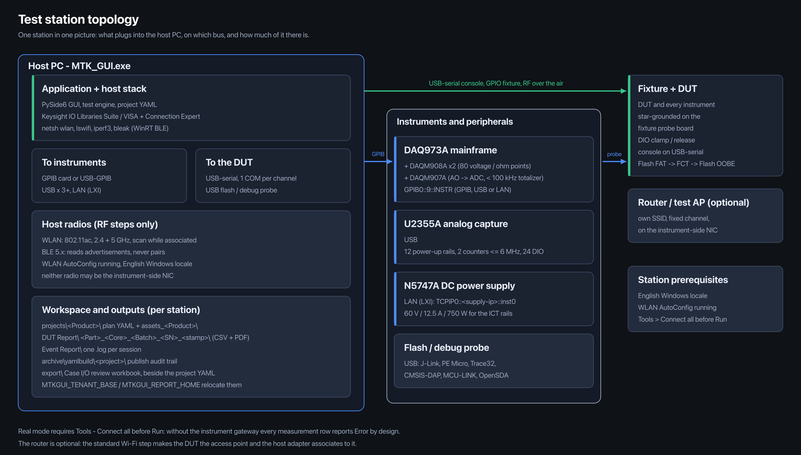

# MTK GUI — Windows Setup, Build & Station Deployment Guide

Get the source, install the toolchain, build `MTK_GUI.exe`, prepare a station, deploy it.
For every TE member: building on your own Windows PC, running a factory station, or both.
Run commands in **PowerShell**; CMD equivalents only where they differ.

## Start here — which path is yours

Two jobs share this guide. Pick yours; you do not need the other half.

| Your situation | What you need on that machine | Read |
|---|---|---|
| **A. Your own Windows PC** — you build the exe, or add features for your project | Python, Git, then a working `dist\MTK_GUI\` | sections 0–6, and section 9 once you change code |
| **B. A factory station** — it only runs tests | the finished `MTK_GUI\` folder. No Git, no Python, no build tools | section 7 |
| **Both** — you build on your PC and feed a station | A first, then the copy step in section 7 | 0–6, then 7 |

Path B never needs the source; path A never needs the station. If a folder on a station looks incomplete, the fix is
a complete `dist\MTK_GUI\` from whoever built it (section 7) — not Python on the station.

**Document control**

| Field | Value |
|---|---|
| Document revision | **R4** |
| Last updated | 2026-11-07 22:47 CST |
| Applies to app version | `v1.0.0.0` — pre-release baseline |
| Applies to code commit | `174000c` / `174000c1bba3cb77833b672327aed202de5d15c6` |
| Release tag | none yet — the first release will be `v1.0.0.1` |
| Canonical history | `git log --follow WINDOWS_DEPLOY_EN.md` |

## Contents

- [Start here — which path is yours](#start-here--which-path-is-yours)
- [0. Get the code](#0-get-the-code)
- [1. Build PC requirements](#1-build-pc-requirements)
- [2. Install the toolchain](#2-install-the-toolchain)
- [3. Set up Python](#3-set-up-python)
- [4. The spec (no edits needed)](#4-the-spec-no-edits-needed)
- [5. Build the exe](#5-build-the-exe)
- [6. Verify the build](#6-verify-the-build)
- [7. Station requirements and deployment](#7-station-requirements-and-deployment)
  - [7.1 Station hardware](#71-station-hardware)
  - [7.2 Port and interface budget](#72-port-and-interface-budget)
  - [7.3 Software and drivers](#73-software-and-drivers)
  - [7.4 Operational prerequisites](#74-operational-prerequisites)
  - [7.5 Roles and run modes](#75-roles-and-run-modes)
- [8. Troubleshooting](#8-troubleshooting)
- [9. If you need to change code](#9-if-you-need-to-change-code)
- [10. Copy-paste end-to-end](#10-copy-paste-end-to-end)
- [Appendix A. Document revision history](#appendix-a-document-revision-history)

---

## 0. Get the code

The release repository is **read-only**: clone it, check out a release, build. No branches, no pull requests, no CI.

Each release is published as a tag. The repository carries one commit per release and no history — deliberate:
anything removed during development never reaches you.

| Machine | Role | Needs |
|---|---|---|
| **Build PC** (Windows) | clone, venv, PyInstaller → `dist\MTK_GUI\` | this guide, sections 0–6 |
| **Station PC** (factory) | run only | nothing installed — copy `dist\MTK_GUI\` (section 7) |
| **Your own repository** (optional) | features your project needs | your own repo — section 9 |

Placeholders used below: `<release-repo-url>` is the URL you were given for the release repository;
`<your-repo-url>` is a repository under your own account.

**Git settings, once per machine**

```powershell
git config --global core.autocrlf false
git config --global core.longpaths true
```

- `core.autocrlf false` — the code is developed on macOS. With CRLF conversion every text file shows as modified right
  after cloning and the build drifts from the source. Already cloned? Delete the folder and clone again.
- `core.longpaths true` — project, report and asset paths exceed the legacy 260-character limit.

Keep the clone **outside** OneDrive / Dropbox / network-synced folders: sync clients and antivirus lock files under
`.git` and produce phantom `index.lock` / "unable to write" errors.

**Clone**

```powershell
git clone https://<your-account>@<release-repo-url> mtk-gui
cd mtk-gui
git tag -l "v1.0.*"
git switch --detach v1.0.x.y
```

HTTPS asks for a password: paste an **app password / access token** issued for your account, never your domain
password. Windows Credential Manager stores it after the first success.

SSH instead of HTTPS:

```powershell
ssh-keygen -t ed25519 -C "mtk-gui-build"
# upload ~/.ssh/id_ed25519.pub to your account, then clone with the ssh:// form of the same URL
```

If SSH is blocked on your network path, use HTTPS.

**Update later**

```powershell
git fetch --tags --prune
git switch develop
git reset --hard origin/develop
```

`reset --hard`, not `pull`: the release branch is republished at each release, not extended, so it does not
fast-forward. This clone is a build source, not your workspace — local edits belong in your own repository
(section 9). To stay on one release: `git switch --detach v1.0.x.y`.

---

## 1. Build PC requirements

| Item | Minimum | Recommended | Why |
|---|---|---|---|
| OS | Windows 10 64-bit | **Windows 11 Pro x64** — the configuration the tool is validated on | Qt 6 / WebEngine, `netsh` output format |
| CPU | 4 cores | 6+ cores | PyInstaller is the slow part; runtime is light |
| RAM | 8 GB | 16 GB | PySide6 + QtWebEngine + large plans |
| Disk | SSD, 50 GB free | SSD, 100 GB+ free | `dist\`, report PDFs and DAQ CSVs accumulate |
| Display | 1400 px width | 1920×1080 or wider | the layout assumes ≥ 1400 px |
| Locale | **English Windows** | — | the tool parses English `netsh` / `ping` output |

Only the OS and the locale are hard gates.

---

## 2. Install the toolchain

| Software | Why | How |
|---|---|---|
| **Git for Windows** | clone, tag, update | https://git-scm.com/download/win — accept defaults |
| **Python 3.12–3.14** | run and package the app | https://www.python.org/downloads/ — **tick "Add Python to PATH"**, the most common failure. Verified end to end on 3.14.7 (repo `.venv`, the one `build_windows.bat` uses) and on 3.13.14 |
| **PyInstaller** | produce the exe | **do not install separately** — pinned in `requirements.txt` (`pyinstaller>=6.0`), arrives with section 3 |
| VC++ Redistributable x64 | only if a stripped image reports a missing DLL | https://aka.ms/vs/17/release/vc_redist.x64.exe |

Open a **new** terminal afterwards (PATH changes do not reach open windows), then check:

```powershell
git --version
python --version
```

If `python` opens the Microsoft Store, the PATH entry is missing: reinstall with "Add Python to PATH", or disable the
Store alias under Settings → Apps → App execution aliases.

---

## 3. Set up Python

```powershell
# a working directory not synced to a cloud drive
D:
cd \work
cd mtk-gui

python -m venv .venv
.venv\Scripts\activate
python -m pip install --upgrade pip
pip install -r requirements.txt
```

Every new terminal needs `.venv\Scripts\activate` again; the prompt then shows `(.venv)`.

> `pip install` pulls PySide6 (~200 MB). On a restricted network, point pip at an internal index
> (`pip config set global.index-url https://<internal-pypi>/simple`) or use the proxy.

---

## 4. The spec (no edits needed)

`MTK_GUI_windows.spec` in the repo root is already correct.

| Setting | Effect | Rule |
|---|---|---|
| `EXE(name='MTK_GUI')` | output `MTK_GUI.exe` | — |
| `COLLECT(name='MTK_GUI')` | output folder `dist\MTK_GUI\` | — |
| `icon='resources/app_icon.ico'` | exe / taskbar icon | — |
| `upx=False` | no UPX | **never** set `upx=True`: compressed DLLs are unpacked and scanned by Defender on every launch, once costing 1+ min to reach the main window |
| `hiddenimports` incl. `PySide6.QtWebEngineWidgets` / `QtWebEngineCore` | ships `QtWebEngineProcess.exe` and the `qtwebengine_*` resources needed by the SharePoint sign-in window | never move these two into `excludes` |

No rename step, no `version.json` step. Build straight from the checkout.

---

## 5. Build the exe

Pick **one** method and stay with it.

**Method A — PyInstaller directly (recommended)**

```powershell
# repo root = the folder holding MTK_GUI_windows.spec
.venv\Scripts\activate
pyinstaller --noconfirm MTK_GUI_windows.spec
```

**Method B — `build_windows.ps1` (adds options)**

```powershell
.\build_windows.ps1                              # → dist\MTK_GUI\
.\build_windows.ps1 -OutDir D:\release\v1.0.0.1   # package elsewhere
.\build_windows.ps1 -SkipProjects                # leave project data out
.\build_windows.ps1 -KeepRunning                 # never force-stop a running GUI
```

It prints the exe size and confirms the bundled `projects\` and `assets\`.

> **Close the GUI normally before building.** Method B's default path runs `Stop-Process -Force` on any running
> `MTK_GUI.exe` so PyInstaller can replace the locked folder. Exit through the application's own close path, or pass
> `-KeepRunning` and close it yourself first. Forcing the kill is acceptable only when no session needs preserving.

**Method C — `scripts\build_windows.bat` (legacy one-shot, also zips)**

```bat
scripts\build_windows.bat
```

Produces `dist\MTK_GUI\` plus `dist\MTK_GUI_win64.zip`, ready for a USB stick.

> All three share one environment: `.venv\` from section 3. You can switch methods without recreating anything.

**Output**

```
dist\MTK_GUI\MTK_GUI.exe      <- double-click to run
dist\MTK_GUI\_internal\       <- every dependency; must stay next to the exe
```

**Post-build checks**

```powershell
Test-Path dist\MTK_GUI\_internal\QtWebEngineProcess.exe     # must be True
Select-String -Path mtkgui\__init__.py -Pattern '__version__'
git describe --tags --always
```

`__version__` must equal the release tag you checked out. If it does not, you built the wrong ref.

---

## 6. Verify the build

Double-click `dist\MTK_GUI\MTK_GUI.exe` — GUI application, no console window.

- Log in (Supervisor / Operator); the status-bar version must match the tag you built.
- `Help → About` shows branch and commit — quote both when reporting anything.
- Every launch writes `_startup_timing.log` beside the exe (plain text, negligible; useful for slow-start complaints).
- Large ICT plans (~517 KB and up) load in stages: the status-bar progress bar tracks them, Run Control and
  double-click table editing are disabled while loading and restored automatically; switching projects closes the
  previous one first.

---

## 7. Station requirements and deployment

A station needs **neither Git nor Python**. Copy the whole station folder, never the exe alone:

```
C:\MTK_Station\
├── app\                  <- the Core package (MTK_GUI.exe + _internal\)
├── work\                 <- everything that must survive an upgrade
│   ├── projects\<PROJECT>\
│   ├── reports\<PROJECT>\
│   ├── sharepoint\<PROJECT>\    (sharepoint_upload.json, state.json)
│   ├── statistics\<PROJECT>\    (YYYY-MM.jsonl)
│   └── accounts\                (supervisor.json - PBKDF2 hash)
├── MTK_GUI_Start.bat     <- launched by the operator
└── README.md             <- STATION_README.md
```

`app\` is the Core package: what `dist\MTK_GUI\` contains, nothing else. Replacing it
during an upgrade is the whole upgrade - `work\` is never touched, which is why
projects, reports, upload state, statistics and the supervisor hash all live under it.
Separating `_internal\` from the exe breaks the application.

A station runs **one Core package plus N project packages**. A *project package* is a
folder archive extracted into `work\projects\`, so a project (its plan YAML, netlist,
BOM, and its own `assets_<PROJECT>\` with drivers, scripts, config templates and audio)
travels as one unit - it never depends on the Core package's bundled example projects,
which the next release replaces wholesale. Point `MTKGUI_TENANT_BASE` at
`work\projects\` (or keep the projects there beside `MTK_GUI_Start.bat`) so every
project you add stays in the surviving tree.

- Build it on a build PC (sections 0–6) and copy over the network, or carry it on a USB stick prepared by whoever
  built it. Copying `MTK_GUI.exe` by itself yields an application that cannot start.
- Record the version the folder carries before copying (`Help → About`). A station has no git history, so the version
  inside the folder is the only identity the installation has.
- Replacing a live station: exit MTK_GUI normally first (`File → Exit`, wait for the process to disappear). Copying
  over a running exe fails with a file-in-use error, and force-killing the GUI can leave a half-written report in
  `DUT Report\`. Exit also waits for an in-flight SharePoint upload, so a package swap cannot leave a partial file on
  the share.
- The four `AP_PROFILE_*` values in
  `work\projects\<PROJECT>\assets_<PROJECT>\resources\scripts\connect_wifi.sh`
  are filled by hand at station setup - they are the only four values an installer must type. The User Guide covers
  them in chapter 7 (`docs\help\07_station_equipment.md`, "Wi-Fi Network Modes"); chapter 17
  ("Tips & Troubleshooting") is the one-page index for the rest of the station setup.

### 7.1 Station hardware

| Item | Minimum | Recommended | Note |
|---|---|---|---|
| OS | Windows 10 64-bit | **Windows 11 Pro x64** | English locale required for `netsh` / `ping` parsing |
| CPU | 4 cores | 6+ cores | measurement loops are I/O-bound |
| RAM | 8 GB | 16 GB | QtWebEngine + large plans + concurrent consoles |
| Disk | SSD, 100 GB free | SSD, 250 GB free | `DUT Report\` keeps one CSV + certificate PDF per DUT |
| Display | 1400 px width | 1920×1080 or wider | the layout assumes ≥ 1400 px |
| LAN | 1 port | **2 ports** (one dedicated to instruments) | keeps instrument traffic off the office network |
| WLAN adapter | 802.11n, 2.4 GHz | **802.11ac, 2.4 + 5 GHz, can scan while associated** | host-side Wi-Fi test; must be a radio of its own, never the NIC used by instruments |
| Wi-Fi router / test AP | — | dedicated 2.4 + 5 GHz AP, own SSID, fixed channel, off the office network | **optional** — the standard flow uses the DUT as the access point |
| Bluetooth | BLE 4.0 capable | **BLE 5.x adapter (onboard or USB)** | the BT test reads **advertisements** only; a classic-only dongle cannot run it |
| USB | 3 free ports | 5+ free ports, powered hub if needed | U2355A + DUT serial + flash probe |
| Serial | 1 COM port per DUT channel | USB-to-serial adapter per channel | console tests |

> **WLAN and Bluetooth** rows matter only when the plan contains `Wifi_Scan` / `BT_RSSI` steps. Two easy misses: the
> BT test scans BLE advertisements through the Windows WinRT API, so a classic-only radio cannot work and Bluetooth
> must be switched on (Airplane mode silently yields zero results); the Wi-Fi test drives `netsh wlan`, which needs
> the **WLAN AutoConfig** service running.

> **When a router is worth having (never required).** The standard Wi-Fi step makes the **DUT** the access point and
> the host associates to it, so no external AP is involved. A station AP helps in three cases: the plan has the DUT
> join an external SSID instead of broadcasting one; throughput runs where you want a known, stable channel; bring-up
> checks, where associating the host to a known good AP tells you whether the host radio or the DUT is at fault.
> Virtual-mode's own hardware notice lists "Wi-Fi router" among real RF hardware, so a station running full RF plans
> is usually expected to have one. If you install one, give it its own SSID and fixed channel, keep it off the office
> network, and plug it into the instrument-side NIC.

### 7.2 Port and interface budget

| Instrument / peripheral | Interface | Count |
|---|---|---|
| DAQ973A mainframe (with DAQM908A ×2, DAQM907A) | GPIB, or LAN / USB | 1 |
| U2355A analog capture | USB | 1 |
| N5747A DC power supply | LAN (LXI) | 1 |
| Router / test AP (**optional**) | LAN | 0 or 1 |
| DUT console | USB-to-serial, one COM per channel | 1 per channel |
| Flash / debug probe (J-Link, PE Micro, Trace32, CMSIS-DAP, MCU-LINK, OpenSDA) | USB | as needed |
| Host WLAN radio (Wi-Fi RF steps) | PCIe / USB, 2.4 + 5 GHz | 1 |
| Host Bluetooth radio (BT RF steps) | onboard or USB, BLE 4.0+ | 1 |



*Figure 1 — one station: what plugs into the host PC, on which bus, and how much of it there is.*

No GPIB card? Use a USB-to-GPIB adapter (e.g. Keysight 82357B) — it needs the IO Libraries Suite below.

### 7.3 Software and drivers

| Component | Needed when | How |
|---|---|---|
| **Keysight IO Libraries Suite** (VISA + **Connection Expert** + GPIB/USB drivers) | any GPIB or USB instrument — recommended on every station | install **before** plugging instruments in, so drivers bind on first enumeration. Then open Connection Expert, confirm each instrument is listed, and query `*IDN?` on all of them — the fastest proof that the instrument layer works |
| USB-to-serial driver | DUT behind a USB-serial cable | FTDI / CP210x install themselves on Win10/11; CH340 usually needs a manual driver |
| VC++ Redistributable x64 | the exe reports a missing DLL | install once |
| `iperf3.exe` | a Wi-Fi throughput step is enabled | drop beside `MTK_GUI.exe` or into `C:\Windows\` |
| **`lswifi`** | the plan runs `Wifi_Scan` — required on every such station | `pip install lswifi`, then get its `Scripts` directory onto `PATH`: the packaged exe calls `lswifi` through the shell, so a missing PATH shows up as "Wifi_Scan always fails". Verify from a **new** terminal with `lswifi --help` |
| Bluetooth host stack | any BT step | **nothing to install** — BLE scanning uses Windows WinRT (`BluetoothLEAdvertisementWatcher`) via the bundled `bleak`; only a BLE radio and Windows 10+ are needed. Classic pairing is not used |
| WLAN AutoConfig service | any Wi-Fi step | built into Windows, must be running and not disabled by policy |
| Third-party flash tool (e.g. SEGGER J-Link) | Flash FAT / Flash OOBE steps are enabled | install it, then fill the CLI profile on the matching Flash / Debug Probe row of the Equipment page (exe path, command templates, output keywords). `mode: auto` → MTK GUI calls the CLI and judges on keywords; `mode: manual` → the operator flashes in the tool's own GUI and answers GO / STOP in the MTK GUI dialog (an optional `launch` path opens it automatically) |

> **Instrument addresses.** The Equipment page takes VISA-style resource strings, e.g. `GPIB0::9::INSTR` (DAQ973A),
> `TCPIP0::<supply-ip>::inst0` (N5747A). Copy exactly what Connection Expert shows — a wrong board or slot number is
> the most common "instrument not responding" cause.

### 7.4 Operational prerequisites

- **Real mode needs the instruments connected before Run**: establish the gateway via Tools → Connect all. Without
  it, ICT rows, standard operations and power-rail capture all report **Error** by design — a fake PASS with an empty
  Measured cell is not possible. Virtual mode is unaffected.
- **A project is one folder under `projects\`**: plan YAML, BOM workbook, netlist, SPF, probe and template files
  together. The old `yaml_plan\` workspace is retired (removed 2026-11-07) — there is no second place for plans.
- **The shipped projects are examples**: `29420`, `94923`, `95308`, `95987`, `95995`, `96317`, `96624`, `97122`. Read
  and copy them; do not edit them in place. They live in `_internal\projects\` and the next release replaces them
  wholesale — nothing under `_internal\` is yours to keep.
- **FRDM-IMX93 FCT demo plan**: not shipped separately — from a source checkout run
  `python scripts\build_frdm_fct_demo_yaml.py`, which rewrites `projects\FRDM-IMX93\`.
- **Work in your own projects folder.** Resolution order: `MTKGUI_TENANT_BASE` → `projects\` beside the exe →
  bundled `_internal\projects\` → `projects\` under the current directory. Point `MTKGUI_TENANT_BASE` at your own
  path (or keep your own `projects\` beside the exe) so every project and asset you add stays in your tree. Each TE
  member's projects are isolated by design; to hand one over, zip the folder.
- **Where plan files land**, so nothing looks lost:
  - `Load current yaml` auto-saves the derived project to
    `projects\<Part#>_<CoreID>_<Batch#>_rev_<version>_Draft.yaml`.
  - The Yaml Build page's **Draft / Final** publish writes into `config\plans\` **of the directory the exe was started
    from** (beside the exe when double-clicked) and keeps a timestamped copy under `archive\yamlbuild\<project>\`.
    A fresh package ships that folder empty; it is created on the first publish and is not version-controlled.
  - The **Load Yaml** picker has no fixed default — it opens where you last used it. Always launch the exe from the
    same folder (a shortcut with **Start in** set to the exe folder) and the three stay together.
- **Report output, and keeping it in your own tree.** Every counted DUT run writes into
  `<reports root>\<PROJECT>\DUT Report\` - **one tree per project**, so two projects on one station never mix. Inside, one
  folder per DUT named `Part#_CoreID_Batch#_SN_<timestamp>`, holding the raw DAQ waveform CSV, the certificate PDF and
  the MES detail CSV. Event logs go to `<reports root>\<PROJECT>\Event Report\`. `<PROJECT>` is the project folder of
  the loaded yaml, or `MTKGUI_PROJECT` when the station launch script sets it (recommended for a packaged station).
  **Settings → Report Folders…** (supervisor) sets the reports root - **Browse** picks any directory - and the two
  sub-folder names; the project level is read-only and shown in the dialog. Saved to `work\report_paths.json`, which a
  package upgrade does not touch. The **default root is the station work folder** (`C:\MTK_Station\work` in the shipped
  layout), **not** the app folder, so a package re-deploy keeps the reports.
  `MTKGUI_REPORT_HOME` only supplies the root while nothing has been saved.
  After deployment, open the dialog once, confirm the preview points where you expect, then run one DUT.
- **Status bar shows `v1.0.0.0`?** That is correct: one release constant, `mtkgui.__version__`, shown in the status
  bar, login box and About alike. Only a release bumps it. Build facts are under `Help → About`.

### 7.5 Roles and run modes

| Role | Who | Rights |
|---|---|---|
| **Supervisor** | named TE members only; the password is issued directly by the tool owner and is deliberately **not documented** — not here, not in email, not on a sticker | chooses Real / Virtual, edits the operator permission set, configures equipment, saves YAML |
| **Operator** | every factory station | starts the test and reads the result; edit rights come from `config\permissions.json` beside the exe — by default nothing is editable |

**Production policy**

1. Factory stations run as **Operator, in Real mode**. Nothing else.
2. **Virtual mode is not permitted on a production station.** It simulates ICT instrument readings only and exists for
   bring-up, demos and fault injection on a development machine. An Operator account cannot select it (login forces
   Real); a Supervisor account can — which is why Supervisors do not stay logged in on a station.
3. The Supervisor password never appears in writing: not in this guide, not in a hand-over email, not in a shared
   spreadsheet, not on the machine. It is handed over verbally, to named TE members.
4. Do not grant Operator accounts Supervisor rights "just to make it work". If a plan seems to need edit rights on
   the floor, that is a configuration decision for the Supervisor.
5. The first run bootstraps a default account pair. **Replace it before the station goes live** — a station running on
   bootstrap accounts has no accountable login. The supervisor password itself is set once from the command line, see
   section 7.6.

### 7.6 Set the supervisor password (once, NXP owner)

The supervisor password is not shipped with the package. Run this once on the
station, as the NXP owner, before handover:

```
MTK_GUI.exe --set-supervisor-password
```

It prompts twice without echo and writes
`C:\MTK_Station\work\accounts\supervisor.json` (a PBKDF2 hash - the plaintext is
never stored, and no file is created if the two entries differ). To check the
state later:

```
MTK_GUI.exe --supervisor-password-status
```

With no hash file the supervisor login refuses with *"This station has no
supervisor password yet. Ask your NXP owner to set it once at station setup."* -
there is no built-in fallback, by design. Keep `work\accounts\` in the station
backup: deleting it locks the supervisor out until the owner sets it again.

> Neither the repository nor the package carries a plaintext password any more:
> the station hash file is the only copy, and it is created on the machine.

---

## 8. Troubleshooting

**Build**

| Symptom | Cause / fix |
|---|---|
| `pyinstaller is not recognized` | venv not active, or wrong venv. Use `.venv\Scripts\activate` (section 3) |
| cannot find `config/permissions.json` or similar | the spec needs files present from the checkout: `config/permissions.json`, `config/FRDM-IMX93_Nets.xlsx`, `config/Nets_Template.xlsx`, `resources`, `assets`, `docs/help`, and `projects` (unless `-SkipProjects`). Build **from the repo root** |
| Permission error replacing `dist\MTK_GUI` | a running `MTK_GUI.exe` holds the folder. Close it normally, rebuild |
| No window on `Report → SharePoint Upload → Connect & Sign in` | `QtWebEngineProcess.exe` missing from `_internal\`. Rebuild without touching the QtWebEngine hiddenimports |
| Startup takes a minute after login | Defender scanning the bundle. Add a Defender exclusion for `dist\`; do **not** re-enable UPX |

**Access**

| Symptom | Cause / fix |
|---|---|
| `403` / `pre-receive hook declined` on push | expected — the repository is read-only (section 0) |
| `fatal: couldn't find remote ref develop` | wrong clone URL; check with `git ls-remote <url>` |
| `git tag -l` empty after cloning | `git fetch --tags` |
| Hundreds of files modified right after cloning | `core.autocrlf` is on — set it to `false` and re-clone (section 0) |
| `index.lock` / "unable to write" | another Git process, an IDE, a sync client or antivirus holds the files. Close them, delete `.git\index.lock`, retry |

**Station**

| Symptom | Cause / fix |
|---|---|
| Instrument rows all report **Error** on Run | no gateway — Tools → Connect all before Run (section 7.4) |
| One instrument silent while others answer | wrong VISA string, or the interface sits on a different board number. Compare with Connection Expert |
| USB instrument invisible after plugging | IO Libraries Suite was installed *after* the device was attached; replug, or re-run its driver install |
| Throughput step fails parsing output | non-English locale, or `iperf3.exe` not reachable from the exe folder |
| `Wifi_Scan` reports "lswifi output is not valid JSON" or command not found | `lswifi` missing, or its `Scripts` dir not on the `PATH` the exe inherits. `pip install lswifi`, open a new terminal, confirm `lswifi --help`, rerun |
| `BT_RSSI` finds nothing | classic-only radio, Bluetooth off / Airplane mode, or no BLE advertiser in range — the test reads advertisements, it does not pair |
| Wi-Fi scan empty now and then | adapter power saving. Device Manager → WLAN adapter → Power Management → clear "Allow the computer to turn off this device" |
| RSSI drifts between identical runs | antenna placement, or a USB 3.0 device radiating next to the 2.4 GHz antenna. Fix the DUT position; put the RF dongle on an extension cable away from USB 3 sockets |
| Login dialog offers a Virtual option | you are Supervisor — log out and use an Operator account in production (section 7.5) |
| Operator cannot edit YAML / test cases | by design. The Supervisor adjusts the permission set in `config\permissions.json`; do not hand out Supervisor credentials |

---

## 9. If you need to change code

The release repository is read-only **for you**. Everything else happens in your own repository: your branches, your
commits, your pushes, the features your project needs.

### 9.1 Point the clone at your own repository

```powershell
cd mtk-gui
git remote rename origin upstream          # the release repo becomes a read-only reference
git remote add origin https://<you>@<your-repo-url>
git switch develop                          # leave the detached tag, if you were on one
git push -u origin develop
```

From then on: `upstream` = new releases (read-only), `origin` = your repository.

> A fork works the same way: clone the fork, add the release repository as `upstream`. What matters is that
> `upstream` is never pushed to.

### 9.2 Branch freely

```powershell
git switch develop
git pull --ff-only upstream develop          # may refuse after a new release: see section 0, reset --hard

git switch -c feature/my-change
git commit -am "my change"
git push -u origin feature/my-change
```

- Branch names, commit style and merge strategy are yours; the release repository's conventions do not apply.
- For a reproducible base, branch off a tag: `git switch -c feature/my-change v1.0.0.1` — your work then sits exactly
  on the build you tested.
- Merge or rebase `upstream/develop` into your branch whenever a new release lands, so you never test stale code.

### 9.3 Keep receiving releases

```powershell
git fetch upstream --tags --prune
git log --oneline upstream/develop -5
git tag -l "v1.0.*"
```

### 9.4 Getting a change into the product

Do not push to the release repository and do not open a pull request against it — it cannot accept one. Hand the
change back through the normal review channel, stating your repository and branch, the release tag you branched from,
and the commit range (`git log --oneline v1.0.0.1..HEAD`). It ships in a later release tag, and you will see it arrive
through `upstream`.

---

## 10. Copy-paste end-to-end

```powershell
git config --global core.autocrlf false
git config --global core.longpaths true

D:
cd \work
git clone https://<your-account>@<release-repo-url> mtk-gui
cd mtk-gui
git tag -l "v1.0.*"
git switch --detach v1.0.x.y

python -m venv .venv
.venv\Scripts\activate
python -m pip install --upgrade pip
pip install -r requirements.txt

pyinstaller --noconfirm MTK_GUI_windows.spec

Test-Path dist\MTK_GUI\_internal\QtWebEngineProcess.exe
Select-String -Path mtkgui\__init__.py -Pattern '__version__'
git describe --tags --always
dist\MTK_GUI\MTK_GUI.exe
```

---

## Appendix A. Document revision history

| Rev | Date (CST) | App version | Code commit | Change |
|---|---|---|---|---|
| R5 | 2026-11-09 | `v1.0.0.0` | `50cd8c7` | Section 7 station layout corrected to the shipping `C:\MTK_Station\` tree (`app\` + `work\` + launcher + README); Core package plus N project packages stated, `assets_<PROJECT>` travelling with its project, the `AP_PROFILE_*` hand-fill pointed at the User Guide instead of repeating the script. QtWebEngine notes and §7.6 untouched |
| R4 | 2026-11-07 22:47 | `v1.0.0.0` | `174000c` | Rewritten for brevity and for a reader who only deploys: sections renumbered 0–10, release-repository internals compressed to what a builder needs (clone, tag, update), no development-side detail, no vendor names. Every cross-reference re-pointed; figure 1 of the release flow dropped, station topology kept |
| R3 | 2026-11-07 22:33 | `v1.0.0.0` | `174000c` | Releases arrive as one commit each with no history; update procedure changed to `reset --hard` because the release branch is republished, not extended |
| R2 | 2026-11-07 22:40 | `v1.0.0.0` | `174000c` | "Start here" routing that separates the two deployments before the reader begins; how the package reaches a station, version identity, replacing a live station |
| R1 | 2026-11-07 22:15 | `v1.0.0.0` | `174000c` | Landed as the canonical Windows guide, replacing the 198-line earlier version. Corrected four statements that no longer matched the code: `yaml_plan\` fully retired, `.bat` and `.ps1` share `.venv`, the spec's required data, the demo-plan regeneration command |
| R0 | 2026-11-07 16:47 | `v1.0.0.0` | `35df1ed` | Baseline: repository access, toolchain install, Windows build, station hardware / drivers / roles, troubleshooting, project-folder model |

### How the stamp stays honest

**Applies to code commit** records the code state this document was *written against* — deliberately not the commit
that contains the file, which cannot stamp itself (writing the hash in changes the hash).

1. On every content edit: bump `Document revision`, update `Last updated`, add a row above.
2. Once a release tag exists: fill `Release tag`, and make `Applies to app version` byte-identical to it.
3. Never put a version or date in the file name: links already handed out would break and `git log --follow` would
   lose the trail. The version lives in the header.
4. Quote the pair when discussing the guide — "per guide R4, tag `v1.0.0.1`" — so both sides know which text was read.

A link pinned to a release tag already pins this document's version:
`.../WINDOWS_DEPLOY_EN.md?at=refs/tags/v1.0.0.1` shows the guide exactly as it stood at that release.
