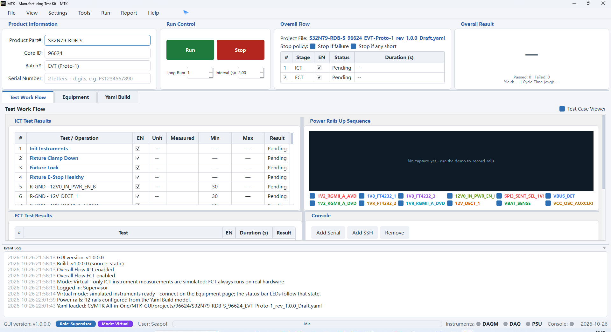
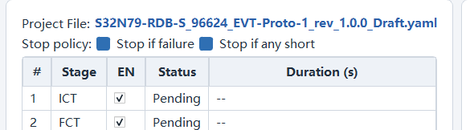
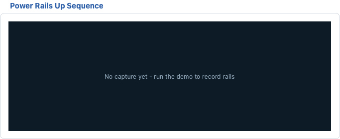

# Test Work Flow

The **Test Work Flow** page is the operator's main workspace. It
combines run control, the Overall Flow stage overview, product
information, the per-step ICT / FCT test tables, the Power Rails Up
Sequence waveform and the multi-channel Console (see chapter
`10_console.md`). A run executes the enabled stages strictly in order:
**ICT first, then FCT**.



## Page Layout

- **Top row** (above the tabs, always visible): `Product Information`,
  `Run Control`, `Overall Flow` and `Overall Result`.
- **Middle row**: `ICT Test Cases` (left, 50%) and
  `Power Rails Up Sequence` (right, at most 50% of the row width).
- **Bottom row**: `FCT Test Cases` (left, 50%) and the embedded
  `Console` (right, 50%).
- All rows can be resized with the splitter handles; panes never
  collapse.
- Page-wide log lines are routed to the central **Event Log** at the
  bottom of the main window (not shown on this page anymore).

## How a Run Executes

A run is a strictly sequential walk over the enabled stages - every
cycle repeats the same deterministic path, which is what makes
results comparable across operators, boards and shifts:

1. **Run gates** - a project YAML must be loaded, at least one stage
   must be enabled and the Auto-SN / serial format pre-check must
   pass (see `Run Gates and Pre-Test`).
2. **ICT stage** - the ICT table executes strictly top -> bottom:
   fixture close -> impedance shorts (board still unpowered) ->
   `Power On DUT` -> electrical measurements -> `Power Off DUT` ->
   fixture open. Every measurement is judged against its per-row
   `Min` / `Max` limits; a short or a `Stop if failure` event ends
   the stage immediately.
3. **FCT stage** - the console channels auto-connect (a failure
   opens the `Console Connect Failed` popup and stops the run), then
   the FCT table executes top -> bottom: operator dialogs, console /
   CLI keyword tests, RF connectivity and flash confirmations.
4. **Rollup** - the per-stage verdicts roll up into the Overall
   Result: every enabled item must report PASS for `PASS`; `FAIL`
   beats `IGNORE`, and `Error` marks an equipment problem rather
   than a bad board.

Between cycles (`Long Run > 1`) the engine resets the per-cycle
state, keeps the product information and waits `Interval (s)` before
the next pass. An abort at any point still executes the flagged
teardown rows (`Power Off DUT`, `Fixture Unlock`, `Fixture Release`,
`Reset Instruments`), so the DUT and the station always end in a
safe state.

## Run Control

The Run Control group carries the **Run** / **Stop** buttons and the
`Long Run` / `Interval (s)` fields (visible in the page screenshot
above).

### Run and Stop

- **Run** (green play button): starts a run, or continues from a paused
  breakpoint. Shortcut `F5`. This is a "Start / Continue" button: while
  the engine is paused at a breakpoint, pressing it resumes the run.
- **Stop** (red stop button): interrupts the current run. Shortcut
  `Shift+F5`.
- Button availability mirrors the engine state:
  - Idle: **Run** enabled, **Stop** disabled.
  - Running: **Run** disabled, **Stop** enabled.
- `Long Run:` repeats the whole cycle 1-999 times. `Interval (s)` sets
  the pause between cycles (0.5-99 s, 0.5 s step, default 2.0) and is
  only editable while Long Run is greater than 1. Long Run skips the
  product information input between cycles.

### Debug Controls (Run menu)

The Run menu carries the Visual-Studio-style debug actions:

- `Run Without Debug` (`Ctrl+F5`): run once while ignoring every
  breakpoint.
- `Restart Run` (`Ctrl+Shift+F5`): abort the current run, then start a
  fresh one as soon as the abort has settled.
- `Step Over` / `Step Into` (`F10` / `F11`): execute exactly one more
  workflow node, then pause again (engine granularity is one workflow
  node).
- `Step Out` (`Shift+F11`): leave single-step mode and resume.
- `Toggle Breakpoint` (`F9`): toggle the breakpoint of the current row
  of the focused ICT / FCT table.
- `Clear All Breakpoints` (`Ctrl+Shift+F9`): remove every breakpoint.
- `Run to Cursor` (`Ctrl+F10`): place a temporary breakpoint on the
  current row, start / continue, and remove it again as soon as it is
  hit.

Breakpointed rows show a `●` prefix (red, bold) in the `#` column with
a `breakpoint` tooltip. A breakpoint pauses the run **after** the node
completes, at the next safe step boundary.

### Run Gates and Pre-Test

When **Run** is pressed the following checks run before any test step:

1. A project YAML must be loaded, otherwise a warning appears:
   `No Test Project ... File > Load Yaml` and the run is blocked.
2. At least one Overall Flow stage must be enabled, otherwise the
   warning `No Available Tests` appears.
3. **Auto-SN** (if enabled in the Settings menu) fills virtual product
   information: empty fields get defaults (`VIRTUAL-PART`, `000000`,
   `freebatch`) and the serial number auto-increments
   (`VS0000000001`, +1 per run).
4. **Pre-test Serial Number Format Check** (configured in the Settings
   menu): the serial must be `<prefix>` + `<SN length>` digits. On
   failure a critical dialog appears, every test item stays blank and
   the Overall Result becomes `IGNORE`.

While the run works in the background, the phase hint above the big
verdict shows `Init...`, `Connecting console...` or `Processing...`,
and the status-bar progress bar tracks the current step
`(current / total)`. The Product Information group is disabled while a
run is active.

### Stopping a Run

- Pressing **Stop** leaves the not-yet-executed items blank and the
  Overall Result becomes `IGNORE` (only when no item failed).
- **FAIL wins over Stop**: a stopped run that already has FAIL items
  reports `FAIL`, never `IGNORE`.
- In Virtual mode only the **ICT** results (instrument measurements)
  are virtualised: they show `Virtual PASS` (yellow-green) /
  `Virtual FAIL` (orange-red). **FCT always runs on real hardware**
  (real DUT + Host PC Wi-Fi/Bluetooth + Wi-Fi router) and its results
  are plain `PASS` (green) / `FAIL` (red) in every mode.

### Overall Result

- Big verdict label: `—` (nothing judged), `RUNNING`, `PASS`, `FAIL`,
  `IGNORE`. In Virtual mode the label reads `Virtual PASS` /
  `Virtual FAIL` (yellow-green / orange-red) **only when virtualised
  ICT results contributed**; a pure-FCT run reports plain `PASS` /
  `FAIL` even in Virtual mode.
- Statistics line underneath, counted **per product** (one complete
  test cycle), not per individual item:

```text
Passed: 12 | Failed: 1
Yield: 92.3 % | Cycle Time (avg): 41.20 s
```

## Overall Flow



The Overall Flow group shows the currently loaded project file and
the two test stages.

- `Project File:` name of the loaded YAML (the full path is shown as a
  tooltip and the label is mouse-selectable). `(none)` when no project
  is loaded.
- Stage table columns: `#`, `Stage`, `EN`, `Status`,
  `Duration (s)`.
  - Row 1 - **ICT**: In-Circuit Test, 80 power nets impedance ->
    voltage -> RTC / CLKOUT1 / CLKOUT2 clocks (shown as a tooltip).
  - Row 2 - **FCT**: Functional Test, LED -> Serial Console (Linux) ->
    Wi-Fi -> Bluetooth -> Flash FAT -> Flash OOBE (tooltip).
- The `EN` checkbox enables / disables a stage. A disabled stage is
  reported as `Skip` when the run reaches it, and every toggle is
  logged (`Overall Flow ICT enabled` / `disabled`).
- `Status` shows `Pending` before, `Running` during and the verdict
  after; `Duration (s)` shows the stage time.

### Stop Policy

Two checkboxes control when a failing run aborts early. Both ship
**enabled** (factory default 2026-10-14): every loaded plan - the
bundled demo plans included - runs with both protections until the
operator unticks a box or a project YAML overrides it.

- `Stop if failure` (default **ON**): any test / operation that
  reports FAIL aborts the whole run immediately when checked.
- `Stop if any short` (default **ON**): applies to every Impedance
  Shorts test. A short under power can damage the board, so the run
  aborts right there - before `Power On DUT`.

**Note:** impedance shorts are intentionally sequenced before the DUT
is powered on; keep `Stop if any short` enabled unless you know the
board is safe.

## Product Information

The Product Information group holds the product identity fields.

### Read-Only Rule

- `Product Part#`, `Core ID` (max 6 digits) and `Batch#` are **100%
  YAML-driven and read-only for every role** (including Supervisor).
  The project YAML file is the only valid editing entrance; the fields
  start empty and refresh only on a YAML load / switch.
- An empty `Batch#` is sent to reports and logs as `freebatch`.

### Serial Number

- `Serial Number` is the single per-unit manual input: format is
  2 letters + digits, e.g. `FS1234567890` (lowercase input is forced
  to uppercase).
- The pre-test format check (prefix + digit count, configured in the
  Settings menu) validates it before every run.

### Auto-SN

- `Settings > Auto-SN (virtual serial, +1 per run)` is a checkable
  action. When active, all four fields are disabled and fully virtual:
  defaults are filled automatically on Run and the serial counter
  increments each cycle.

## ICT Test Cases

The ICT table executes strictly top -> bottom. Columns:

- `#` - execution order (with the `●` breakpoint marker when set).
- `Test / Operation` - step name; standard operations are blue and
  bold, measurement tests plain.
- `EN` - single-click the checkbox to enable / disable the step.
- `Unit` - measurement unit (`Ω`, `V`, `Hz`, `ch`); `—` for operations.
- `Measured` - measured / captured value, filled during the run.
- `Min` / `Max` - numeric limits; Impedance Shorts has only a Min
  threshold (Max stays blank).
- `Result` - `PASS` / `FAIL` for tests, `Done` / `Error` for standard
  operations.

The factory sequence (17 steps): `Init Instruments`, `Fixture Clamp
Down`, `Fixture Lock`, `Fixture E-Stop Healthy`, `Impedance Shorts
(80 pts)` (Min 1.5 Ω), `Power On DUT`, `Power Voltage (80 pts)`
(3.201-3.399 V), `RTC - 32.768 kHz (907A TOT)`, `CLKOUT1 - 4 MHz
(U2355A CTR0)`, `CLKOUT2 - 6 MHz (U2355A CTR1)`, `ADC Stimulus
AO0/AO1 -> TP_ADC` (±12 V), `Fixture DIO (16 ch, 4 used)`,
`DUT GPIO (24 ch)`, `Power Off DUT`, `Fixture Unlock`,
`Fixture Release`, `Reset Instruments`.

### ICT Test Methods

The `Test Method` field of a measurement row decides how the row is
executed and judged. Four measurement methods exist, plus the
generic `test` row type.

#### Static Impedance

- **What it does** - closes the DAQM908A crosspoint of the net under
  test and reads the 2-wire resistance through the DAQ973A built-in
  DMM. This is the Impedance Shorts screen: every power net is
  measured against a minimum threshold while the board is still
  unpowered.
- **Configure** - `Test Method` = `Static Impedance`, `Net` = a
  power net from the Yaml Build parse, `Min` = lower resistance
  limit, `Max` blank, `Unit` fixed to `Ω`.
- **Use when** - the net must be proven not shorted to ground or a
  neighbouring net **before** power is applied. Keep these rows in
  the pre-power segment of the sequence.
- **Example** - row `Impedance Shorts (80 pts)`, Min `1.5`: a
  reading of `0.62` trips `Stop if any short` and aborts the run
  right there, before `Power On DUT`.

#### Power Voltage

- **What it does** - re-closes the same multiplexer channels while
  the PSU drives the board and reads DC voltage through the DAQ973A
  DCV function, judged against a window.
- **Configure** - `Test Method` = `Power Voltage`, `Net` = power
  net, `Min` / `Max` in volts, `Unit` fixed to `V`.
- **Use when** - every rail must sit inside its regulation window
  after `Power On DUT` (load regulation, LDO dropout, missing
  components).
- **Example** - row `Power Voltage (80 pts)`, window 3.201-3.399 V
  for a 3.3 V rail: one rail reading 3.12 V reports FAIL and, with
  `Stop if failure` on, ends the run.

#### Clock Hz

- **What it does** - routes a clock net to a frequency counter and
  compares the measured frequency with the expected value. Slow
  clocks (RTC crystals) use the DAQ973A frequency function
  (3 Hz - 300 kHz); faster clocks go through the U2355A counters
  (0.1 Hz - 6 MHz), per the channel map built in Yaml Build.
- **Configure** - `Test Method` = `Clock Hz`, `Net` = a clock net,
  `Expected` plus `Min` / `Max` in Hz, `Unit` fixed to `Hz`.
- **Use when** - crystals, PLL outputs or clock buffers must be
  proven alive and within tolerance.
- **Example** - rows `RTC - 32.768 kHz (907A TOT)` (window
  32752-32784), `CLKOUT1 - 4 MHz (U2355A CTR0)`,
  `CLKOUT2 - 6 MHz (U2355A CTR1)`.

#### DAQ AI

- **What it does** - the U2355A analog inputs acquire every critical
  rail while the board powers up (the Power Rails Up Sequence),
  writes the CSV log under `logs/` and runs the rule-based AI wave
  review. The row verdict comes from the acquisition itself.
- **Configure** - capture start / end, sample rate (up to the
  250 kSa/s aggregate limit) and the rail set live in the project
  YAML and the waveform Properties dialog; the row needs no
  Min / Max. The `Net` cell is READ-ONLY and shows
  `N Power rails assigned on DAQ channels` - the rail set comes
  from the U2355A AI channels assigned in Channel Allocation (the
  page rail set syncs from it automatically; a manual rail edit in
  the Properties dialog still wins). It is never a single free net
  - binding it to one net reports `no rails defined` at run time.
- **Use when** - ramp shape, overshoot, sequencing and startup
  ripple matter, not just the final DC value.
- **Example** - row `12 Power rails assigned on DAQ channels`
  (kind `DAQ AI`) placed right after `Power On DUT`; the waveform
  shows each rail's t=0 ramp and the AI review flags anomalies.

#### test (generic)

- **What it does** - measurement row for nets outside the power /
  clock categories (typically DUT GPIO level checks through the
  fixture DIO); judged against its limits like any measurement.
- **Configure** - `Test Method` = `test`, `Net` = a GPIO net from
  the parse, limits optional (`—` = no value).

### During the Run

- The row being executed is highlighted (amber) and scrolled into
  view.
- `Measured` updates as each measurement completes.
- In Virtual mode the **ICT** result texts carry the `Virtual` prefix
  (FCT results are always plain - FCT runs on real hardware).

### Real Mode and Instrument Availability

In Real mode ICT steps are never simulated. Every instrument-touching
step needs a connected rack session - connect from the Equipment page
or with `Tools > Set All instruments > Connect all` (see
`05_equipment.md`).

- Without a connection, `Static Impedance`, `Power Voltage`,
  `Clock Hz`, the `DAQ AI` rails capture and the instrument /
  fixture / power operations report `Error` - never a PASS. The
  `Measured` cell stays empty and the Event Log prints the reason
  (e.g. `no instrument gateway connected (Real mode)`).
- With the rack connected but an instrument call failing, the step
  also reports `Error`; the instrument's failure reason shows in the
  row detail and the Event Log.
- The first instrument fault stops the run (equipment RESOURCE stop
  policy); flagged cleanup rows (`Power Off DUT`, fixture release,
  ...) still execute before the run ends.

### Context Menu (right-click a row)

- `Breakpoint` - pause the run after this node completes.
- `Simulate FAIL on next run` - measurement rows only; forces a FAIL
  on the next run to exercise the stop policies.
- `Edit comment...` - free-text note per node, shown as the row
  tooltip and archived to the project YAML (follows the ICT edit
  permission).

## Standard Operations

Operations (`op` rows) are the scaffolding around the measurements:
they move the fixture, control the power and prepare the
instruments. They report `Done` / `Error` instead of PASS / FAIL and
most of them open a dedicated parameter dialog in the sequence
editor.

| Operation | Purpose | Parameters |
|---|---|---|
| `Init Instruments` | opens the rack session, loads the plan limits and brings every instrument into a known state | instruments checklist (DAQM / DAQ / PSU) |
| `Fixture Clamp Down` | clamps the board onto the pogo pins | `Signal` = `press`, `Level` `H`/`L` |
| `Fixture Lock` | locks the clamps; the in-position feedback must confirm | `Signal` = `inpos`, `Level` |
| `Fixture E-Stop Healthy` | verifies the emergency-stop chain is closed **before** any power is applied | `Signal` = `estop`, `Level` |
| `Power On DUT` | switches the N5747A output on with the row setpoints | `Voltage` 0-60 V, `Current limit` 0-12.5 A |
| `Power Off DUT` | switches the output off (teardown) | none |
| `Fixture Unlock` / `Fixture Release` | releases the board after the tests (teardown) | `Signal` / `Level` |
| `Reset Instruments` | returns every instrument to a safe standby (teardown) | instruments checklist |
| `Operation: Custom` | free-form operation row for site-specific control | per dialog |

- **Use when** - keep the factory order: impedance before power
  (shorts must never be probed on a live board), E-Stop check before
  `Power On DUT`, and never remove a teardown row - an aborted run
  would leave the DUT powered or the fixture closed.
- **Scenario** - a custom op can park a robot arm, switch an
  external relay box or warm up a burner between the standard steps;
  it executes like any op and logs its sub-actions to the Event Log.

## FCT Test Cases

The FCT table lists the functional / message test cases. Columns:
`#`, `Test`, `EN`, `Duration (s)` (filled after execution) and
`Result` (`PASS` / `FAIL` / `Error`).

The factory sequence (7 steps): `MessageYesNo: LED Test`, 
`CapturefromConsole: COM1, 'Linux version' (expected)`,
`WaitforConsole: COM1, 'Pass' or 'OK' (expected)`,
`SendtoCLI: "wifi_test --scan"`, `SendtoCLI: "bt_test --scan"`,
`MessageGoStop: Flash FAT Firmware`, `MessageGoStop: Flash OOBE
Firmware`.

### FCT Test Methods

The FCT `Test Method` dropdown carries twelve methods in three
families. All keyword judgements share the **negative-wins** rule:
any `Fail` / `Error` keyword in the captured batch beats a later
`Pass`.

#### Operator dialogs

- **MessageOK** - information dialog with an OK button; acknowledging
  it passes the step. *Use for*: instructions the operator must
  confirm, e.g. `Attach the antenna before the Wi-Fi test`.
- **MessageYesNo** - Yes / No question; answering No - or just
  closing the dialog - fails the step. *Use for*: subjective checks
  only a human can make, e.g. `LED Test - all four LEDs lit?`.
- **MessageGoStop** - a GO / STOP gate used before long or
  intrusive actions such as firmware flashing; STOP (or closing)
  fails the step, GO continues. *Example*: `Flash FAT Firmware`.

#### Console and CLI keyword tests

- **SendtoConsole** / **WaitforConsole** / **CapturefromConsole** -
  write to, wait for, or capture a keyword from a serial / SSH
  console channel (channel behaviour in `10_console.md`).
  *Use for*: boot banners, kernel messages, interactive Linux
  prompts, e.g. `WaitforConsole: COM1, 'Pass' or 'OK'`.
- **SendtoCLI** / **WaitforCLI** / **CapturefromCLI** - the same
  trio against the Host PC command line: station-side processes and
  RF tool outputs, e.g. `SendtoCLI: "wifi_test --scan"`.
- **Delay** - plain wait in milliseconds. *Use for*: settling time
  between actions, e.g. 2000 ms before reading a sensor that just
  powered up.

#### RF connectivity

- **WIFI** - Wi-Fi connectivity exercised through the CLI tools
  (`wifi_test`, `iperf3` throughput runs) or the vendor utility.
  *Use when* the DUT's WLAN must associate with the test AP and pass
  traffic; the scan listing the reference SSID is a typical
  criterion.
- **Bluetooth** - BT connectivity via `bt_test` / the vendor tool.
  *Use when* the DUT must discover or pair with the reference
  device, e.g. an inquiry must list the reference headset.

The quoted segments of the step name are the command / keyword
payload the method uses at run time - edit them in the FCT Step
dialog, and keep the expected keywords aligned with the negative-wins
rule (put the failure keywords first when order matters).

## Editing Steps (Sequence Editor)

Double-click any cell of the ICT or FCT table to open the sequence
editor. It works on a **copy** of the step lists; only **Ok** writes
the changes back and refills the table.

### Editor Buttons

- `Move Up` / `Move Down` - reorder the selected step.
- `Add` - dropdown with every supported step type; the new step is
  inserted after the current row and its edit dialog opens immediately.
  - ICT: every standard `Operation:` (with its default parameters),
    `Operation: Custom` and `Test (measurement)`.
  - FCT: standard operations first, then one entry per test method
    (`MessageOK`, `MessageYesNo`, `MessageGoStop`, `SendtoConsole`,
    `WaitforConsole`, `CapturefromConsole`, `Delay`, `SendtoCLI`,
    `WaitforCLI`, `CapturefromCLI`, `WIFI`, `Bluetooth`).
- `Remove` - delete the selected step (disabled when only one step
  remains).
- `Edit` - open the edit dialog for the selected step (double-click a
  list entry does the same).
- `Duplicate` - copy the selected step to the next position.
- Every list row carries an enable checkbox.

### Step Edit Dialog (ICT measurement)

Fields, in order:

- `Test Method` - `op`, `test`, `Static Impedance`, `Power Voltage`,
  `Clock Hz`, `DAQ AI`. Changing it updates the fields below.
- `Net` - the net name. The offered choices come **per test method**
  from the Yaml Build parse result: Power nets for `Static Impedance`
  and `Power Voltage`, Clock nets for `Clock Hz`, GPIO nets for the
  generic `test`. A legacy name outside the category stays
  selectable (prepended to the list). For `DAQ AI` the field is
  READ-ONLY and shows the rail count from Channel Allocation
  (`N Power rails assigned on DAQ channels`) - no net can be picked.
- `Enable`, `Wait` (0-99999 ms, pause before the step) and `Timeout`
  (0-999999 ms, maximum step time).
- `Unit` - read-only, auto-filled by the method (`Ω` / `V` / `Hz`).
- `Expected`, `Min`, `Max` - numeric fields; `—` means "no value".

### Operation Step Edit

Standard operations (`Init Instruments`, fixture steps, `Power On /
Off DUT`, ...) open a per-type parameter editor:

- Instruments / reset operations: checkboxes for `DAQM`, `DAQ`, `PSU`.
- Fixture operations: `Signal` (`press` / `inpos` / `estop`) and
  `Level` (`H` / `L`).
- `Power On DUT`: `Voltage` (0-60 V) and `Current limit` (0-12.5 A);
  `Power Off DUT` has no setpoints (N5747A output OFF).

### FCT Step Edit

- `Name` - free text; the quoted segments are the command / keywords
  used by the console methods.
- `Test Method` - one of the twelve FCT methods.
- `Enable`, `Wait`, `Timeout`.

**Note:** steps changed here live on the page; use the YAML save /
apply flow (the main window offers it after sequence builders run) to
persist them into the project file.

## Power Rails Up Sequence



The right half of the middle row draws the power-rail ramp-up capture:
the critical rails (from the project YAML) are recorded by the
U2355A analog inputs while the run executes the DAQ AI capture step,
saved as a CSV log under `logs/` and drawn here as a waveform. It is a
**record-only** view - there is no pass / fail judgement.

- Legend at the top: one colored entry per rail with its nominal
  voltage, e.g. `VDD_3V3 (3.30 V)`.
- Y axis: voltage; the top of the scale is 110% of the highest nominal
  rail. X axis: time in seconds; the capture may start **before**
  power-on (negative start, default -0.5 s), so the t=0 ramp is
  visible.
- Default capture: 6.0 s duration at 200 Hz sample rate (both
  configurable per project).
- In Virtual mode a `VIRTUAL DATA (simulated)` badge marks the capture
  as simulated.

### "No capture yet"

Before any capture the plot shows the placeholder text:

```text
No capture yet - run the demo to record rails
```

The waveform appears as soon as a run executes the DAQ AI capture
step, and it is cleared again at the start of every new run (re-captured
when the step executes). Loading a project with a different rail set
also clears it.

### Rail Visibility Checkboxes

Below the waveform one checkbox per rail (tick = show its curve),
built from the YAML rail set. Untick a rail to hide it without
re-running.

### Properties and AI Review

Double-click the waveform to open `Power Rails — Properties` (three
pages, the zoomable waveform first):

- `Waveform` tab: the capture drawn ENLARGED (1300 x 650 base vs the
  embedded preview) - the mouse wheel zooms 50% - 300% (or the
  `Zoom In` / `Zoom Out` / `Fit 100%` buttons), the scrollbars pan,
  and the bigger plot draws more curve samples, so zooming in shows
  real detail. The page clones the capture at open time; closing the
  dialog never changes the capture.
- `Measurement cursors` (Zoom page): hovering shows a crosshair with
  a readout box at the cursor (`t` plus every rail's interpolated
  voltage). Clicking pins cursor `A` (amber), a second click pins
  `B` (violet) - the toolbar line reports `dt` and each rail's
  `dV` between the pins (rise / fall times, ripple amplitude). A
  third click clears both and starts a new `A`.
- `Properties` tab: `Capture Start` (-10 to 0 s, negative = before
  power-on), `Capture End` (0.1-30 s), computed `Duration`,
  `Sample Rate` (1-250000 Hz, the U2355A aggregate limit) and
  `Record waveform data to DAQ csv file`, plus a read-only rail table
  (`Rail`, `Color`, `Nominal V`, `Ramp Offset (s)`).
- `AI Review` tab: a rule-based review of the sampled waveform
  parameters with a `Re-analyze` button.
- On **Ok** the new capture settings are applied, the waveform is
  regenerated and the rail configuration is synced into the Yaml Build
  model so it lands in the project YAML preview.

## How Permissions Affect the Page

Run / Stop and console Open / Close stay available for every role.
Everything else follows the supervisor-granted permission keys:

- `edit_ict` / `edit_fct` - double-click editing of the ICT / FCT
  tables and the `Edit comment...` context-menu entry. Without the
  key an information box explains that the operator account cannot
  edit the table.
- `toggle_stages` - the Overall Flow `EN` checkboxes. Without the key
  they stay visible but grayed out (not clickable).
- `run_policy_stop_failure` / `run_policy_stop_short` - the two stop
  policy checkboxes.
- `run_policy_auto_sn` - the Auto-SN settings action.
- `edit_run_control` - the `Long Run` / `Interval` fields.
- Product `Part#` / `Core ID` / `Batch#` are read-only for every role
  (YAML is the only editing entrance).
- Console-specific keys are described in `10_console.md`.

## Common Errors and Recovery

- **Run blocked: no YAML file loaded** - load a project with
  `File > Load Yaml` first; the page starts empty by design (zero
  table rows, no rails, no consoles).
- **Pre-test Failed (serial format)** - correct the Serial Number or
  adjust the format rule in the Settings menu; both fields empty means
  no check.
- **ICT steps show Error in Real mode** - no instrument rack is
  connected (or an instrument call failed). Connect the instruments
  (Equipment page or `Tools > Set All instruments > Connect all`);
  the Event Log carries the exact reason for each step.
- **Console Connect Failed popup** - the pre-FCT auto-connect could
  not open every console channel; the run stops. Check the console
  parameters and connections (see `10_console.md`), then run again.
- **A stage shows Skip** - its `EN` checkbox is unticked; a supervisor
  (or an operator with `toggle_stages`) can re-enable it.
- **Overall Result IGNORE after Stop** - expected for a manual stop
  without failed items; FAIL items still report FAIL.
- **Breakpoint pauses the run unexpectedly** - the `●` marker in the
  `#` column shows where; press `F5` to continue or
  `Ctrl+Shift+F9` to clear all breakpoints.
