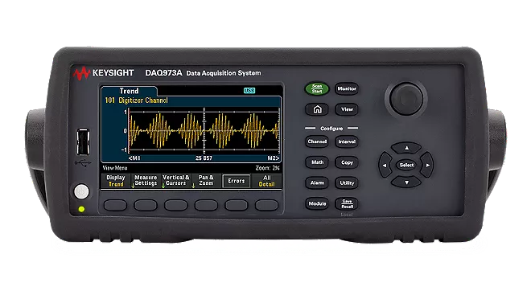
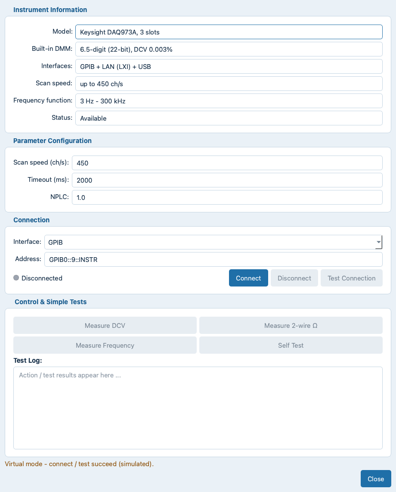
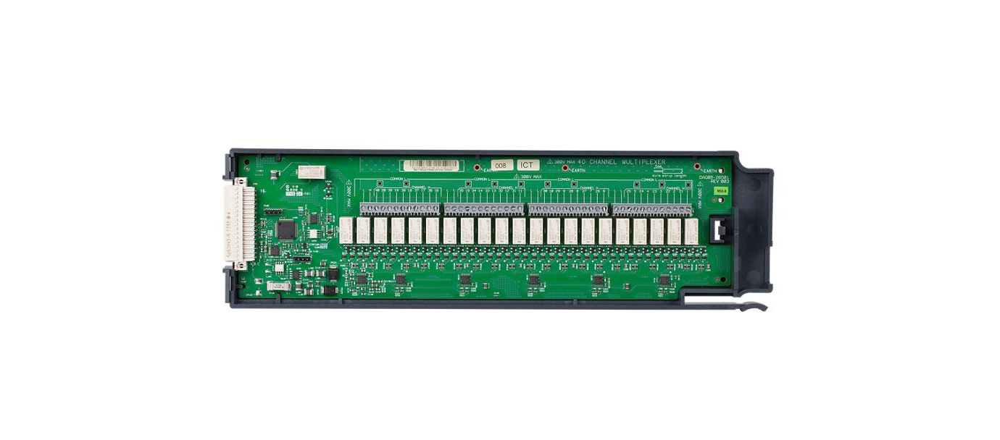
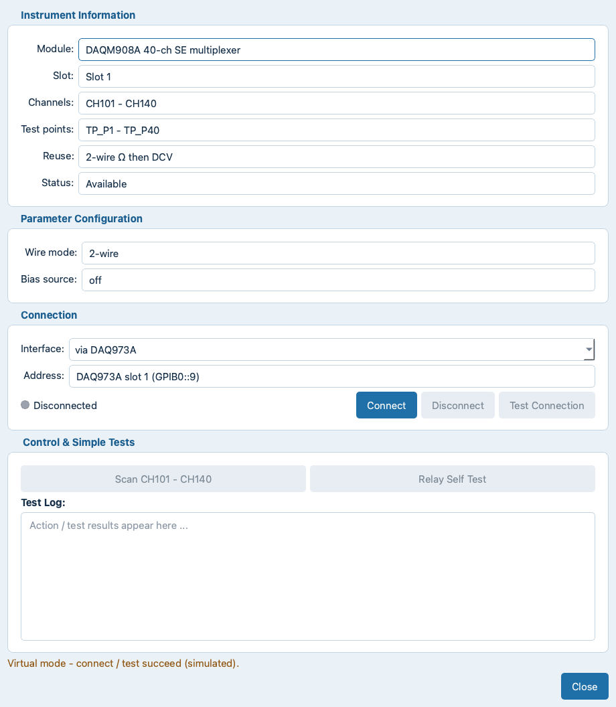
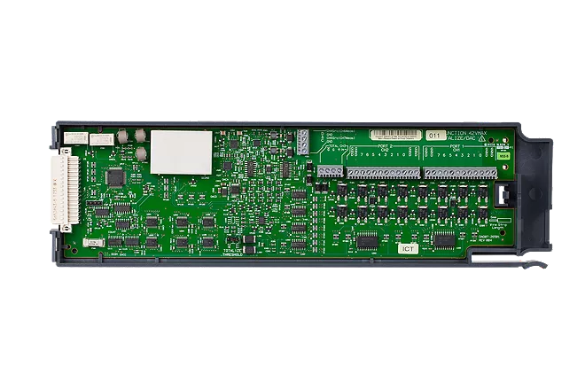
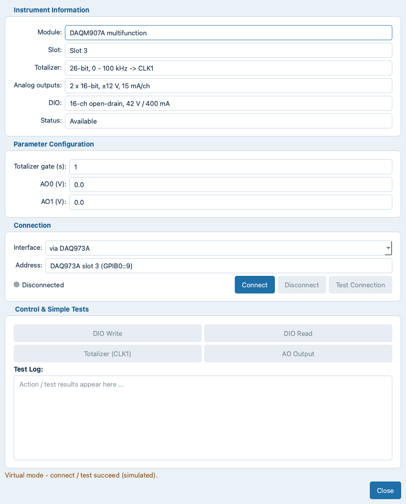
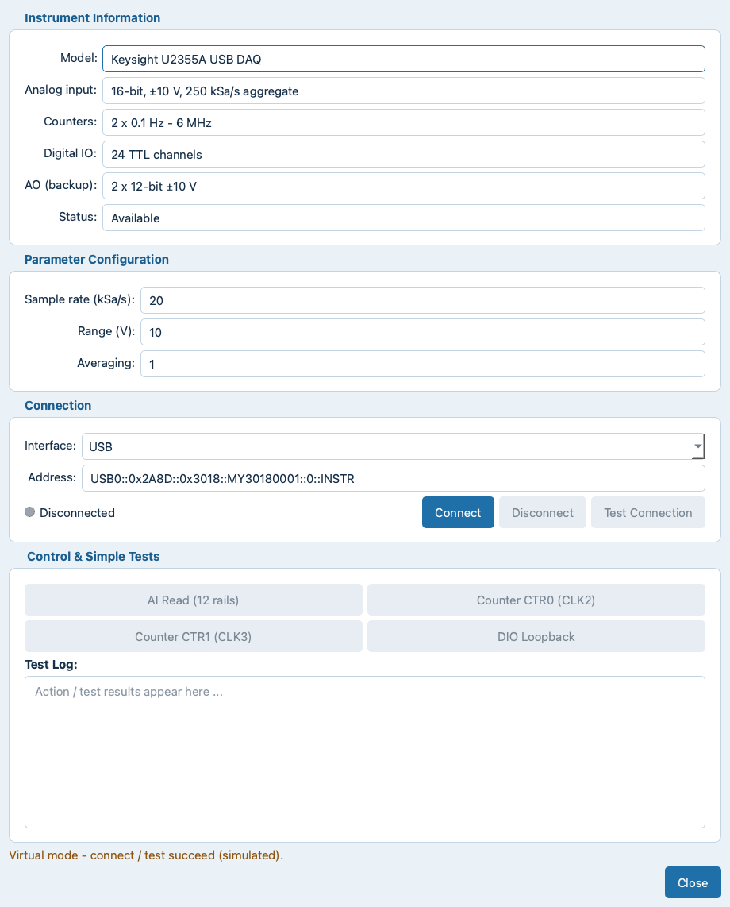
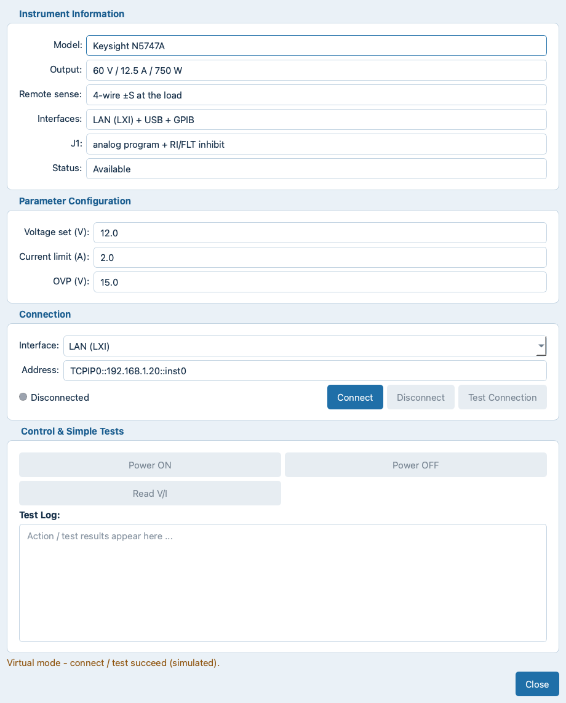
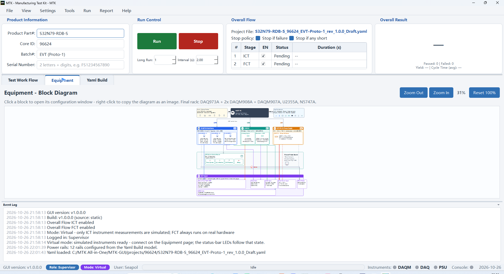

# Instruments

This chapter documents the rack instruments of the reference
station: why each model was selected, what it does, how it is
configured and connected, and how the ICT test methods use it. The
configuration windows themselves are described in chapter
`05_equipment.md` (Instrument Configuration Windows).

## Why This Rack

- **One mainframe for the analog screens** - the Keysight DAQ973A
  carries the 6.5-digit DMM and the three plug-in modules, so
  impedance, voltage and slow-clock measurements share one chassis,
  one GPIB address and one calibration schedule instead of three
  separate bench instruments.
- **Channel density with reuse** - two DAQM908A multiplexers give
  80 single-ended channels (CH101 - CH240); one wire pair per net
  serves the 2-wire ohm AND the DCV screen (`2-wire Ω then DCV`
  reuse), which halves the fixture harness compared with separate
  channels per measurement.
- **Digital and stimulus on slot 3** - the DAQM907A adds the
  open-drain DIO that drives the fixture actuators (clamp, lock,
  E-Stop chain), two ±12 V analog outputs for the ADC stimulus and
  a 100 kHz totalizer for pulse counting - no separate digital IO
  instrument needed.
- **A dedicated waveform recorder** - the U2355A samples the
  power-rail ramps at up to 250 kSa/s (16-bit), which a scanning
  DMM architecture cannot do, and its 6 MHz counters take the fast
  clocks beyond the DAQ973A's 300 kHz frequency function.
- **A system PSU with remote sense** - the N5747A provides 60 V /
  12.5 A / 750 W with 4-wire remote sense at the load, so the
  harness drop does not shift the DUT supply, plus LAN control and
  an inhibit input for the station safety chain.

## The Rack Instruments

The reference rack is a Keysight DAQ973A mainframe carrying two
DAQM908A multiplexers and one DAQM907A multifunction module, plus a
U2355A USB data-acquisition unit and an N5747A system power supply.
Each instrument shows the real hardware photo **and** the GUI
configuration window; every field rendered in the window is saved
with the project YAML.

### DAQ973A Mainframe (DAQM)

- **Role** - the 3-slot measurement mainframe: it routes every slot
  module channel to its built-in 6.5-digit DMM (22-bit) and to its
  frequency function (3 Hz - 300 kHz), with auto-calibration
  compensating internal drift from time and temperature.
- **Key specifications** (Keysight data) - 6.5-digit (22-bit)
  internal DMM; scanning up to 450 ch/s; 3 module slots (up to 120
  channels with modules); USB, LAN (LXI) and GPIB built in; 100 000
  readings non-volatile memory; per-channel Hi/LO alarm limits plus
  4 TTL alarm outputs; measures AC/DC volts and current, resistance
  up to 1000 MOhm, frequency/period, temperature
  (thermocouple / RTD / thermistor), diode and capacitance.
- **Configure** - `Scan speed (ch/s)` 450, `Timeout (ms)` 2000,
  `NPLC` 1.0 (integration time per reading: higher = quieter but
  slower - raise it for noisy R-GND readings).
- **Connects to the PC** - `GPIB0::9::INSTR` (LAN / USB also
  available); all three slot modules share this one address.
- **In the tests** - `Measure 2-wire Ω` behind every
  R-GND row, `Measure DCV` behind Power Voltage,
  `Measure Frequency` for slow clock rows.
- **Reference** -
  [Keysight DAQ973A product page](https://www.keysight.com/us/en/product/DAQ973A/data-acquisition-system-usb-lan-gpib.html)

### DAQM908A Multiplexer x2 (DAQM)

- **Role** - two 40-channel single-ended multiplexers (slot 1 and
  slot 2): the switching matrix that lands one net at a time on the
  mainframe DMM.
- **Key specifications** (Keysight data) - 40 single-ended channels
  per module; single-wire switching for common-low applications;
  scanning up to 100 ch/s; channels rated 300 V; the module low is
  isolated from earth and can float up to 300 V; every two-wire
  internal measurement except current is supported.
- **Station build** - channels CH101-CH140 (module 1) and
  CH201-CH240 (module 2); each channel maps to a fixture test point
  (TP_P1 - TP_P80); channel reuse = `2-wire Ω then DCV` (one wire
  pair serves the R-GND and the voltage screen).
- **Configure** - `Wire mode` 2-wire, `Bias source` off; the
  net -> channel assignment comes from the Yaml Build channel
  allocation, not from this window.
- **Connects to the fixture** - the module terminal block is wired
  1:1 to the fixture test points through the harness.
- **In the tests** - R-GND Shorts and Power Voltage rows; the
  `Scan CH101 - CH140` and `Relay Self Test` simple tests verify the
  relay matrix.
- **Reference** -
  [Keysight DAQM908A product page](https://www.keysight.com/us/en/product/DAQM908A/40-channel-single-ended-multiplexer-module-for-daq970a-daq973a.html)

### DAQM907A Multifunction (DAQM)

- **Role** - slot 3 module for digital and stimulus work: it drives
  the fixture actuators, stimulates analog test points and counts
  pulses - all on a single earth-referenced module.
- **Key specifications** (Keysight data) - 16 bits of digital I/O
  (two 8-bit ports); 100 kHz gated totalizer with 26-bit resolution
  (counts at full speed for about 45 minutes without overflow); two
  ±12 V analog outputs plus two voltage/current sensing channels.
- **Station build** - the digital outputs are open-drain, rated
  42 V / 400 mA per line; totalizer input -> CLK1; analog outputs
  2 x 16-bit, 15 mA/ch.
- **Configure** - `Totalizer gate (s)` 1, `AO0 (V)` / `AO1 (V)`
  setpoints.
- **Connects to the fixture** - the open-drain DIO lines drive the
  fixture signals (clamp `press`, `inpos` feedback, `estop` chain);
  AO0 / AO1 land on analog test points (the factory plan stimulates
  `TP_ADC` with ±12 V); the totalizer input takes fixture pulse
  sources (CLK1).
- **In the tests** - `Fixture Clamp Down` / `Lock` / `E-Stop
  Healthy` ops and the `ADC Stimulus` row.
- **Reference** -
  [Keysight DAQM907A product page](https://www.keysight.com/us/en/product/DAQM907A/multifunction-module-for-daq970a-daq973a.html)

### U2355A USB DAQ (DAQ)

- **Role** - the waveform recorder: acquires the power-rails up
  sequence and measures the fast clocks.
- **Key specifications** - analog input 16-bit, ±10 V, 250 kSa/s
  aggregate; counters 2 x 0.1 Hz - 6 MHz; 24 TTL DIO in two roles
  (digital output / digital input); backup AO 2 x 12-bit ±10 V.
- **Configure** - `Sample rate (kSa/s)` 20, `Range (V)` 10,
  `Averaging` 1; the capture window and the rail set live in the
  project YAML (max 12 capture nets) and the waveform Properties
  dialog.
- **Connects to the PC** - USB
  (`USB0::0x2A8D::0x3018::MY30180001::0::INSTR`).
- **Connects to the fixture** - the analog inputs sense the critical
  rails at the fixture (one channel per rail), the counters take the
  fast clock taps (CLK2 / CLK3), and the 24 TTL DIO lines run through
  the station level shifters to the DUT control-IO nets
  (non-multiplexed GPIO / enable / chip-select / reset). The DAQM907A
  open-drain DIO stays the fixture-control pool (press / inpos /
  presence / estop) and is never offered as a DUT GPIO pool.
- **DIO capability in the tests** - the same 24 channels carry both
  directions, selected by the standard operation:
  - **Digital output** - `U2355A DIO Write` drives the allocated
    control nets (`Channels` range + `Pattern`, e.g.
    `DIO01-DIO08` = `0x3C`). It runs in ICT and FCT anywhere a
    standard operation is allowed and is guarded by the isolation
    preflight (see `09_yaml_build.md`).
  - **Digital input** - `U2355A DIO Read` samples the whole bank once
    and prints the level of every control net already allocated to
    DIO01-24 as `Control IO <NET>: DIO<n> = HIGH/LOW` to the Event
    Log. The row is engineering reference only - it makes no
    assertion and always reports `Done`.
  - **Capacity** - 24 DIO channels. Nets beyond capacity stay
    classified but get no channel (the summary shows e.g.
    `gpio=24 (+4 over capacity)`), so they can be neither driven nor
    read until a channel is assigned.
- **In the tests** - the `DAQ AI` power-rails row (CSV + AI review),
  the >300 kHz Clock Hz rows, and the `U2355A DIO Read` /
  `U2355A DIO Write` control-IO operations.

### N5747A System Power Supply (PSU)

- **Role** - the DUT power source switched by the `Power On / Off
  DUT` operations.
- **Key specifications** - output 60 V / 12.5 A / 750 W; remote
  sense 4-wire ±S at the load; LAN (LXI) + USB + GPIB; J1 analog
  program + RI/FLT inhibit.
- **Configure** - `Voltage set (V)` 12.0, `Current limit (A)` 2.0,
  `OVP (V)` 15.0 (the sequence-editor `Power On DUT` dialog edits
  the same setpoints per run).
- **Connects to the PC** - LAN `TCPIP0::192.168.1.20::inst0` (USB /
  GPIB also available).
- **Connects to the fixture** - the output feeds the fixture power
  blades with 4-wire remote sense wired **at the load** so the
  regulation compensates the harness drop; J1 can be wired into the
  station safety chain (inhibit).
- **In the tests** - `Power On DUT` / `Power Off DUT`, `Read V/I`
  readback (about 1 %).

## How the Rack Connects

**PC to instruments** - one bus per instrument family: the DAQ973A
mainframe (with all three slot modules) answers on GPIB address 9 -
`GPIB0::9::INSTR`, LAN (LXI) and USB also available; the U2355A is a
USB device; the N5747A sits on LAN (USB / GPIB optional). Every
address is editable in the instrument's `Connection` group, follows
the VISA resource-name conventions and persists with the project
YAML - so a saved project reconnects directly.

**Instruments to the fixture** - all DUT-facing signals leave the
instruments through the fixture harness:

- the two DAQM908A multiplexers land their 80 channels
  (CH101 - CH240) on the fixture test points TP_P1 - TP_P80 as
  2-wire pairs, reused for R-GND and then voltage;
- the DAQM907A open-drain DIO drives the fixture actuators and
  feedback lines (clamp / lock / E-Stop chain) and its ±12 V analog
  outputs stimulate the analog test points;
- the U2355A analog inputs sense the critical rails at the fixture,
  its counters take the fast clock taps, and its 24 DIO lines reach
  the DUT control-IO nets through the level shifters;
- the N5747A output (with 4-wire remote sense at the load) feeds the
  fixture power blades.

**Wiring rules** - keep the sense wires at the load (harness drop
otherwise shifts every voltage reading), route the analog sense
pairs away from the PSU current path, and label both harness ends
with the channel / test-point name: the Yaml Build channel
allocation must match the physical mapping exactly.

## Instrument Resource Map

| Resource | Instrument | Pool | Used by |
|---|---|---|---|
| 2-wire Ω + DCV sense | DAQM908A #1 / #2 via DAQ973A | CH101 - CH240 (80 ch) | R-GND, Power Voltage |
| Power-rails capture | U2355A analog inputs | AI01 - AI12 (12 ch) | DAQ AI power-rails capture |
| Slow-clock frequency | DAQ973A frequency function | 3 Hz - 300 kHz | Clock Hz (RTC crystals) |
| Fast-clock counters | U2355A counters | CTR0 / CTR1, 0.1 Hz - 6 MHz | Clock Hz (> 300 kHz) |
| Fixture DIO | DAQM907A open-drain outputs | DIO01 - DIO16 (42 V / 400 mA) | fixture ops (clamp / lock / E-Stop) |
| Analog stimulus | DAQM907A AO0 / AO1 | ±12 V, 15 mA/ch | ADC Stimulus row |
| Pulse counting | DAQM907A totalizer | CLK1, 0 - 100 kHz | pulse sources |
| DUT power | N5747A | 60 V / 12.5 A / 750 W | Power On / Off DUT |

## How the Tests Use the Instruments

- **R-GND** - the DAQM908A closes the net's crosspoint
  and the DAQ973A reads the 2-wire resistance against the row Min
  limit; the `NPLC` setting trades noise against scan speed.
- **Power Voltage** - the SAME channel pair is reused for DCV after
  `Power On DUT`; every rail is judged against its Min / Max window.
- **Clock Hz** - slow clocks (RTC crystals) go through the DAQ973A
  frequency function, fast clocks (4 MHz / 6 MHz) through the
  U2355A counters; the net -> resource map comes from the Yaml
  Build channel allocation.
- **Power rails (DAQ AI)** - the U2355A records AI01 - AI12 while
  the N5747A ramps the DUT; the capture becomes the CSV log under
  `logs/` and the waveform with the AI review.

See chapter `04_test_workflow.md` (ICT Test Methods) for the
row-level configuration of each method.

## Configuring and Connecting

1. Configure interface / address and parameters in the instrument's
   configuration window on the Equipment page (chapter
   `05_equipment.md`, Step-by-Step: Connect an Instrument).
2. Click `Connect`, then `Test Connection` (the `*IDN?` check) -
   the status LED and the status-bar lights follow.
3. Or run `Tools > Set All instruments > Connect all` to connect
   the whole rack at once - the live session is handed to the Test
   Work Flow page for Real-mode runs.

Real mode never simulates: without a connected rack the affected
steps report `Error` and the Event Log carries the reason (see
chapter `04_test_workflow.md`, Real Mode and Instrument
Availability).
