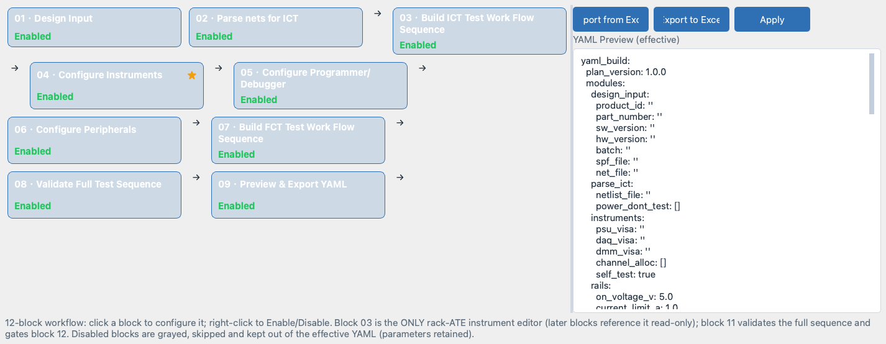
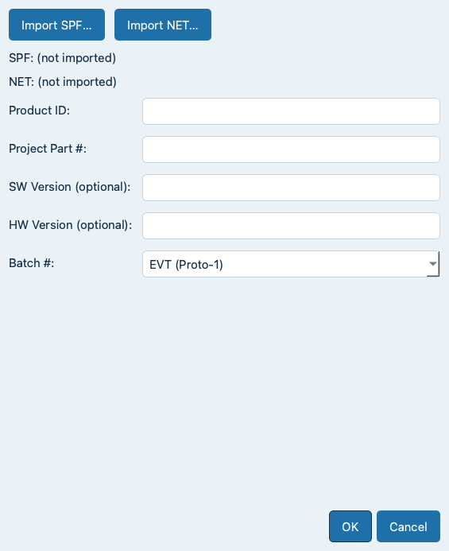
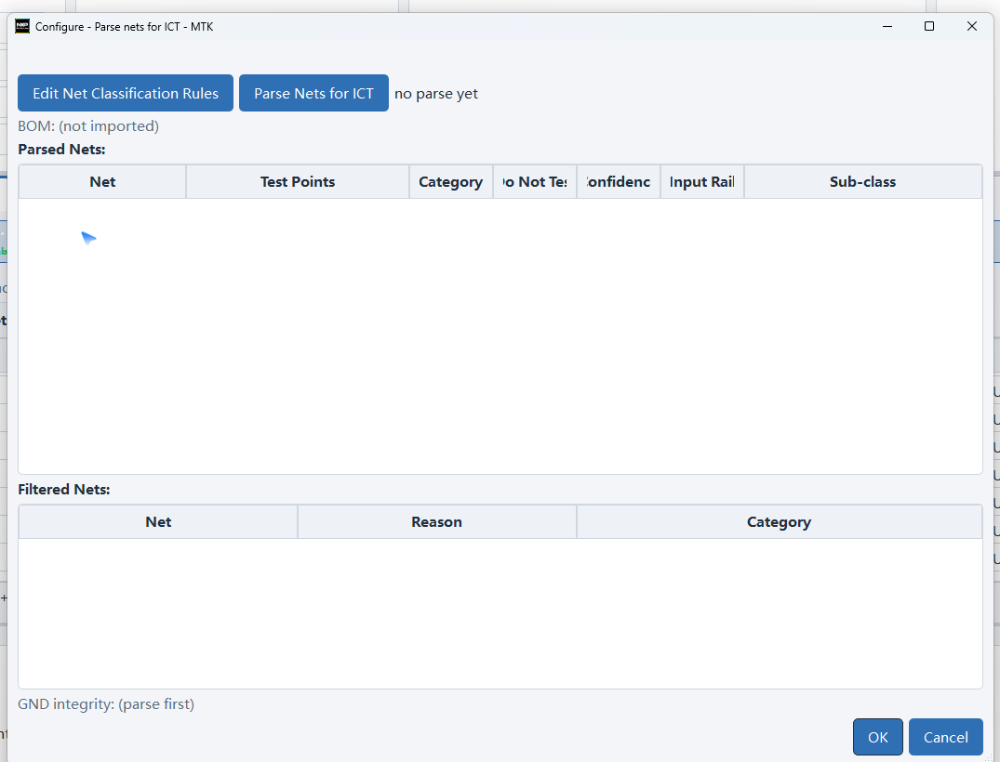
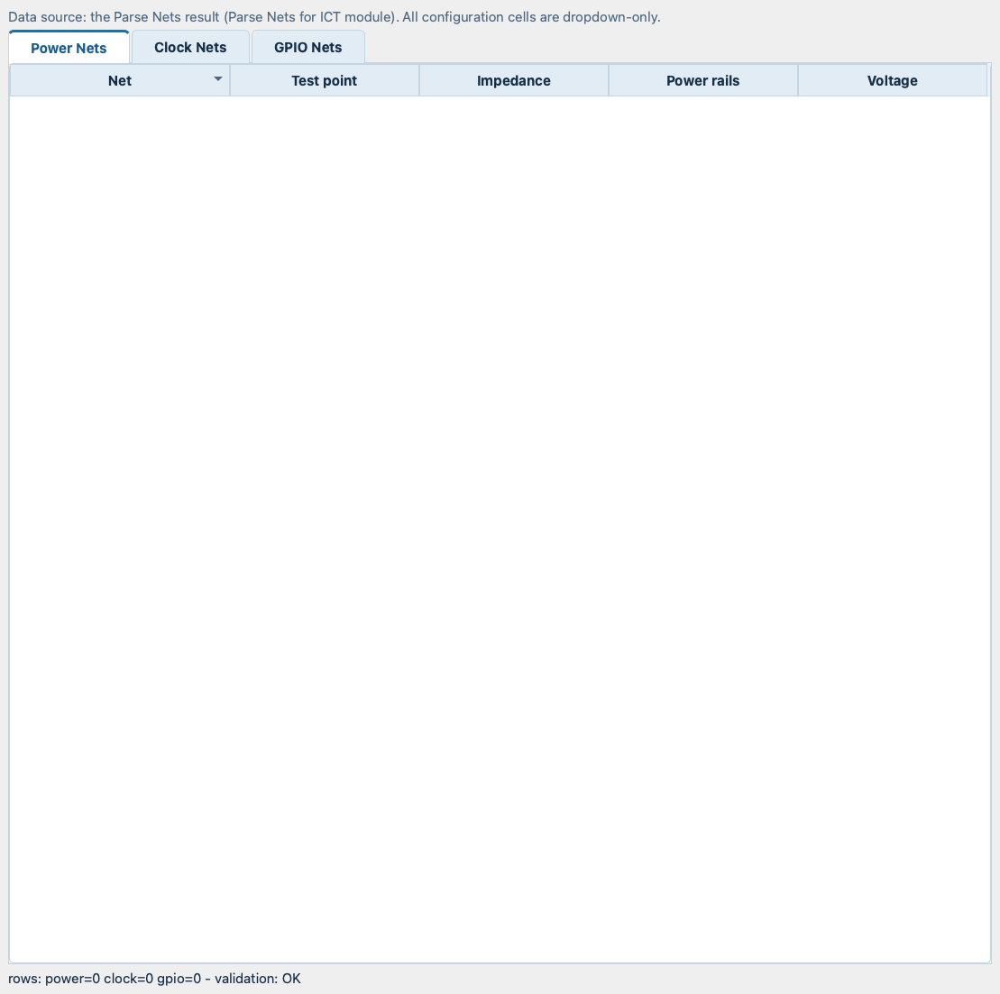

# Yaml Build Page

The **Yaml Build** tab authors the test project: a five-card block
flow on the left (`01 · Design Input` -> `02 · Parse nets for ICT`
-> `03 · Channel Allocation` -> `04 · Build ICT Test Work Flow
Sequence` -> `05 · Build FCT Test Work Flow Sequence`), the
Channel Allocation tables embedded right below the cards and the
live YAML preview on the right. You work top-to-bottom: import the
design data, parse the nets, allocate the channels, build the ICT
and FCT sequences and export the plan YAML.



## Page Layout

- **Left pane - block flow**: the workflow stages as chained cards.
  Wide windows lay the cards out in wrapping rows; narrow windows
  fall back to a single column. The order is fixed and cannot be
  reordered.
- **Right pane - YAML Preview**: the effective YAML, directly
  editable (no Edit mode). The `Apply` button validates the text and
  commits valid changes into the model.
- **Top button row** (directly above the preview): `Import from
  Excel`, `Export to Excel` and `Apply` share one uniform width.
- The splitter default is 7 : 3; drag the divider as needed.

The page hint summarizes the rules: click a block to configure it;
right-click to Enable / Disable. Instrument / programmer / peripheral
hardware is configured on the **Equipment** page - the Yaml Build
flow references it read-only. The full-sequence validation runs
AUTOMATICALLY before every publish (Build Draft / Release Final);
the YAML preview on the right is always visible and editable.
Disabled blocks are grayed, skipped and kept out of the effective
YAML (their parameters are retained).

## Working with Block Cards

- **Left-click** (or double-click) a card to open its dedicated
  configuration dialog. Each dialog validates independently:
  invalid input keeps the dialog open with the error list, so a
  module save is always all-or-nothing. The `Channel Allocation`
  card is navigation-only: it scrolls to the allocation tables
  embedded right below the cards.
- **Right-click** a card for `Enable` / `Disable` plus the batch
  actions `Enable All` / `Disable All`. Disabled cards render grayed
  with a dashed border and an explicit `Disabled` badge, keep their
  tooltip and parameters, and are skipped by the flow, the
  validation and the YAML generation.
- **Marks** (top-right of a card): a star means edited (the dialog
  was confirmed with OK). Marks persist with the project.
- Every field carries a hover tooltip with label, unit, range,
  choices, requirement and usage notes.

The cards in workflow order (single-page vertical flow, 2026-10-13;
the Channel Allocation tables sit directly below the cards):

```
01 Design Input
02 Parse nets for ICT
03 Channel Allocation          (nav card -> embedded tables)
04 Build ICT Test Work Flow Sequence (merged card for the
                                      rails / clocks / gpios modules)
05 Build FCT Test Work Flow Sequence
```

## Block 01 - Design Input



The entry point: import the schematic PDF and the netlist, fill the
product metadata. The card opens the unified Design Input panel.

- `Import SPF…` - loads an **Allegro Smart PDF** (`*.pdf` only).
  The file is read and the project info is auto-parsed: **Product
  ID** from the Core ID in the file name and **Project Part #** from
  the first-page drawing title. Both fields stay editable. Errors
  are reported with the exact reason (e.g. a scanned or vector-only
  PDF with no extractable text, an empty file).
- `Import NET…` - loads the netlist (`*.net`, `*.net.txt`, `*.txt`)
  **load only**: raw bytes into memory, no parsing and no structure
  analysis. The formal parse happens in block 02. The captions under
  the buttons show the imported files (`SPF:` / `NET:` with the path
  and file name).
- Metadata fields: `Product ID` (required), `Project Part #`
  (required - the only board-level part number source),
  `SW Version` / `HW Version` (optional, report metadata only) and
  the `Batch #` dropdown.

`Batch #` options: `EVT (Proto-1)`, `DVT (Proto-2)`, `PVT
(Pilot-1)`, `Ramp-up (Pilot-2)`, `MP (Production)`, `R&R
(Return&Rework)`, `Deviation (DRQ)` (opens a dialog for up to 3 DRQ
numbers) and `Customized` (opens a name dialog).

Steps:

1. Click the `Design Input` card.
2. `Import SPF…` - Product ID / Project Part # auto-fill; correct
   them if the drawing title differs.
3. `Import NET…` - the NET bytes are kept for block 02.
4. Fill SW / HW version and Batch #.
5. `OK` - the fields validate (Product ID and Project Part # are
   required) and the card gets a star.

**Note:** Product ID + Project Part # drive the plan file naming
(block 12) and the project identity, so they must be correct before
you publish.

## Block 02 - Parse nets for ICT



The formal netlist analysis. The panel consumes the NET file
imported in block 01 - without it you get
`no NET file loaded - import a NET file on the Design Input page
first`.

- `Edit Net Classification Rules` (left of the parse button) - edit
  the net name regex rules for Power / SE Clock / Differential pair
  with instant test, factory reset and save-time regex validation.
  GND is system-auto and never user-configured. User rules override
  the system defaults; an explicitly empty pattern suppresses the
  name-based default for that category. Saving re-runs the parse
  immediately.
- `Parse Nets for ICT` - runs the formal parse with live progress
  on the global status bar and Event-Log detail per step: format
  auto-detection (SPF / PSTXNET / NET), cleaning, parsing,
  classification, test-point selection and path-risk scoring.
- `Risk Thresholds` - configure the test path complexity score
  thresholds (factory defaults: score 0-3 Low / 4-6 Medium / 7-10
  High). The warning is advisory only and never blocks a channel
  assignment.

The parse sorts every net into the three ICT test objects:

- **Power nets** - supply rails (`VDD`, `VCC`, `nVn`, `VPRE`, ...).
- **Clock nets** - single-ended clock nets (`CLK`, `XTAL`, `OSC`,
  ...).
- **Control IO nets** - the remaining non-multiplexed GPIO / enable /
  chip-select / reset nets (`Control IO (non-mux GPIO/EN/CS/RST)`).

Plus **GND** reference grounds (measurement loop reference, default
Do Not Test) and the **Filtered Nets** table.

### Parsed Nets table

Columns `Net` / `Test Points` / `Category` / `Do Not Test`:

- **Net** - net name (read-only).
- **Test Points** - the net's member probe pins; the best candidate
  first, alternatives shown as `(+n alt)`.
- **Category** - dropdown with `Power` / `SE Clock` /
  `Control IO (non-mux GPIO/EN/CS/RST)` / `GND` / `Filtered`.
  Picking `Filtered` moves the net into the
  Filtered Nets table; the override survives re-parses.
- **Do Not Test** - checkbox. Control IO and `GND` nets default to
  Do Not Test; an explicit toggle wins over the category default.

### Filtered Nets table

Columns `Net` / `Reason` / `Category`. A net lands here with a
reason when it is not an ICT test object:

- `reference ground (measurement loop)`.
- `differential pair (not an ICT test object)`.
- `no valid member pin (no test point)`.
- `excluded by Exclude Parse Nets regex`.

The `Category` combo defaults to `Filtered`; picking a real category
moves the net back into the Parsed Nets table.

**Note:** every net that exists in the NET file but not in the
imported SPF is treated as an Allegro auto-generated net: it is
classified as Control IO and **locked Do Not Test** (a WARNING line
lands in the Event Log).

**Warning:** the parse fails hard on unusable input with
`no nets found - the file has no recognizable netlist content
(wrong file or unsupported format)`. Re-check the file imported in
block 01.

The **GND integrity** hint below the tables is advisory: a single
global reference ground reads OK, several distinct reference grounds
hint at a multi-point / segmented ground (review the star-ground
topology).

On `OK` the parse result becomes the single data source for the
Channel Allocation tables; the Do-Not-Test flags, the classification
rules and the risk thresholds persist with the project.

## Channel Allocation (workflow step 03)

Channel assignment happens in the tables **embedded in this page**
right below the cards - three dropdown-only tables assign the
instrument channel resources to the nets parsed by block 02. In the
workflow it sits between the parse and the build steps:

- Every parsed net lands in one of the three tables
  (Power / Clock / Control IO) and receives its instrument resources from
  dropdowns only.
- The **03 · Auto-Channel Allocation** card fills the Power / Clock
  tables automatically (best test point + sequential channels);
  results appear in the tables below.
- A net **without a fully allocated channel set is automatically
  Do-Not-Test**: only allocated nets reach the ICT Test Work Flow
  sequence builder.
- The allocation is a first-class part of the project YAML - the
  Yaml Build model carries it and it persists automatically.



### Data Source and Model Link

- **Data source**: the Parse Nets result (block 02) - the single
  data source. The muted hint line under the tables states exactly
  this; all configuration cells are dropdown-only.
- **Model injection**: the tables are written into the model's
  `channel_allocation` section (persisted to the project YAML) and
  into the restart-safe project store.
- **Refresh**: the tables re-sync with the current parse result on
  every page entry and after every parse - the saved configuration
  of unchanged nets is kept, new nets are appended, removed nets
  are dropped.
- **Autosave**: leaving the Yaml Build tab persists the
  configuration automatically; opening the ICT sequence card or
  publishing syncs the tables into the model silently first.

**Note:** empty tables mean there is no parse result yet - run
block 02 `Parse nets for ICT` first.

### Table Layout

- The tables sit directly below the five workflow cards; the
  `Auto` allocation is triggered by the **03 · Auto-Channel
  Allocation** card (the standalone buttons are gone; applying to
  the YAML is owned by the preview pane's `Apply to Yaml` button).
- The muted hint line naming the data source.
- The tab widget with `Power Nets` / `Clock Nets` / `Control IO Nets`.
- The summary line at the bottom, for example
  `rows: power=12 clock=3 gpio=8 - validation: OK`. With resource
  conflicts the line turns red and appends the detail, e.g.
  `- CONFLICT: DAQM908A CH101 -> VDD_3V3, VDD_1V8`.

### Power Nets Tab

Columns:

- `Net` - net name from the parse result (read-only).
- `Test point` - dropdown of the net's member pins: a `TP` probe
  pin when the members carry one, otherwise the member pins; the
  fixed `TP1` - `TP4` fallback applies only when a net has no
  dot-pins at all.
- `R-GND` - DAQM908A sense channel for the 2-wire ohm
  measurement: `DAQM908A #1 CH101` - `CH140` and `DAQM908A #2
  CH201` - `CH240`.
- `Power rails` - U2355A analog input for the up-sequence capture:
  `U2355A AI01` - `AI12` (the hardware offers 16 inputs, the GUI
  provides 12 for a balanced sampling rate).
- `Voltage` - DAQM908A sense channel for the DCV measurement (the
  same pool as `R-GND`).

There are no `Instrument` / `Channel` / `Status` columns by design -
the resource is implicit in the channel name.

### Clock Nets Tab

- `Net` - net name (read-only).
- `Test point` - member-pin dropdown.
- `SE Clock Hz` - the capture resource: `DAQM907A TOT`,
  `U2355A CTR0` or `U2355A CTR1`.
- `Frequency band` - read-only, hardware-derived from the chosen
  resource: `DAQM907A TOT` maps to `0 ~ 100 kHz`, the two U2355A
  counters map to `0.1 Hz ~ 6 MHz`. A legacy free-text band resets
  to the unset state on reload.

### Control IO Nets Tab

- `Net` - net name (read-only).
- `Test point` - member-pin dropdown.
- `DIO Channel` - one of the 24 U2355A digital channels
  (`U2355A DIO01` - `U2355A DIO24`). The DAQM907A DIO stays
  reserved for the fixture control (press / inpos / presence /
  estop).

There are no `Digital Input` / `Digital Output` columns - the
drive / read / toggle behavior comes from the test definitions, not
from the allocation.

### Dropdown Rules

- Every configurable cell is a **dropdown** - free text is
  impossible.
- Unset cells show the placeholder `—`.
- Single-choice combos auto-show their only option (e.g. a net with
  exactly one member pin) - a row never hides an unset state behind
  a displayed value.
- Legacy values that are no longer offered by the resource pool
  reset cleanly to `—` (never a hidden stale value).
- Empty or legacy project files load blank without error.

### Auto Allocation

`Auto` fills the **Power**, **Clock** and **Control IO** tables
top-down:

1. **Test point**: the best probe pin of the net (a `TP` pin
   preferred, else the first member pin).
2. **Power rows**: sequential DAQM908A sense channels - `R-GND`
   and `Voltage` share the SAME channel (the 2-wire ohm then DCV
   reuse) - plus the next free `U2355A AI` channel for
   `Power rails`.
3. **Clock rows**: sequential `SE Clock Hz` resources; the
   `Frequency band` auto-fills from the hardware mapping.
4. **Control IO rows**: the top 24 nets in parse rank order take
   `U2355A DIO01` - `U2355A DIO24`; excess nets stay classified but
   unallocated (capacity overflow, e.g. `gpio=24 (+4 over capacity)`).
5. Beyond the pool capacity the row stays unset - that net cannot
   be tested; adjust the affected rows manually afterwards.

### Row Validation

A row is OK when every configurable cell of its kind is set:

- power: `Test point` + `R-GND` + `Power rails` + `Voltage`
- clock: `Test point` + `SE Clock Hz` (the band auto-fills)
- gpio: `Test point` + `DIO Channel`

The bottom summary shows `validation: OK` only when every Power /
Clock row and the first 24 Control IO rows are complete (later
Control IO nets are expected capacity overflow); otherwise it reads
`NOK (incomplete rows)`.

### Do-Not-Test Rules

- A net **without a fully allocated channel set is automatically
  Do-Not-Test**: only allocated nets reach the ICT Test Work Flow
  sequence builder. A power net needs all three resources
  (`R-GND` + `Power rails` + `Voltage`) before its tests are
  generated; a clock net needs `SE Clock Hz`; a Control IO net needs
  `DIO Channel`.
- Nets flagged Do Not Test in the Parse Nets panel (block 02) keep
  that flag; the flags persist with the project.
- Rows the pool could not serve (Auto overflow) stay unset and are
  therefore not testable until you assign resources manually.
- Nets you filtered or moved in the block 02 tables never appear
  in the allocation tables at all.

### Channel Conflicts

One instrument resource used by **more than one net** is a conflict
and turns the summary line red:

- The conflict check runs per resource pool: DAQM908A (the
  `R-GND` + `Voltage` pool), `U2355A AI` (the `Power rails`
  pool), `SE Clock` and `U2355A DIO`.
- One net using the same channel for `R-GND` AND `Voltage` is
  the normal Auto behavior - NOT a conflict.
- The summary line shows the conflicts in red as soon as they
  exist, e.g. `- CONFLICT: DAQM908A CH101 -> VDD_3V3, VDD_1V8`.

### Persistence (Apply to Yaml)

1. The tables persist into the model automatically: on Yaml Build
   tab leave, before the ICT sequence card opens and before every
   publish (project YAML `channel_allocation` section plus the
   project store, an Event Log line records the row counts).
2. The right-pane preview's `Apply to Yaml` button commits the full
   model into the YAML document (and offers the file save).

**Warning:** Operator accounts cannot modify the YAML configuration
- the allocation dropdowns stay disabled (view only).

### Table Behavior

- Click a column header to sort the whole table by that column;
  clicking the same header again toggles ascending / descending.
- Columns are user-draggable with per-column minimum widths; the
  `Net` column grows first but only up to a cap, so it can never
  starve the other columns.
- Your manual column widths persist with the project and are
  restored on reopen; a window resize re-distributes the widths per
  the adaptive rules.

### Allocation Troubleshooting

- Empty tables - no parse result yet: run block 02
  `Parse nets for ICT`.
- `Channel Conflict` on apply - one resource is assigned to more
  than one net; the dialog names the exact pool, channel and nets.
- `validation: NOK (incomplete rows)` - work through the rows with
  unset `—` cells, or run `Auto` for the Power / Clock tables
  first.
- A parsed net is missing - it was filtered or moved to Filtered
  during the parse; restore it in the block 02 panel (pick a real
  category) and re-open the tables.
- The `Frequency band` cell shows `—` although a clock is picked -
  the saved value predates the resource pool and was reset; pick
  the `SE Clock Hz` resource again.

## Equipment-owned Instrument Configuration

Instrument / programmer / peripheral hardware is configured on the
**Equipment** page; the workflow references it read-only (the
`instruments` YAML module carries the mirrored values, no card).
Connection state mirrors between the Equipment page and the
status-bar LEDs.

## Build ICT Test Work Flow Sequence (Rails / Clocks / Control IO)

The merged card for the underlying `rails` / `clocks` / `gpios`
modules. It reuses the Equipment-page instrument resources read-only
and owns the ICT test case editing. Clicking the card opens the
**Build ICT Test Work Flow Sequence** dialog:

- One ICT test per row, auto-generated in the canonical order
  **R-GND -> power rails (voltage) -> clock** from the parse
  result: per power net one `R-GND` and one
  `Power Voltage` test, per clock net one `Clock Hz` test. No
  standard operations here - they are added on the Test Work Flow
  page on `OK`.
- **Bidirectional sync** - the dialog opens pre-loaded with the
  CURRENT ICT Test Cases rows of the Test Work Flow page (the page
  is the source of truth): edit the live sequence, then `OK` writes
  it back and offers the YAML save. Without any rows yet it falls
  back to the fresh auto-generation.
- Columns: `Test Method` / `Net` / `Unit` / `Expected` / `Min` /
  `Max`.
- Buttons: `Auto` (regenerate the sequence), `Move Up` /
  `Move Down`, `Add` / `Remove` / `Edit` / `Duplicate`; double-click
  a row to edit it in the `ICT Test Item` dialog.
- The `ICT Test Item` dialog picks the `Test Method` first; the
  `Net` combo follows the method, the `Unit` auto-fills and
  `Expected` pre-fills from the net name (`P3V3_LDO` -> 3.3 V,
  `CLK_24M` -> 24 MHz). The expected value with the default
  tolerance derives `Min` / `Max` (power rails +/-5%, clock
  +/-50 ppm). `R-GND` has no expected value and no max -
  a lower limit only.
- Only nets **with an allocated instrument channel** are offered;
  unallocated nets are auto Do-Not-Test.
- `OK` merges the standard operations on the Test Work Flow page
  and offers the YAML save; the card gets a star.

**Note:** the `DAQ AI` method has no free net - its scope is the
power rails already allocated to the U2355A AI channels in Channel
Allocation. The `Net` cell is READ-ONLY and shows
`N Power rails assigned on DAQ channels` (N = assigned rails);
adding the test row is enough. The row keeps the `DAQ AI` kind in
the project YAML and re-inserts after `Power On DUT` even when the
sequence is regenerated (`Load current yaml` / `Auto`).

### Underlying module parameters

The three underlying modules own the capture + sequence parameters
(also settable via `Import from Excel` or a hand-edited YAML
`Apply`):

```
rails   Power-On Voltage (V, 0-60, default 5.0)
        Current Limit (A, 0-12.5, default 1.0)
        Power-On Delay (ms, 0-60000, default 100)
        Power-Off Delay (ms, 0-60000, default 200)
        Power-Off Protection (default true)
        Rail Sequence - one "rail:delay_s" entry per line (required)
        Voltage Tolerance (%, 0-5, default 0.1)
        R-GND Min (Ohm, default 1.5)
        Sample Rate (Hz, 1-250000, default 1000)
        Pre-Trigger (s, default -0.5)
        Post-Trigger (s, default 6.0)
        Anomaly Policy (stop | warn, default stop)

clocks  Clock Definitions - one "name:freq_hz:tolerance_pct" per
        line (required)
        Stabilize Time (ms, 0-10000, default 100)
        Drift Detection (default true)
        Multi-Clock-Domain Check (default false)

gpios   Pin Groups - one "name:pin:mode:pull" per line (required)
        Level Threshold (V, 0-5, default 1.5)
        Exception Check Rules (default true)
```

The merged card shows `Enabled` when ANY of the three underlying
modules is enabled; the right-click Enable / Disable applies to all
of them.

## Retired Blocks (2026-10-13)

`Configure Programmer/Debugger`, `Configure Peripherals`,
`Validate Full Test Sequence` and `Preview & Export YAML` were
removed from the workflow:

- **Programmer/Debugger / Peripherals**: the hardware (flash probes,
  DUT peripherals) is configured on the **Equipment** page; the test
  level parameters (Wi-Fi / Bluetooth / console) live in the FCT
  Test Config. The retired parameter groups had no runtime consumer.
- **Validate Full Test Sequence**: the identical validation
  (resource conflicts, parameter ranges, dependency violations) runs
  AUTOMATICALLY before every `Build Draft YAML` / `Release Final
  YAML` - a failed validation blocks the publish with the error
  list.
- **Preview & Export YAML**: the YAML preview is the always-visible
  right pane of this page; publishing goes through the top
  `Build Draft YAML` / `Release Final YAML` buttons (see
  *Publishing* below).

Old project files / YAML plans carrying the retired modules load
cleanly - the entries are dropped silently.

## Build FCT Test Work Flow Sequence

The FCT panel has three tabs - `Console`, `Wi-Fi`, `Bluetooth` -
editing the `fct_test_config`. On `OK` the configuration is parsed
and validated, and the ordered FCT step list (console commands +
Wi-Fi + Bluetooth) is generated, wrapped with the setup and closed
by a final `FCT done` operator dialog. The generated cases replace
the FCT Test Cases table on the Test Work Flow page (each case
carries its full step marker) and the YAML save is offered.

**Note:** a project may be ICT only, FCT only, or both. An FCT
configuration with every tab disabled is valid and yields zero
cases.

**Warning:** an invalid FCT configuration blocks the dialog with
the error list (`FCT config parse failed: ...` or the validation
errors, up to 15 shown) - fix the listed problems before applying.

## YAML Preview (right pane)

The right-pane **YAML Preview** shows the effective YAML of the
enabled modules in the fixed workflow order. The editor is directly
editable:

1. Edit the YAML text.
2. Click `Apply` - the text is validated.
3. On PASS the changes commit into the model, the block cards
   refresh and the main window offers the file save (overwrite the
   current YAML or save to a new YAML file).
4. On FAIL the errors are marked in red and nothing is committed.

## Excel Import / Export

- `Export to Excel` writes all module parameters, thresholds,
  sequences, enable states and remarks to an `.xlsx` workbook
  (default name `YamlBuild_<project>.xlsx`).
- `Import from Excel` validates the whole workbook first: invalid
  rows abort the import with the exact row reasons (the Event Log
  lists the first failures, the dialog shows up to 20).

**Note:** Operator accounts cannot modify the YAML configuration -
the action row and the `Apply` button are disabled and the preview
stays read-only.

## Publishing: Draft / Final Plan YAML

Publishing builds the plan document (header + effective modules)
and requires **all enabled modules to validate**. The file name is
composed automatically from the Design Input - no manual input:

```
Draft: [Project Part#]_[Core ID]_[Batch#]_rev_1.x.x_Draft.yaml
Final: [Project Part#]_[Core ID]_[Batch#]_rev_1.x.x_Final.yaml

Example: MTK12345_IMXRT700_MP-(Production)_rev_1.0.0_Draft.yaml
```

- The three leading components come from the Design Input:
  `Project Part #`, `Product ID` (= Core ID) and `Batch #` (empty
  batch falls back to `freebatch`). Characters outside letters,
  digits, `.`, `_` and `-` are replaced with `-` (spaces collapse),
  matching the project Save-as naming rule.
- The plan version defaults to `1.0.0`; the dynamic `built_with`
  build version is embedded in the YAML header (`plan` section) and
  in the archive copy names, keeping the canonical file names
  compliant.
- A `Final` plan carries `locked: true` in the plan header.
- The file is written to the standard plans directory and an
  **archive copy** is stored under `archive/yamlbuild/<project key>`
  with a timestamp - the audit trail survives restarts and project
  switches.
- The result dialog lists the file, the archive copy, the plan
  version and the build version.

**Warning:** publishing fails with `Design Input must provide Core
ID and Project Part # before building a plan file` when block 01 is
incomplete, and with the validation error list when any enabled
module is invalid.

## Common Issues

- `no NET file loaded - import a NET file on the Design Input page
  first` - block 02 needs the NET import from block 01.
- `no nets found - the file has no recognizable netlist content`
  - wrong file or unsupported format; re-import the correct
  netlist.
- `Design Input must provide Core ID and Project Part # ...` -
  complete block 01 before publishing.
- A card shows a star but no check - run the Validate block; only
  validated modules carry the check.
- Validation lists `module <name>: <field>: value required` - open
  the named block and fill the required field.
- The ICT sequence builder offers fewer nets than parsed - the
  missing nets have no allocated channel (auto Do-Not-Test) or are
  flagged Do Not Test; complete the Channel Allocation tables.
