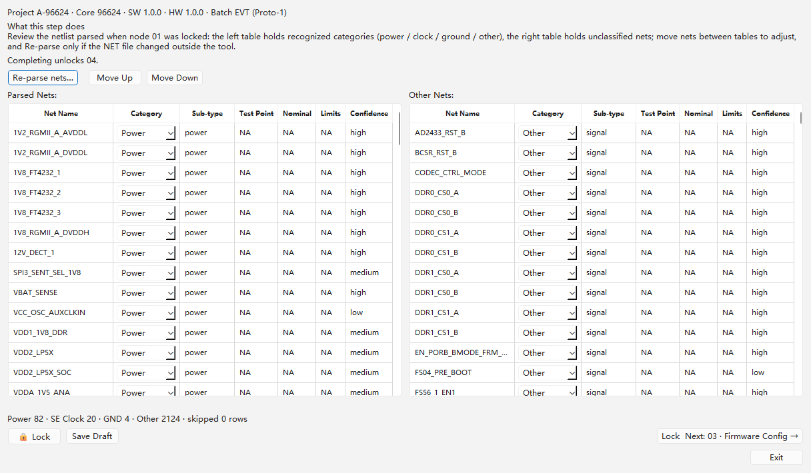

# Yaml Build Page

The **Yaml Build** tab is where a test project is authored. It has one
layout, top to bottom:

```text
Plan version: [ field ]                       <- header
01 Design Input -> 02 Parse nets for ICT -> 03 Channel Allocation
-> 04 Build ICT Test Work Flow Sequence -> 05 Build FCT Test Work Flow Sequence
[ Power Nets | Clock Nets | Control IO Nets ]  <- embedded tables
rows: power=.. power_rails=../.. clock=.. gpio=.. - validation: ..
```

Five nodes on a single row, each connected to the next; the Channel
Allocation tables sit directly below them; the status line under the tables
reports the four counts and the validation state. There is no YAML preview
pane any more - the YAML is written by `Apply_Save yaml` inside each node
dialog and by the File menu.


The shot above is the shipped `examples/ict_96624` demo plan, so it also shows
what a capacity-limited plan looks like: 82 power nets against the 80-point
front end and 692 parsed Control-IO candidates against the 24 DIO lines. The
footer says so (`+668 over capacity`, `validation: NOK (incomplete rows)`)
instead of dropping the extra nets quietly.

## How the nodes behave

- **Left-click a node** to open its dialog. Each dialog validates its own
  fields: invalid input keeps the dialog open with the reason, and a node
  is never half-saved.
- **Right-click a node** for `Enable` / `Disable`, plus `Enable All` /
  `Disable All`. A disabled node renders gray with a `Disabled` badge,
  keeps its parameters, and is skipped by the flow, the validation and the
  YAML it generates.
- **A star** on the node means it has been applied and validated at least
  once in this project. Stars persist with the project.
- **Gating** follows the data, not the clock: node 02 opens once node 01
  carries SPF + NET + BOM; nodes 03 and 04 share the same gate level, so
  neither opens before the parse is applied; node 05 (FCT) is independent
  and always opens - an FCT-only project is legal.
- **If any of the three design files is missing**, only node 01 opens.

## Node 01 - Design Input


Three route choices at the top of the panel:

| Route | Input | What it does |
|---|---|---|
| **A** `SPF + NET + BoM` | Allegro Smart PDF + netlist (+ BOM) | the normal path: node 02 classifies the nets |
| **B** `ICT Excel Spreadsheet` | a traditional ICT Excel | imports a prepared per-net test list |
| **C** `MTK ICT Excel Sheet` | the four-sheet workbook written by this tool | round trip for stations that review plans in Excel |

Route A fields:

- `Import SPF...` - Allegro Smart PDF only. The title block fills
  **Project Part #** and **Core ID**; both stay editable.
- `Import NET...` - **load only**. The netlist is kept in memory and parsed
  by node 02, never by the import.
- `Import BOM...` - optional and non-blocking. The status line reports
  `records / DNP / conflicts / warnings`. The BOM matters: DNP parts make
  their nets untestable (see node 02).
- **Batch #** - a batch containing `Production` marks the plan as
  production (OEE counts it); anything else stays engineering.
- **Enable** - tick it when the panel is complete.

Press **Apply_Save yaml** to apply and write the project YAML.

## Node 02 - Parse nets for ICT



`Parse Nets for ICT` classifies every net into three views:

- **Parsed Nets** - net, test point, category (`Power` / `Clock` /
  `Control IO` / `GND` / `Other`), confidence, input-rail flag, sub-class.
  A dropdown lets you move a net to another category.
- **Filtered Nets** - nets removed by the rule set or by DNP, with the
  reason and a category dropdown so a net can be brought back.
- **GND integrity** - one line under the tables; more than one reference
  ground raises a warning instead of being silently accepted.

`Edit Net Classification Rules` opens the regex rule set (power tree
patterns, clock patterns, exclude patterns, DNP handling). Two behaviours
worth knowing:

- the counters above the tables are `classified + filtered` for this file,
  so the number is reproducible;
- importing a BOM changes the power count, because nets on DNP parts drop
  out. On the 96624 reference board that is `power=82` from the netlist
  alone against `power=49` with the BOM.

The result is written into the model only when the dialog is applied.

## Node 03 - Channel Allocation

The node is a navigation card with an `Auto assign` button: clicking it runs
the automatic allocation and fills the embedded tables below; no dialog
opens. Three tabs follow the resource pools:

- **Power Nets** - test point, `R-GND Min limit (ohm)`, `Nominal (V)`,
  `Lower limit (V)`, `Upper limit (V)`; the voltage columns become the
  voltage rows of node 04, the resistance column becomes the `R-GND` rows.
- **Clock Nets** - test point, expected frequency, window.
- **Control IO Nets** - the 24 DIO lines, drive / read / toggle.

Rows are editable in place (dropdown-only where a fixed choice applies). The
status line under the tables counts them:

```text
rows: power=82 power_rails=12/82 clock=20 gpio=24 - validation: OK
```

`power_rails=12/82` means 12 of the 82 power nets are armed for the rails
capture. Anything that does not fit a pool is reported as over capacity and
becomes Do-Not-Test when the sequence is built - visible, never silent.

## Node 04 - Build ICT Test Work Flow Sequence

This node opens the ICT step editor - one row per test or operation, in the
canonical order the engine runs them:

```text
Power On DUT -> rails capture (Start) -> voltage rows -> clock rows
-> GPIO drive/read/toggle -> rails capture (End) -> Power Off DUT
```

Rails capture brackets the measurement block, so the waveform belongs to one
run. Each row carries its test point, limits, timeout and channel; double
click a row to edit it. The dialog re-seeds itself from an existing sequence,
so loading a saved plan and re-opening node 04 shows the stored rows instead
of an empty table.

The Test Work Flow table is a read-only result view of this sequence:
double clicking an ICT row opens the same editor, so there is exactly one
place to change a step.

## Node 05 - Build FCT Test Work Flow Sequence

Same editor shape, FCT content: `Init Instruments`, `Fixture Clamp Down`,
`Power On/Off DUT`, `Delay`, console rows (`Console_serial` / `_ssh` /
`_cli`, `Message`), file transfer rows (`Serial: Push file to DUT`,
`SSH SFTP: Push/Pull`), RF rows (`Wifi_Scan`, `Wifi_Ping`, `Wifi_Iperf`,
`BT_RSSI`, `BT_Pair`, `BT_Tone`) and `STEP_FLASH` for the two firmware
stages. `Load Template` writes a starter sequence in place for
`Bare Metal DUT`, `Linux DUT` or `Wifi_Scan (Host<->DUT)`.

Every console row must name what it expects (`Expected must be found`,
`Unexpected must not be found`); a row without a judge cannot pass, and the
save is blocked with that reason.

## Saving, validating, exporting

- **`Apply_Save yaml`** in every node dialog: validate, apply to the model,
  write the project YAML in place.
- **File -> Save Yaml (current file)** (`Ctrl+S`) writes the current file;
  **File -> Save Yaml As... (current file)** (`Ctrl+Shift+S`) writes a named
  copy; **File -> Close Yaml** clears the page.
- An empty sequence raises `No Test Items - Save anyway?`; answering **No**
  keeps you in the editor.
- **Plan version** in the header is copied into the YAML and bumps with each
  iteration (`Draft` -> `Final`).
- **File -> Excel** holds the review paths: export the config workbook,
  import a traditional ICT plan, import / export the MTK ICT sheet.

## Where to go next

- Chapter `15 · Example Build of ICT Test Case` walks the whole page on the
  shipped 96624 plan, with the real numbers for each step.
- Chapter `16 · Example Build of FCT Test Case` does the same for the
  FRDM-IMX93 FCT plan.
