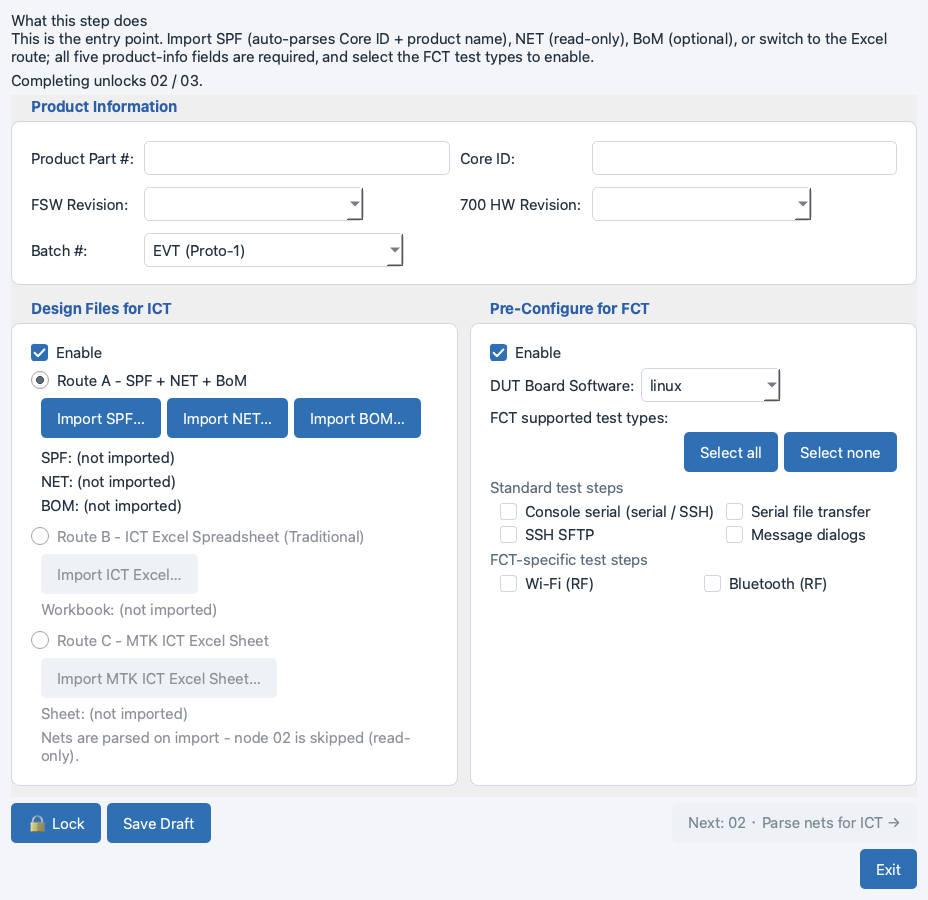
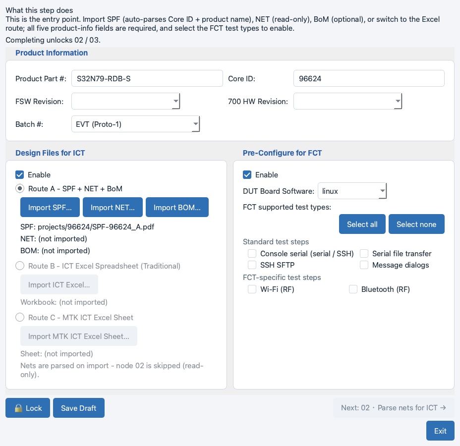
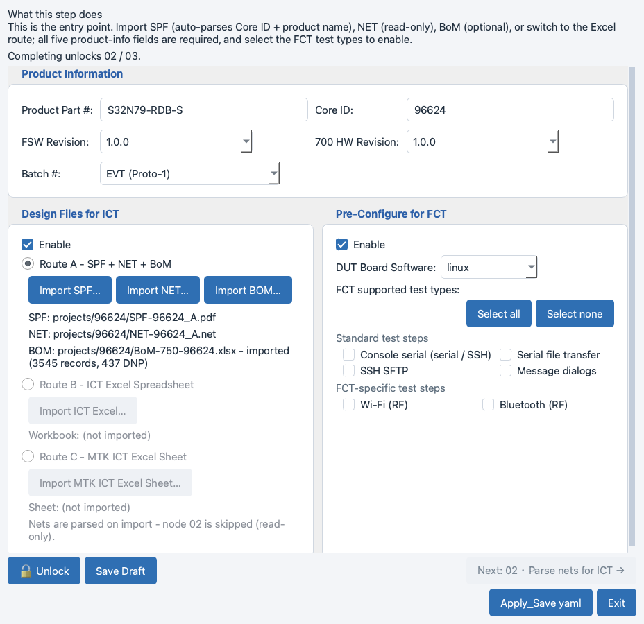
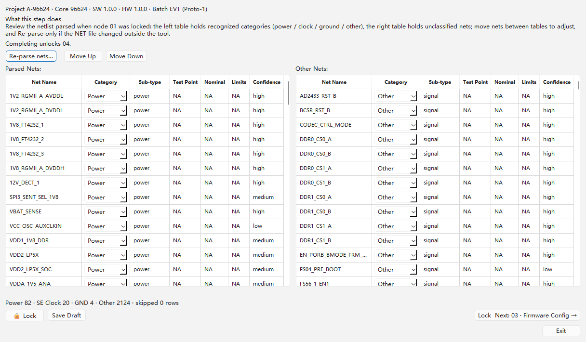
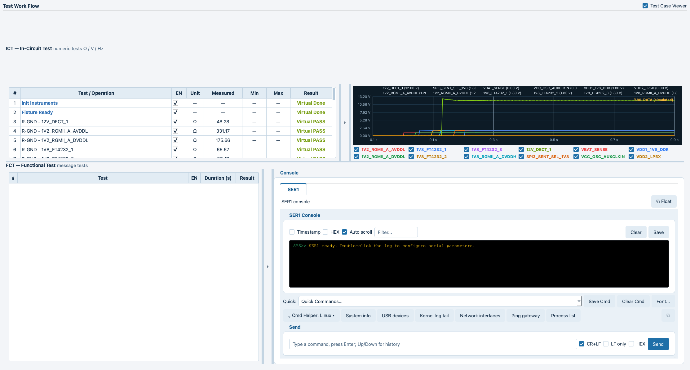

# Example Build of ICT Test Case

This chapter walks you through an **ICT** (In-Circuit Test) plan from the raw
design data to a saved YAML, using a real board: **CORE 96624 / part
A-96624**. Every number below was read off the screens in this chapter on
2026-11-25 - if your build shows a different count, the difference is in your
input files, not in the procedure.

The Yaml Build page has seven nodes in one flow band:

```text
01 Design Input -> (02 Parse nets for ICT || 03 Firmware Config)
-> 04 Equipment Config -> (05 Build ICT || 06 Build FCT) -> 07 Apply & Save Yaml
```

The gates are what make this chapter's order mandatory: 01 unlocks 02 and
03, either of them unlocks 04, 04 unlocks 05 and 06, and either of those
unlocks 07. Nodes 02 and 05 are the ones this walkthrough edits; 03, 04 and
06 are covered in chapters 9 and 16.

## Prerequisites

- MTK GUI logged in as **Supervisor** (channel editing needs the Yaml Build
  page; an Operator can open it read-only).
- The design files on disk. For this walkthrough:

```text
projects\96624\SPF-96624_A.pdf        (Allegro Smart PDF)
projects\96624\NET-96624_A.net        (Allegro netlist)
projects\96624\BoM-750-96624.xlsx     (BOM, optional but recommended)
```

`projects\` is your data folder, not part of the repository - the plans
travel with the exe only under `_internal\projects`. The finished reference
plan for this board ships as `examples\ict_96624\` and is described at the
end of the chapter.

## Step 1 - Open Yaml Build and node 01

Select the **Yaml Build** tab. The flow band shows the seven nodes and the
project path band at the top; greyed nodes are locked until their upstream
gate is done. Open **01 - Design Input** by clicking the tile.



The panel has three parts:

- **Product Information** - `Product Part #` / `Core ID` on the first row,
  `FSW Revision` / `700 HW Revision` on the second (both a `Rev A` ... `Rev
  H` dropdown), `Batch #` on the third.
- **Design Files for ICT** - the route selector **Route A** (`SPF + NET +
  BoM`), **Route B** (`ICT Excel Spreadsheet (Traditional)`) or **Route C** (`MTK ICT
  Excel Sheet`), stacked top to bottom; route A is the default and the one
  this chapter uses, the other two stay greyed out.
- **Pre-Configure for FCT**, next to it - the DUT board software and the
  FCT test types this plan supports.

`Batch #` decides whether this plan counts as production: a batch containing
`Production` flips the OEE switch to production, anything else (here
`EVT (Proto-1)`) keeps it engineering. Set it correctly now - it is copied
into the YAML's `design_input`.

## Step 2 - Import the three files, one at a time

1. **Import SPF...** - pick `SPF-96624_A.pdf`. The Smart PDF is extracted in
   a worker (about 1 s for this file), then the title block fills
   `Product Part # = S32N79-RDB-S` and `Core ID = 96624` automatically. The
   status line under the buttons shows the imported path.
2. **Import NET...** - pick `NET-96624_A.net`. This is a **load only** step:
   the file is read into memory and nothing is parsed yet. Node 02 does the
   parsing, which is why the node stays locked until the file is present.
3. **Import BOM...** - pick `BoM-750-96624.xlsx`. The line reports
   `3 545 records, 437 DNP, 0 conflicts, 0 warnings` for this board.





Tick **Enable** when the panel is complete. Leaving it unticked is legal - the
plan simply does not claim design input yet - but the later nodes then build
from an empty model.

The panel writes what you type straight into the model (that is why the
badge on node 01 turns `Edited`), so there is no per-node apply button any
more: press **Next** in the footer to go back to the flow. Nothing on disk
changes until node 07 writes the YAML.

## Step 3 - Parse the nets (node 02)

Locking node 01 already parsed the netlist, so open **02 - Parse nets for
ICT** and the two tables are filled: `Parse nets` is there for the case
where the NET file changed outside the tool.



Read the summary line under the two tables:

```text
Power 82 · SE Clock 20 · GND 4 · Other 2124 · skipped 0 rows
```

- **Parsed Nets** (left table) - the testable nets with their test point,
  category and confidence. The first rows of this board are
  `1V2_RGMII_A_AVDD…`, `1V2_RGMII_A_DV…`, `1V8_FT4232_1`.
- **Other Nets** (right table) - everything that landed in `Other`
  (`AD2433_RST_B`, `BCSR_RST_B`, `CODEC_CTRL_MODE`, …); each row keeps a
  category dropdown, so a net you disagree with moves buckets without a
  re-parse.
- **`skipped 0 rows`** - nothing the parser refused; a non-zero value is
  the tool telling you about a malformed line rather than about the board.

Numbers worth knowing before you compare with a colleague's build:

- **How the counter adds up.** `2 230` is every row of this netlist
  (`82 + 20 + 4 + 2124`); nothing is lost between the two tables and the
  number.
- **The BOM changes the power count.** With the BOM loaded the `Power`
  bucket drops to `49`: nets whose parts are marked DNP (437 of them here)
  are not testable and leave the bucket. The shipped reference plan was
  built from the netlist alone, which is why its model reads `Power 82`.
  Decide once per product whether DNP parts count, and keep that decision
  in the plan.

Press **Next** when the tables look right - the classification is already in
the model, so node 04 and then node 05 open against it.

## Step 4 - Check the instruments on the Equipment page

Switch to the **Equipment** tab and confirm the five instruments are the
ones physically on the rack:

| Instrument | Role in ICT | Connection |
|---|---|---|
| DAQ973A mainframe | 80-point 2-wire Ω + DCV, clock frequency | GPIB |
| DAQM908A #1 / #2 | 40 + 40 single-ended MUX channels | inside the mainframe |
| DAQM907A | AO stimulus for the DUT ADC, totalizer for CLK1 | inside the mainframe |
| U2355A | 12-rail up-sequence, CTR0/1 for CLK2/CLK3, 24 DIO | USB |
| N5747A | DUT supply, 5 / 12 / 24 / 48 V single output | LAN |

Press **Test Connection** per instrument if you are on the rack; in Virtual
mode the check is simulated and returns the configured identity. A wrong
connection string here is the most common reason a real run fails at row 1
with `no instrument at address`.

## Step 5 - Build the ICT sequence (node 05)

Open **05 - Build ICT Test Sequence**. The editor lists one row per
test or operation in the order the engine runs them:

```text
Power On DUT -> rails capture (Start) -> voltage rows -> clock rows
-> GPIO drive/read/toggle -> rails capture (End) -> Power Off DUT
```

The rails capture brackets the measurement block, so the waveform you see
later belongs to one run instead of being stitched together. Every row
carries its test point, limits, timeout and instrument channel, and
double-click edits it.

The shipped `examples/ict_96624` plan settles at 34 rows - 27 numeric tests
(R-GND, voltage, clock) plus 7 standard operations - with 12 rails armed for
the DAQ capture. A fresh build from all 82 raw power nets would need more
voltage rows than the 80-point front end can serve, which the footer reports
as over capacity instead of dropping nets quietly. If a net has no channel the
builder says so before opening an empty table, and the net becomes Do-Not-Test
with a reason.

The rails capture settings themselves (sample rate, pre/post-trigger window,
anomaly policy) come from the plan's `equipment.rails` block; the values this
demo plan carries are a 200 Hz sample rate, a -0.5 s pre-trigger, a 6.0 s
post-trigger window and `stop` as the anomaly policy. They are data in the
YAML, not hidden defaults.

## Step 6 - Read the channel allocation back (still node 05)

The allocation tables sit inside the node 05 dialog, above the test rows, and
their status line reports the four counts at a glance:

```text
rows: power=82 power_rails=12/82 clock=20 gpio=24
```

They show what landed where - `R-GND` and voltage on the DAQM908A channels,
the 12 armed rails on `U2355A AI01..AI12`, clocks split between the DAQM907A
totalizer and the U2355A counters. Any net that did not fit a pool is listed
as over capacity and is auto Do-Not-Test when the sequence is built - it
stays visible in the model so the gap is auditable.

## Step 7 - Save the YAML (node 07)

**07 - Apply & Save Yaml** is the only write path: it previews the generated
YAML read-only, then `Apply & Save Yaml` writes it in place. For a named
copy use **File → Save as Yaml...**; the proposed name comes from the product
metadata:

```text
S32N79-RDB-S_96624_EVT-(Proto-1)_rev_1.0.0_Draft.yaml
```

Confirm the **Overall Flow** band shows that file, and the Event Log records
`Yaml saved: ...`. An empty sequence raises `No Test Items - Save anyway?`;
answer **Yes** only when you mean to keep a half-built model.

## Step 8 - Run it and export for review

Open **Test Work Flow** and press **Run** in Virtual mode: the ICT stage
runs the whole sequence with no hardware, and the rails chart fills in.




For the design engineer, export the plan instead of the screenshots:
**File → Excel → Export ICT Test plan** writes the plan sheets (`YamlBuild`,
`Power`, `Clock`, `GPIO`) with the test point, the `R-GND` floor, the nominal
and the pass window per row. Hand that file over, get the limits agreed, edit
them in the GUI, and re-export - the round trip is field-lossless, and
`File → Import from Excel...` will not break the YAML structure.

## Summary - the ICT build loop

- Design input → parse → instruments → rails / clocks / GPIOs → save → run →
  export.
- The four numbers the design engineer signs off are the test point, the
  `R-GND` floor, the voltage nominal and the voltage window.
- Everything you cannot measure stays visible: a net with no limit becomes a
  disabled row with a reason, never a silent omission.

## Load the reference plan instead of rebuilding: 96624

The repository ships the finished plan for this board, built entirely by
route A with no hand editing:

```text
examples\ict_96624\A-96624_ICT_Demo_v1.0.1.yaml
```

`File → Load Yaml…` and open it, then look at three pages in this order: the
Yaml Build model (above, `rows: power=82 power_rails=12/82 clock=20 gpio=24`),
the Test Work Flow table (34 rows: 27 numeric tests plus 7 standard
operations, 12 rails armed for the capture) and the rails chart after a
Virtual run.

### Why three rows are disabled

`Power Voltage - VBAT_SENSE`, `Power Voltage - VCC_OSC_AUXCLKIN` and
`Power Voltage - VDD2_LP5X` have no limit: neither the SPF nor any engineer
sheet gave one. A limit-less row measures but reports **TBD**, and TBD fails
the ICT stage, so the builder disables them and writes the reason into the
row's `comment`. The row stays visible, the reason stays readable, and the run
is not blocked by an item nobody can judge.

To bring one back: author the window in **Yaml Build → Power Nets** (Nominal,
Lower, Upper), tick **EN**, save the plan. The same three rails also carry
`nominal_v: 0.0`, which is why they draw flat in the chart - authoring a
nominal fixes both at once.

### Reading the plan against your own

- 82 power nets, 12 of them armed as rails. The gap is the point: not every
  rail needs a waveform, only the ones whose power-up order matters.
- 20 clock nets, all at 32.768 kHz ±50 ppm in this demo. That is a template
  value from the build step, not a measurement of each net - check every clock
  row against the schematic before production.
- 24 control IO nets for the fixture DIO, 4 GND nets, and 1 432 filtered
  (mostly differential pairs and exclude-regex matches).
- The three disabled rows carry `nominal_v: 0.0` because nobody authored a
  limit for them yet; that is the one cosmetic gap the example shows on
  purpose.
