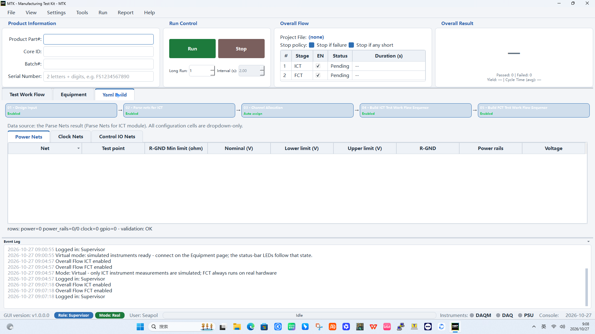
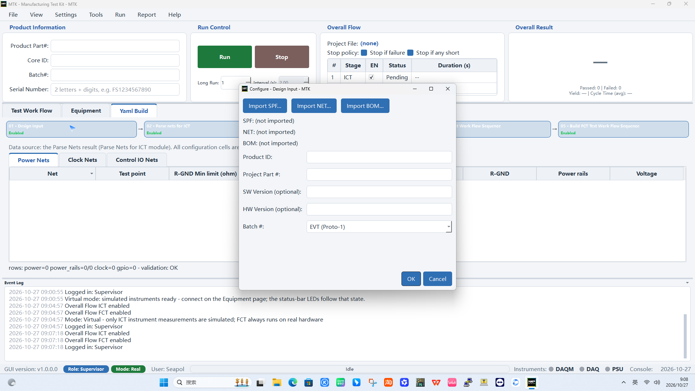
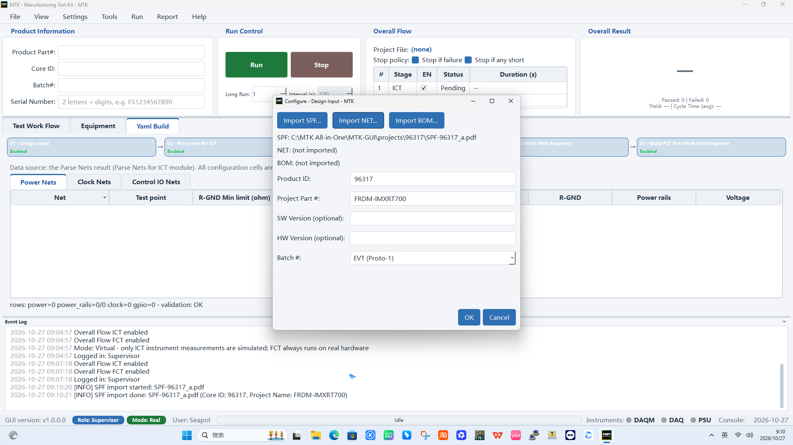
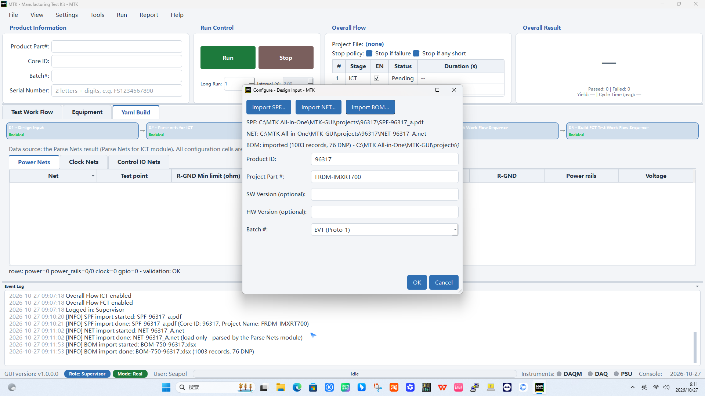
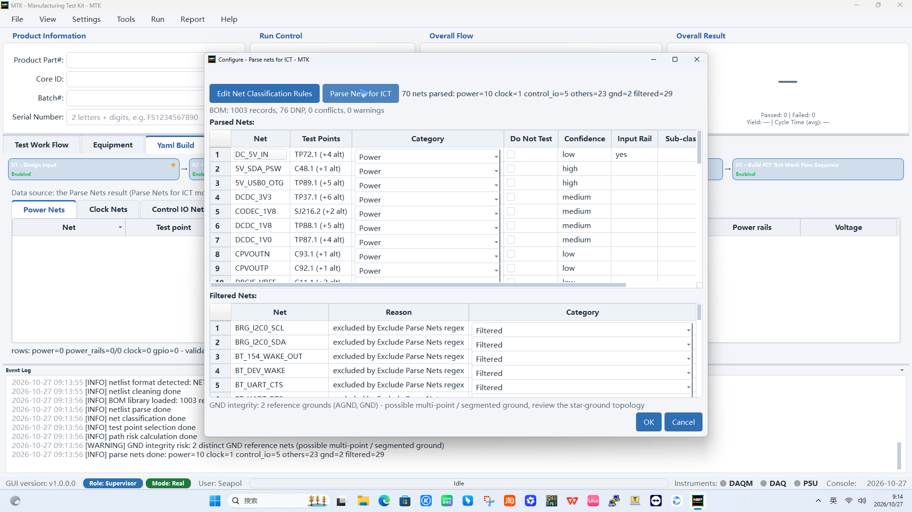
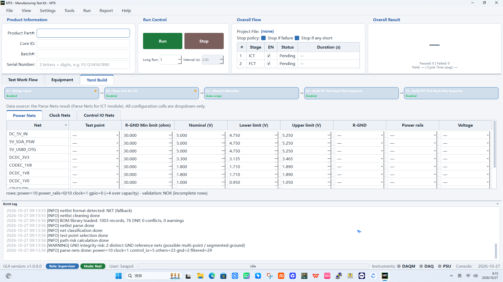
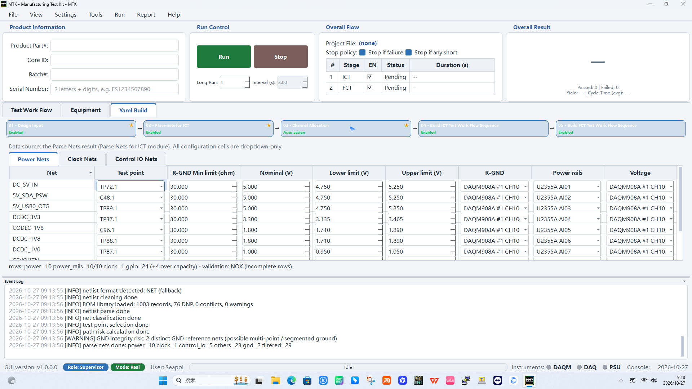
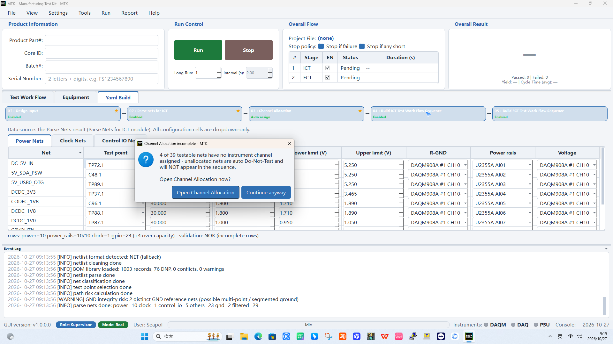
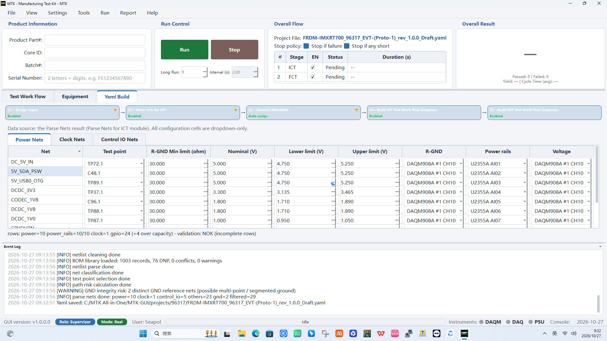
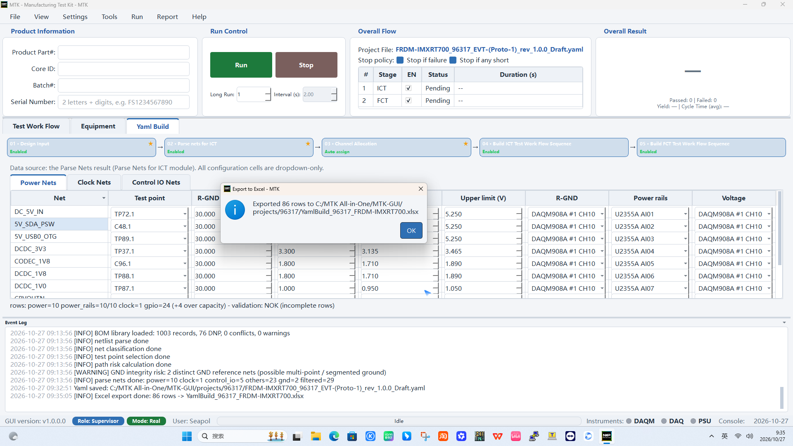

# Example Build of ICT Test Case

This chapter walks you end-to-end through building an **ICT** (In-Circuit
Test) test case with a real example product: **96317 (FRDM-IMXRT700)**.
You go from the raw design data (schematic PDF, netlist, BOM) to a
completed test-plan YAML, and then export the plan to Excel for review
with the design engineer. The same five-card flow applies to any other
product; only the input files change.

**Goal of this tutorial**

- Import the design data (SPF / NET / BOM).
- Parse and classify the nets (power / clock / control IO).
- Review and adjust the test points and limits (thresholds).
- Allocate the instrument channels.
- Build the ICT sequence, save the project YAML.
- Export the test plan Excel for the design engineer to review.
- Iterate: adjust tests and limits, re-export.

## Prerequisites

- MTK GUI is running and you are logged in (Supervisor or Operator;
  channel editing requires the YAML project to be open).
- The product design files are available on disk. For this example:

```text
C:\MTK All-in-One\MTK-GUI\projects\96317\SPF-96317_a.pdf
C:\MTK All-in-One\MTK-GUI\projects\96317\NET-96317_A.net
C:\MTK All-in-One\MTK-GUI\projects\96317\BOM-750-96317.xlsx
```

## Step 1 - Open the Yaml Build page

Select the **Yaml Build** tab at the top of the middle pane. The page
shows the five-card block flow:

`01 · Design Input` -> `02 · Parse nets for ICT` -> `03 · Channel
Allocation` -> `04 · Build ICT Test Work Flow Sequence` -> `05 · Build
FCT Test Work Flow Sequence`



The Channel Allocation tables (Power Nets / Clock Nets / Control IO
Nets) sit directly below the cards; the live YAML preview is on the
right. Work top-to-bottom.

## Step 2 - Import the design data (Block 01 · Design Input)

Click the **01 · Design Input** card. The `Configure - Design Input`
dialog opens with three import buttons and the product metadata
fields.



1. Click **Import SPF...** and select `SPF-96317_a.pdf` (an Allegro
   Smart PDF). The file is read and the project info is auto-parsed:
   **Product ID** fills `96317` and **Project Part #** fills
   `FRDM-IMXRT700` from the PDF title block.
2. Click **Import NET...** and select `NET-96317_A.net`. The netlist
   is loaded (raw load only - it is parsed by the Parse Nets module).
3. Click **Import BOM...** and select `BOM-750-96317.xlsx`. The BOM
   import reports the record count and DNP count.





Optionally fill **SW Version** / **HW Version** and keep the **Batch #**
drop-down (default `EVT (Proto-1)`). Click **OK** to close the dialog.

## Step 3 - Parse the nets (Block 02 · Parse nets for ICT)

Click the **02 · Parse nets for ICT** card, then click
**Parse Nets for ICT** in the dialog. The module reads the netlist and
BOM and classifies every net:

```text
70 nets parsed: power=10 clock=1 control_io=5 others=23 gnd=2 filtered=29
BOM: 1003 records, 76 DNP, 0 conflicts, 0 warnings
```



- **Parsed Nets** table: every testable net with its test point, the
  auto-assigned category (`Power` / `Clock` / `Control IO` / `GND` /
  `Other`), the confidence (`high` / `medium` / `low`), the input rail
  and the sub-class. Example rows for 96317: `DC_5V_IN` (TP72.1,
  Power), `DCDC_3V3` (TP37.1, Power), `DCDC_1V0` (TP87.1, Power).
- **Filtered Nets** table: nets excluded by the Exclude Parse Nets
  regex (e.g. `BRG_I2C0_SCL`, `BT_DEV_WAKE`) with the reason.
- **GND integrity** line: a warning is shown when more than one
  reference ground is found (`AGND` + `GND`) - possible multi-point /
  segmented ground. Review the star-ground topology on the fixture
  before releasing the plan.

Click **OK** to apply the result. The Yaml Build tables below the
cards are now filled: the **Power Nets** tab lists every power net
with its test point, `R-GND Min limit (ohm)`, `Nominal (V)`,
`Lower limit (V)` and `Upper limit (V)`.



## Step 4 - Review and adjust limits

Each row is editable through the cells (dropdown-only where a fixed
choice applies). Review the values against the product requirements:

- `R-GND Min limit (ohm)` - the anti-short / anti-over-current floor.
  A power rail that reads below this resistance is flagged as a
  short-risk. The default template value is `30.000`; for production
  set it from the rail budget, e.g. for a 3.3 V rail with a 2 A
  allowance: `R_min = V_rail / I_allow = 3.3 / 2.0 = 1.65 ohm`.
- `Nominal (V)` / `Lower limit (V)` / `Upper limit (V)` - the
  expected rail voltage and the pass window. Default template values
  come from the design data (e.g. `DCDC_3V3`: 3.300 / 3.135 / 3.465).

Adjust the cells to the values agreed with the design engineer. The
validation line below the tables shows the row counts and the overall
state (`validation: OK` or `NOK (incomplete rows)` - incomplete rows
are rows that still miss a test point or an allocation).

## Step 5 - Allocate the instrument channels (Block 03 · Channel Allocation)

Click the **03 · Channel Allocation** card. The auto-assign runs
immediately and fills the allocation columns:

- **R-GND** - measured on the DAQM908A multiplexer channels
  (e.g. `DAQM908A #1 CH10`).
- **Power rails** - the 12 rails are wired to the U2355A analog inputs
  (`U2355A AI01` - `AI07` for the 96317 rails).
- **Voltage** - also routed to a DAQM908A channel per rail.



The status line reports the allocation result, for example
`power=10 power_rails=10/10 clock=1 gpio=24 (+4 over capacity)` -
`+4 over capacity` means four control-IO nets could not be mapped
because the DIO pool is full. These nets are handled in Step 6.

## Step 6 - Build the ICT sequence (Block 04 · Build ICT)

Click **04 · Build ICT Test Work Flow Sequence**. If any net still
has no instrument channel, a dialog explains the situation:

```text
4 of 39 testable nets have no instrument channel assigned -
unallocated nets are auto Do-Not-Test and will NOT appear in the sequence.
```



Choose **Open Channel Allocation** to assign the remaining nets
manually (edit the allocation cells / mark them Do-Not-Test), or
**Continue anyway** to let the builder auto-mark them Do-Not-Test.
The ICT sequence is then generated from the allocated rails, clocks
and GPIO nets.

## Step 7 - Save the project YAML

Open **File > Save as Yaml...**. The dialog proposes a file name from
the product metadata:

```text
FRDM-IMXRT700_96317_EVT-(Proto-1)_rev_1.0.0_Draft.yaml
```

Navigate to the product folder (`projects\96317`), then click **Save**.
The project file name now shows in the **Overall Flow** panel and the
Event Log records `Yaml saved: ...`.



If the sequence tables are empty (no test items built yet), a
`No Test Items` dialog asks `Save anyway?` - answer **Yes** to keep
the configuration, or **No** and build the sequences first.

## Step 8 - Export the test plan Excel for review

Open **File > Export ICT Test plan from Yaml to Excel**. Choose the
target folder and file name (e.g. `YamlBuild_96317_FRDM-IMXRT700.xlsx`)
and click **Save**. The export confirmation reports the number of rows
written, and the Event Log records `Excel export done`.



The workbook contains the plan sheets (`YamlBuild`, `Power`, `Clock`,
`GPIO`) - hand this file to the design engineer to review the test
points, categories and limits.

## Iterating after review

1. Adjust the limits in the GUI (Step 4) or edit the exported Excel
   and re-import with **File > Import from Excel...**.
2. Re-run **Parse Nets for ICT** if the netlist or BOM changed.
3. Re-save the YAML and re-export the Excel; the version field in the
   YAML (`plan_version`) tracks the iterations.
4. When the plan is approved, publish the final version
   (`Draft` -> `Final`) and archive the plan from the Yaml Build page.

## Summary - the ICT build loop

- Import design data -> Parse nets -> Review/adjust limits ->
  Allocate channels -> Build sequence -> Save YAML -> Export Excel.
- The four "numbers" the design engineer reviews are the test point,
  the `R-GND` floor, the voltage nominal and the voltage pass window.
- Unallocated nets are auto Do-Not-Test: keep the DIO pool and the
  U2355A AI channels in mind when the plan grows.
