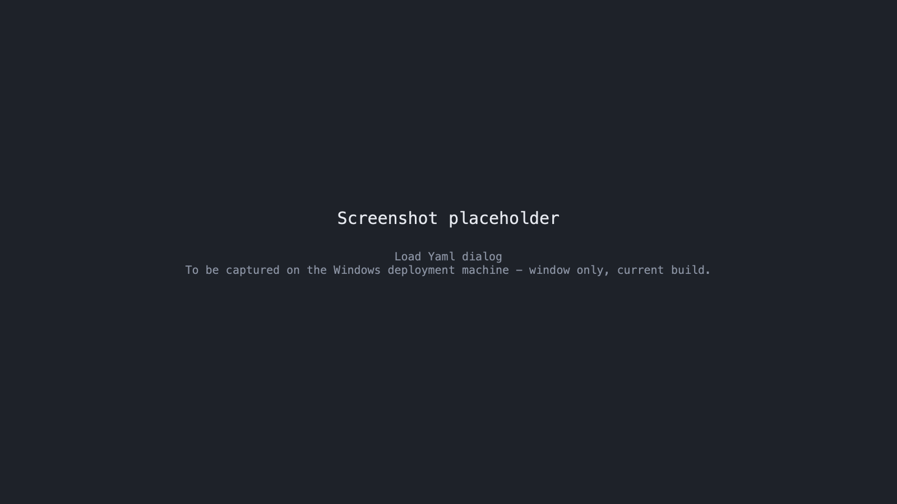
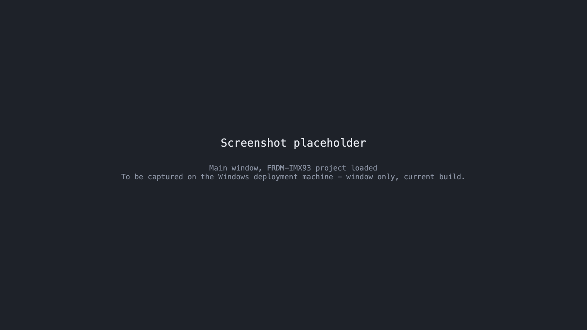
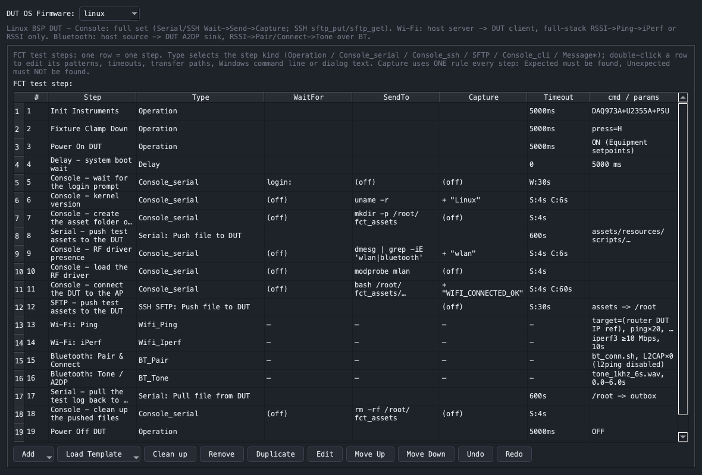
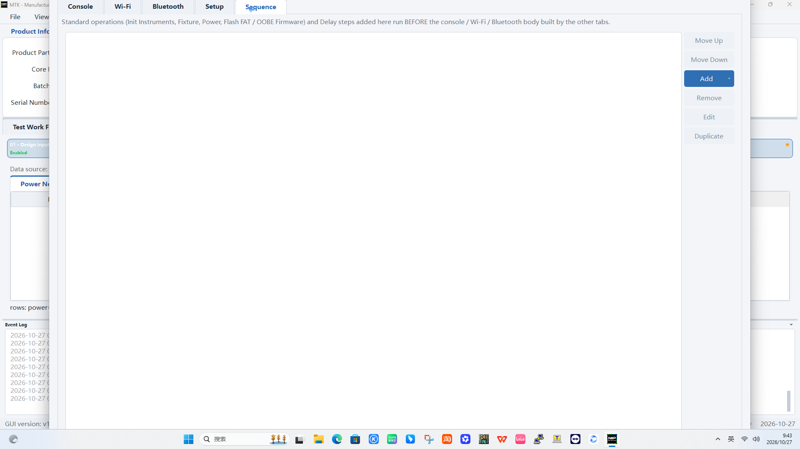
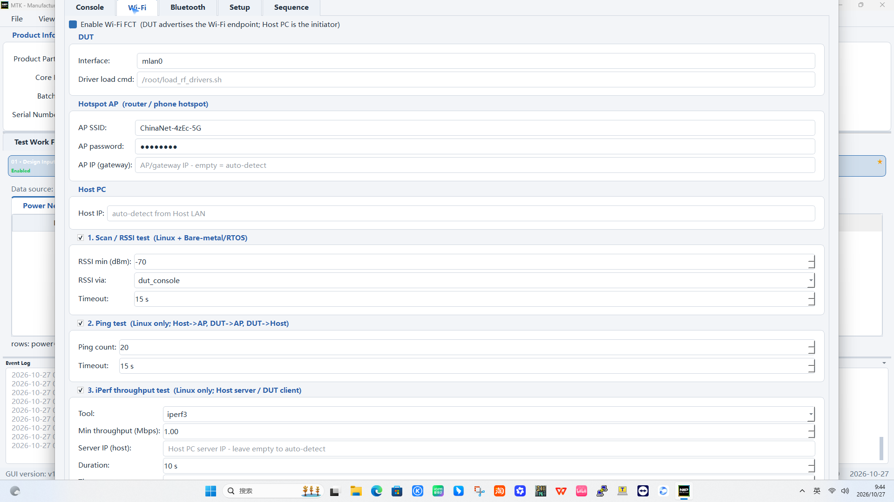

# Example Build of FCT Test Case

This chapter walks you end-to-end through building an **FCT**
(Functional Test) test case with a real example product:
**FRDM-IMX93** (NXP i.MX93 evaluation board). FCT is a *message test*:
the GUI drives the DUT through its serial console, Wi-Fi / Bluetooth
interfaces and operator dialogs, and every step passes when the
expected message appears (e.g. `PREFLIGHT_PASS`, `WIFI_CONNECTED_OK`)
or fails when an error message shows up. The same flow applies to
production products.

**Goal of this tutorial**

- Load the FRDM-IMX93 demo FCT project.
- Walk through the FCT sequence editor (Console / Wi-Fi / Bluetooth /
  Sequence tabs).
- Understand the DUT-side Linux scripts the sequence calls into.
- Copy the scripts from the host PC to the DUT Linux rootfs.
- Save the YAML and export the plan for review.

## Prerequisites

- The FRDM-IMX93 board is powered on and connected:
  - USB serial (CDC) to the host PC - the console appears as a COM
    port on Windows (e.g. `COM4`) or `/dev/cu.usbmodem...` on macOS.
  - Optional: Ethernet / Wi-Fi link between the DUT and the host for
    the file copy and the throughput tests.
- The demo project YAML exists on disk:

```text
C:\MTK All-in-One\MTK-GUI\projects\FRDM-IMX93\FRDM-IMX93_94611_Demo-FCT_rev_1.0.5_Draft.yaml
```

## Step 1 - Load the project YAML

Open **File > Load Yaml...**, navigate to `projects\FRDM-IMX93` and
open the demo YAML.



The project loads and the product metadata is filled automatically:
**Product Part #** = `FRDM-IMX93`, **Core ID** = `94611`, **Batch #** =
`Demo FCT`. The **Overall Flow** panel shows the project file name.



## Step 2 - Build the FCT sequence (Block 05 · Build FCT)

Go to the **Yaml Build** tab and click the **05 · Build FCT Test Work
Flow Sequence** card. The FCT editor opens with four tabs:
`Console` / `Wi-Fi` / `Bluetooth` / `Sequence`.

### Console tab - the serial message chain

Tick **Enable Console FCT**, set the **Port** (the COM port the DUT
serial is on; the demo YAML stores the macOS path
`/dev/cu.usbmodem53930099631` - change it to the Windows COM port of
your board) and the **Baudrate** (`115200`).



The **Test commands** table is the ordered message chain. Each row has
a name, the console (`serial` / `ssh` / `message`), the **WaitFor**
prompt before sending, the **SendTo** text, the **Capture** pattern
that must appear for the step to pass, plus **Timeout / Retry**. The
demo chain for FRDM-IMX93:

| # | Step | Send | Capture (pass marker) |
|---|------|------|------------------------|
| 1 | Power on DUT | (dialog) | Go-Stop dialog, 100 s |
| 2 | Console login | `root` | `root@imx93frdm` |
| 3 | Preflight: kernel version | `uname -r` | `6.6.36-lts-next` |
| 4 | Preflight (fat.py / ALSA / ...) | `sh /root/fct_assets/01_system_check.sh` | `PRECHECK_OK` |
| 5 | Load RF drivers | `sh /root/fct_assets/load_drivers.sh` | `DRIVERS_OK` |
| 6 | Start fat.py (interactive) | `cd /root/frdm_imx93_board_test && python3 -u fat.py --json /root/fat_result.json 2>&1 | tee /root/fat.log` | `FRDM-i.MX93 DUT` |
| 7 | fat.py: setup confirm | `y` | `Running as root` |
| 8 | fat.py: MQS earphone tone | `y` | operator confirmed tone |
| 9 | fat.py: HDMI visual | `y` | operator confirmed HDMI |
| 10 | fat.py: RGB LED start | `y` | `[RGB LED] Display RED` |
| 11 | fat.py: RGB LED colors | `y` | operator confirmed all RGB |
| 12 | fat.py summary | - | `Overall result:` |
| 13 | Start sshd | `mkdir -p /var/run/sshd; /usr/sbin/sshd` | `SSHD_STARTED` |
| 14 | Wi-Fi connect (router or hotspot) | `bash /root/fct_assets/connect_wifi.sh router` | `WIFI_CONNECTED_OK` |
| 15 | DUT Wi-Fi IP check | `ip -4 addr show mlan0` | `inet` |
| 16 | Ping Host (pre-SFTP) | `ping -I mlan0 -c 4 {{host_ip}}` | `0% packet loss` |
| 17 | Retrieve fat_result.json (SFTP) | (ssh) | fetched into `DUT Report` |
| 18 | Retrieve fat.log (SFTP) | (ssh) | fetched into `DUT Report` |
| 19 | Start iperf3 server (Host CLI) | (host) | server up |
| 20 | FCT done. | (dialog) | OK dialog |

Steps 8-11 are **operator dialogs**: the GUI asks the operator to
confirm what is heard / seen (tone, HDMI picture, RGB colours) - the
test waits up to 300 s per dialog.

### Sequence tab - standard operations

The **Sequence** tab holds the standard operations that run BEFORE the
console / Wi-Fi / Bluetooth body: `Init Instruments`, `Fixture`,
`Power`, `Flash FAT / OOBE Firmware` and `Delay` steps. Add them with
the `Add` button and order them with `Move Up` / `Move Down`.



Flashing the FAT / OOBE firmware is part of FCT: the flashing step
runs the third-party programmer (GUI flash then an operator Pass/Fail
dialog, or a CLI flash whose return message is parsed) and the result
feeds the FCT verdict.

## Step 3 - Configure Wi-Fi FCT (optional)

Open the **Wi-Fi** tab, tick **Enable Wi-Fi FCT** and fill the three
panels:

- **DUT**: interface `mlan0`, driver load command
  `sh /root/fct_assets/load_drivers.sh`.
- **Hotspot AP (router / phone hotspot)**: the AP SSID and password
  (e.g. `ChinaNet-4zEc-5G`).
- **Host PC**: the host IP (auto-detect from the Host LAN).
- Tests: `1. Scan / RSSI test` (RSSI min, e.g. `-70 dBm`),
  `2. Ping test` (ping count, e.g. `20`), `3. iPerf throughput test`
  (tool `iperf3`, min throughput, duration).



Bluetooth FCT is configured the same way on the **Bluetooth** tab.

## Step 4 - The DUT-side Linux scripts

The FCT chain calls into a small set of files that must exist on the DUT
rootfs. They are **project assets**: they live in the project's
`assets_<Project>/` folder (chapter `07_station_equipment.md`,
`Config assets for projects…`), and ordinary `Serial Push` / SFTP steps
copy them onto the DUT before the row that runs them. Nothing is
pre-installed on a production DUT.

The FRDM-IMX93 project asset tree:

```text
projects/FRDM-IMX93/assets_FRDM-IMX93/
  precheck/01_system_check.sh      fat.py / ALSA / memory / Wi-Fi / BT presence
  drivers/load_drivers.sh          probe-first Wi-Fi / BT module loader
  resources/scripts/connect_wifi.sh   station Wi-Fi join (router | hotspot)
  resources/scripts/bt_conn.sh        BT pairing helper used by BT_Pair
  resources/audio/                 BT Tone / music wav files
  resources/config/                static configs (wpa_supplicant, ...)
```

| Asset (in `assets_<Project>/`) | Purpose | Invoked by the row as | Pass marker |
|---|---|---|---|
| `precheck/01_system_check.sh` | Pre-flight: kernel, ALSA mixer, memory, filesystems, Wi-Fi / BT interface presence | `sh /root/fct_assets/01_system_check.sh` | `PRECHECK_OK` |
| `drivers/load_drivers.sh` | Loads the Wi-Fi / Bluetooth modules - probes first, so an already-autoloaded interface is left alone | `sh /root/fct_assets/load_drivers.sh` | `DRIVERS_OK` |
| `resources/scripts/connect_wifi.sh` | Joins `mlan0` to the station AP; the first argument selects the profile (`router` or `hotspot`), the credentials are inside the script | `bash /root/fct_assets/connect_wifi.sh router` | `WIFI_CONNECTED_OK` |
| `resources/scripts/bt_conn.sh` | Pairs the DUT with the host BT adapter and runs the L2CAP ping | `sh /root/fct_assets/bt_conn.sh` | `BT_CONN_OK` |
| `/root/frdm_imx93_board_test/` | BSP board-test package - contains `fat.py` (the interactive FAT menu); not an asset, it ships with the BSP image | `cd /root/frdm_imx93_board_test && python3 -u fat.py --json /root/fat_result.json 2>&1 \| tee /root/fat.log` | menu prompt `FRDM-i.MX93 DUT`, then `Overall result:` |
| `/root/fat_result.json` | JSON result written by `fat.py` (re-created on every run) | fetched into `DUT Report` via SFTP (step 17), then **removed on the DUT** | file fetched |
| `/root/fat.log` | Log written by `fat.py` via `tee` (re-created on every run) | fetched into `DUT Report` via SFTP (step 18), then **removed on the DUT** | file fetched |
| `iperf3` | Throughput server/client (system tool on the DUT rootfs) | used by the Wi-Fi throughput test | - |

The `send` strings above come from the project YAML - keep each script's
final marker in sync with that row's `Capture` pattern. Every script
prints exactly one *OK* line on success and one *FAIL* line (with the
offending item) on failure, so the capture pattern is unambiguous.

### Why no `chmod`

The rows call the interpreter explicitly (`sh …` / `bash …`), which only
needs **read** permission on the file: no execute bit is required, and a
`Serial Push` therefore never has to preserve file modes. `bash` rather
than `sh` is used where the script may need bash semantics; both scripts
in the tree stay POSIX `sh` so either interpreter works.

Do **not** add `chmod +x` rows: they cost a serial round-trip and hide
the real question (whether the file arrived intact).

## Step 5 - Copy the files from the host to the DUT

In the sequence this is one ordinary row per file: `Serial Push file to
DUT` (or `SFTP_put` once SSH is up), whose **Local** path is the asset
inside `projects/<Project>/assets_<Project>/` and whose **Remote** path
is the folder the console row will name. The GUI copies nothing behind
your back - when the push row is missing, the console row fails and says
so.

The demo chain pushes them to `/root/fct_assets/`; the folder has to
exist before the first push:

```
Console_serial:  mkdir -p /root/fct_assets
```

Where a file ends up is decided by the push row, not by this chapter:
a **single-file** push lands directly in the Remote folder
(`/root/fct_assets/connect_wifi.sh`), while pushing a **whole folder**
lands one level deeper under that folder's own name (`local:
assets_FRDM-IMX93/resources/scripts` + `remote: /root/fct_assets` ->
`/root/fct_assets/scripts/`). The console row must name the path the
push row actually creates - a mismatch shows up as a run-time "not
found" on the first step that runs the script.

For a fresh board you can do the same by hand once `sshd` is up (the
chain starts it in step 13; for the very first copy, start it by hand
over the serial console):

```sh
# host shell, from the repo root; <DUT_IP> is the address the DUT got
# on the station AP
scp projects/FRDM-IMX93/assets_FRDM-IMX93/precheck/01_system_check.sh \
    root@<DUT_IP>:/root/fct_assets/
scp projects/FRDM-IMX93/assets_FRDM-IMX93/drivers/load_drivers.sh \
    root@<DUT_IP>:/root/fct_assets/
scp projects/FRDM-IMX93/assets_FRDM-IMX93/resources/scripts/*.sh \
    root@<DUT_IP>:/root/fct_assets/
```

`scp` is only a convenience for the very first bring-up: it needs the
network that the Wi-Fi step is meant to establish, so a cold board is
normally provisioned over the serial console instead. No `chmod` is
needed either way - see "Why no `chmod`" above.

Keep the host copies inside the project's `assets_<Project>/` folder so
the YAML, the scripts and the credentials travel together with the
project - one copy, no separate `scripts/` folder.

## Step 6 - Save the project and export for review

1. **File > Save as Yaml...** - save the updated project (the demo
   draft, or a new file name for your product).
2. **File > Export to Excel...** (or the Yaml Build top button row) -
   export the full plan (Console / Wi-Fi / Bluetooth / Sequence rows)
   and hand the workbook to the design engineer with the DUT script
   list for review.
3. Iterate on the captured patterns / limits and re-export until the
   plan is approved, then publish `Draft` -> `Final`.

## Windows real-hardware runbook

### 1. DUT power-cycle timing (the first FCT row)

The first FCT row is a `MessageOKtoConsole` operator gate with the
`gostop` style.  Press **Run**, the GO / STOP dialog appears, then:

1. **Power the DUT on.**
2. **Wait for the `login:` prompt (~25 s on the FRDM-IMX93 BSP).**
3. **Press GO.**

Pressing GO before the prompt is up leaves the carriage return in the
U-Boot window and can abort autoboot.  For this project the GO answer
is a carriage return (`send_yes: "\r"`), not `y`; keep
`send_console_answer` on only for rows the DUT really answers.

### 2. `Console_cli` step that starts the Host iperf3 server

The throughput test needs an iperf3 server on the Host PC.  Author a
`SendtoCLI` / `Console_cli` row with `host_cmd: "iperf3 -s -D"`
(Windows: the bundled `iperf3.exe`, e.g.
`"C:\MTK All-in-One\MTK-GUI\dist\MTK_GUI\_internal\iperf3.exe -s -D"`).

- The host runner **kills the process after `timeout_s`** (default
  30 s), so a long-running server **must** be detached (`-D`, or
  `start /b`) - never foreground, otherwise the server dies with the
  step.
- The server port (5201) must be allowed inbound by Windows Defender
  Firewall (see `14_faq.md`, Q17).

### 3. SSH pull of `fat.log` over Wi-Fi

The SFTP row uses the SSH channel.  When no SSH console is bound, the
engine auto-binds it to the DUT's **Wi-Fi** address (`fct_dut_ip`,
produced by the Wi-Fi connect step) with the `equipment.dut.ssh`
credentials, pulls `/root/fat.log` into `{{dut_report}}` and deletes
the remote copy afterwards.

DUT-side preconditions: `sshd` listening on `:22`, root login allowed
(an empty root password is supported), and `/root/fat.log` present
(for example `dmesg > /root/fat.log`).  Without a Wi-Fi IP the row is
an ERROR (`no DUT Wi-Fi IP; run the Wi-Fi connect step before SFTP`) -
it never falls back to the serial console.

## Summary - the FCT build loop

- Load the YAML -> configure the Console message chain -> (optional)
  Wi-Fi / Bluetooth tests -> add standard operations (power, flash,
  delays) in the Sequence tab -> copy the DUT scripts -> save ->
  export Excel for review.
- FCT passes on **message evidence**: every step needs its capture
  pattern (`PREFLIGHT_PASS`, `WIFI_CONNECTED_OK`, `0% packet loss`,
  operator confirmations). Keep the DUT scripts and their output
  markers in sync with the YAML captures.
- Serial console steps need the correct COM port for the host - the
  demo YAML was authored on macOS (`/dev/cu.usbmodem...`); on Windows
  set the COM port of your board.
