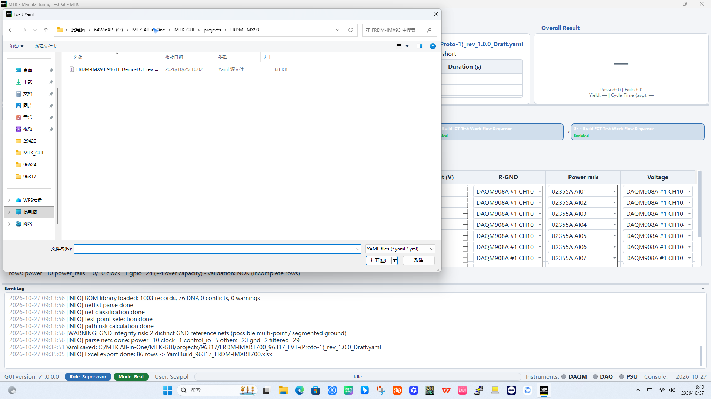
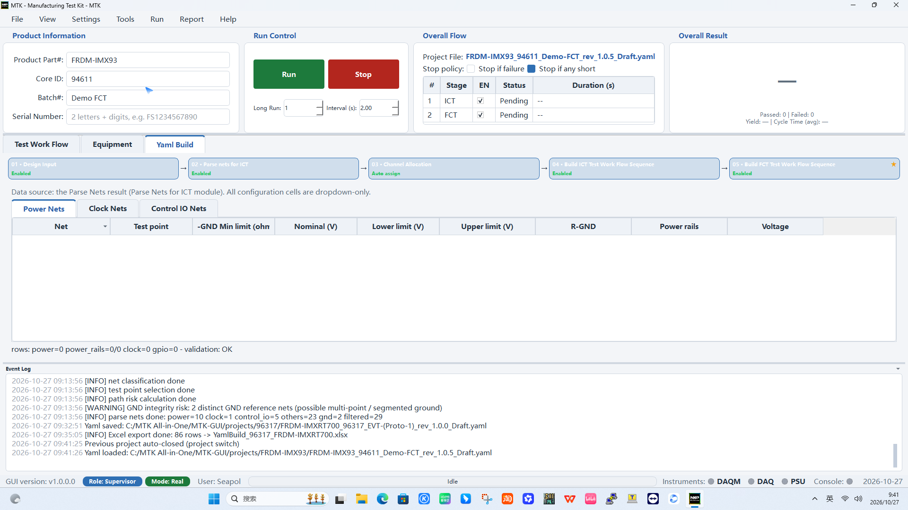
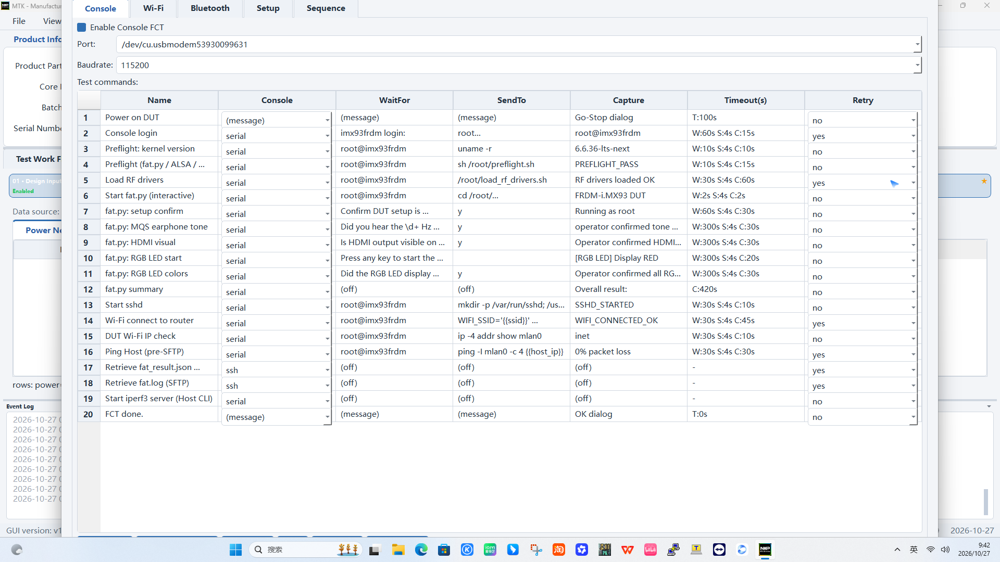
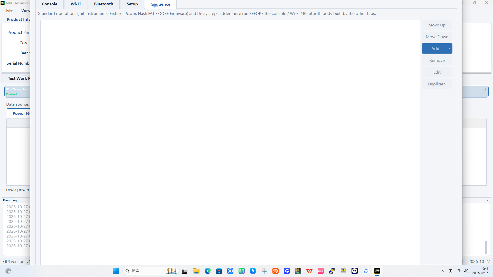
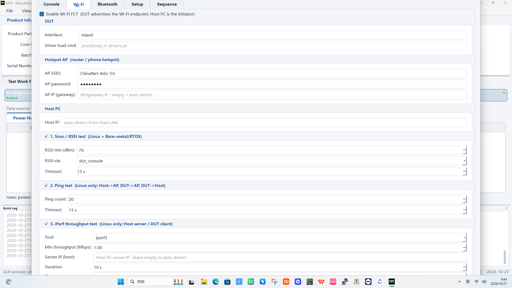

# Example Build of FCT Test Case

This chapter walks you end-to-end through building an **FCT**
(Functional Test) test case with a real example product:
**FRDM-IMX93** (NXP i.MX93 evaluation board). FCT is a *message test*:
the GUI drives the DUT through its serial console, Wi-Fi / Bluetooth
interfaces and operator dialogs, and every step passes when the
expected message appears (e.g. `PREFLIGHT_PASS`, `WIFI_CONNECTED_OK`)
or fails when an error message shows up. The same flow applies to
production products.

**Goal of this tutorial**

- Load the FRDM-IMX93 demo FCT project.
- Walk through the FCT sequence editor (Console / Wi-Fi / Bluetooth /
  Sequence tabs).
- Understand the DUT-side Linux scripts the sequence calls into.
- Copy the scripts from the host PC to the DUT Linux rootfs.
- Save the YAML and export the plan for review.

## Prerequisites

- The FRDM-IMX93 board is powered on and connected:
  - USB serial (CDC) to the host PC - the console appears as a COM
    port on Windows (e.g. `COM4`) or `/dev/cu.usbmodem...` on macOS.
  - Optional: Ethernet / Wi-Fi link between the DUT and the host for
    the file copy and the throughput tests.
- The demo project YAML exists on disk:

```text
C:\MTK All-in-One\MTK-GUI\projects\FRDM-IMX93\FRDM-IMX93_94611_Demo-FCT_rev_1.0.5_Draft.yaml
```

## Step 1 - Load the project YAML

Open **File > Load Yaml...**, navigate to `projects\FRDM-IMX93` and
open the demo YAML.



The project loads and the product metadata is filled automatically:
**Product Part #** = `FRDM-IMX93`, **Core ID** = `94611`, **Batch #** =
`Demo FCT`. The **Overall Flow** panel shows the project file name.



## Step 2 - Build the FCT sequence (Block 05 · Build FCT)

Go to the **Yaml Build** tab and click the **05 · Build FCT Test Work
Flow Sequence** card. The FCT editor opens with four tabs:
`Console` / `Wi-Fi` / `Bluetooth` / `Sequence`.

### Console tab - the serial message chain

Tick **Enable Console FCT**, set the **Port** (the COM port the DUT
serial is on; the demo YAML stores the macOS path
`/dev/cu.usbmodem53930099631` - change it to the Windows COM port of
your board) and the **Baudrate** (`115200`).



The **Test commands** table is the ordered message chain. Each row has
a name, the console (`serial` / `ssh` / `message`), the **WaitFor**
prompt before sending, the **SendTo** text, the **Capture** pattern
that must appear for the step to pass, plus **Timeout / Retry**. The
demo chain for FRDM-IMX93:

| # | Step | Send | Capture (pass marker) |
|---|------|------|------------------------|
| 1 | Power on DUT | (dialog) | Go-Stop dialog, 100 s |
| 2 | Console login | `root` | `root@imx93frdm` |
| 3 | Preflight: kernel version | `uname -r` | `6.6.36-lts-next` |
| 4 | Preflight (fat.py / ALSA / ...) | `sh /root/preflight.sh` | `PREFLIGHT_PASS` |
| 5 | Load RF drivers | `/root/load_rf_drivers.sh` | `RF drivers loaded OK` |
| 6 | Start fat.py (interactive) | `cd /root/frdm_imx93_board_test && python3 -u fat.py --json /root/fat_result.json 2>&1 | tee /root/fat.log` | `FRDM-i.MX93 DUT` |
| 7 | fat.py: setup confirm | `y` | `Running as root` |
| 8 | fat.py: MQS earphone tone | `y` | operator confirmed tone |
| 9 | fat.py: HDMI visual | `y` | operator confirmed HDMI |
| 10 | fat.py: RGB LED start | `y` | `[RGB LED] Display RED` |
| 11 | fat.py: RGB LED colors | `y` | operator confirmed all RGB |
| 12 | fat.py summary | - | `Overall result:` |
| 13 | Start sshd | `mkdir -p /var/run/sshd; /usr/sbin/sshd` | `SSHD_STARTED` |
| 14 | Wi-Fi connect to router | `WIFI_SSID='{{ssid}}' WIFI_PASSWORD='{{password}}' sh /root/connect_wifi.sh` | `WIFI_CONNECTED_OK` |
| 15 | DUT Wi-Fi IP check | `ip -4 addr show mlan0` | `inet` |
| 16 | Ping Host (pre-SFTP) | `ping -I mlan0 -c 4 {{host_ip}}` | `0% packet loss` |
| 17 | Retrieve fat_result.json (SFTP) | (ssh) | fetched into `DUT Report` |
| 18 | Retrieve fat.log (SFTP) | (ssh) | fetched into `DUT Report` |
| 19 | Start iperf3 server (Host CLI) | (host) | server up |
| 20 | FCT done. | (dialog) | OK dialog |

Steps 8-11 are **operator dialogs**: the GUI asks the operator to
confirm what is heard / seen (tone, HDMI picture, RGB colours) - the
test waits up to 300 s per dialog.

### Sequence tab - standard operations

The **Sequence** tab holds the standard operations that run BEFORE the
console / Wi-Fi / Bluetooth body: `Init Instruments`, `Fixture`,
`Power`, `Flash FAT / OOBE Firmware` and `Delay` steps. Add them with
the `Add` button and order them with `Move Up` / `Move Down`.



Flashing the FAT / OOBE firmware is part of FCT: the flashing step
runs the third-party programmer (GUI flash then an operator Pass/Fail
dialog, or a CLI flash whose return message is parsed) and the result
feeds the FCT verdict.

## Step 3 - Configure Wi-Fi FCT (optional)

Open the **Wi-Fi** tab, tick **Enable Wi-Fi FCT** and fill the three
panels:

- **DUT**: interface `mlan0`, driver load command
  `/root/load_rf_drivers.sh`.
- **Hotspot AP (router / phone hotspot)**: the AP SSID and password
  (e.g. `ChinaNet-4zEc-5G`).
- **Host PC**: the host IP (auto-detect from the Host LAN).
- Tests: `1. Scan / RSSI test` (RSSI min, e.g. `-70 dBm`),
  `2. Ping test` (ping count, e.g. `20`), `3. iPerf throughput test`
  (tool `iperf3`, min throughput, duration).



Bluetooth FCT is configured the same way on the **Bluetooth** tab.

## Step 4 - The DUT-side Linux scripts

The FCT chain calls into a small set of files that must exist on the
DUT rootfs (`/root/`). The listing below is the **actual state of the
demo board** (`ls -l /root` on `root@imx93frdm`), cross-checked against
the commands the YAML sends:

```text
-rw-r--r-- 1 root root    1723  FCT_SETUP.md
-rwx--x--x 1 root root    1891  connect_wifi.sh
-rw-r--r-- 1 root root  127221  fat.log
-rw-r--r-- 1 root root  208649  fat_result.json
drwxrwxrwx 4 root root    4096  frdm_imx93_board_test/
-rwxr-xr-x 1 root root    2253  load_rf_drivers.sh
-rwxr-xr-x 1 root root    2016  preflight.sh
```

| File (on DUT) | Purpose | Invoked by the YAML as | Expected output |
|---------------|---------|------------------------|-----------------|
| `/root/preflight.sh` | Preflight checks: kernel version, ALSA mixer, memory, filesystem | `sh /root/preflight.sh` | `PREFLIGHT_PASS` |
| `/root/load_rf_drivers.sh` | Loads the Wi-Fi / Bluetooth drivers and firmware | `/root/load_rf_drivers.sh` | `RF drivers loaded OK` |
| `/root/frdm_imx93_board_test/` | BSP board-test package - contains `fat.py` (the interactive FAT menu) | `cd /root/frdm_imx93_board_test && python3 -u fat.py --json /root/fat_result.json 2>&1 | tee /root/fat.log` | menu prompt `FRDM-i.MX93 DUT`, then `Overall result:` |
| `/root/fat_result.json` | JSON result file written by `fat.py` (re-created on every run) | fetched into `DUT Report` via SFTP (step 17), then **removed on the DUT** | file fetched |
| `/root/fat.log` | Log file written by `fat.py` via `tee` (re-created on every run) | fetched into `DUT Report` via SFTP (step 18), then **removed on the DUT** | file fetched |
| `/root/connect_wifi.sh` | Connects `mlan0` to the AP given as env vars | `WIFI_SSID='{{ssid}}' WIFI_PASSWORD='{{password}}' sh /root/connect_wifi.sh` | `WIFI_CONNECTED_OK` |
| `/root/FCT_SETUP.md` | On-board FCT set-up notes (earphone / HDMI / LED wiring, prerequisites) | reference only | - |
| `iperf3` | Throughput server/client (system tool on the DUT rootfs) | used by the Wi-Fi throughput test | - |

The exact `send` strings above come from the project YAML - keep the
scripts' output markers in sync with the YAML `capture` patterns.

Reference shapes (your BSP already ships working versions - the shapes
below only illustrate the ideas):

```sh
# preflight.sh - shape of the on-board version
#!/bin/sh
set -e
echo "kernel: $(uname -r)"
echo "mem:    $(free -m | awk 'NR==2{print $2}') MB"
echo "PREFLIGHT_PASS"
```

```sh
# load_rf_drivers.sh - shape of the on-board version
#!/bin/sh
modprobe moal mod_para=nxp/wifi_mod_para.conf
sleep 1
echo "RF drivers loaded OK"
```

```text
# frdm_imx93_board_test/ - BSP board-test package (on the demo board)
# contains fat.py (the interactive FAT menu) plus its helper modules.
# Invoked by the YAML as:
#   cd /root/frdm_imx93_board_test && python3 -u fat.py --json /root/fat_result.json
# fat.py runs the MQS tone / HDMI / RGB LED checks with operator
# confirmations and writes /root/fat_result.json (log via tee to /root/fat.log).
```

Make the scripts executable on the DUT (only needed after a copy):

```sh
chmod +x /root/preflight.sh /root/load_rf_drivers.sh /root/connect_wifi.sh
```

## Step 5 - Copy the files from the host to the DUT

The demo board already ships the whole set (see the `/root` listing
above - the BSP provides `frdm_imx93_board_test/` with `fat.py`).
Copying is only needed when you (a) bring up a fresh board, or (b)
push an updated version of a script. Prerequisite: the DUT runs `sshd`
(the FCT chain starts it in step 13; for a first copy you can start it
by hand after logging in over the serial console). Then copy over the
network:

```sh
# one file at a time (host shell; replace <DUT_IP> with the DUT address)
scp /root/preflight.sh root@<DUT_IP>:/root/
scp /root/load_rf_drivers.sh root@<DUT_IP>:/root/
scp /root/connect_wifi.sh root@<DUT_IP>:/root/
```

```sh
# the BSP package is a directory - copy it recursively
scp -r /root/frdm_imx93_board_test root@<DUT_IP>:/root/
```

```sh
# or interactively with sftp
sftp root@<DUT_IP>
put C:\MTK All-in-One\MTK-GUI\projects\FRDM-IMX93\scripts\preflight.sh /root/
put C:\MTK All-in-One\MTK-GUI\projects\FRDM-IMX93\scripts\load_rf_drivers.sh /root/
put C:\MTK All-in-One\MTK-GUI\projects\FRDM-IMX93\scripts\connect_wifi.sh /root/
put -r C:\MTK All-in-One\MTK-GUI\projects\FRDM-IMX93\scripts\frdm_imx93_board_test /root/
bye
```

If the DUT has no network yet, transfer the files over the serial
console with a terminal that supports ZMODEM (`sz` / `rz`), then
`chmod +x` them as above.

Keep the host copies under
`C:\MTK All-in-One\MTK-GUI\projects\FRDM-IMX93\scripts\` so the YAML
and the scripts travel together with the project.

## Step 6 - Save the project and export for review

1. **File > Save as Yaml...** - save the updated project (the demo
   draft, or a new file name for your product).
2. **File > Export to Excel...** (or the Yaml Build top button row) -
   export the full plan (Console / Wi-Fi / Bluetooth / Sequence rows)
   and hand the workbook to the design engineer with the DUT script
   list for review.
3. Iterate on the captured patterns / limits and re-export until the
   plan is approved, then publish `Draft` -> `Final`.

## Summary - the FCT build loop

- Load the YAML -> configure the Console message chain -> (optional)
  Wi-Fi / Bluetooth tests -> add standard operations (power, flash,
  delays) in the Sequence tab -> copy the DUT scripts -> save ->
  export Excel for review.
- FCT passes on **message evidence**: every step needs its capture
  pattern (`PREFLIGHT_PASS`, `WIFI_CONNECTED_OK`, `0% packet loss`,
  operator confirmations). Keep the DUT scripts and their output
  markers in sync with the YAML captures.
- Serial console steps need the correct COM port for the host - the
  demo YAML was authored on macOS (`/dev/cu.usbmodem...`); on Windows
  set the COM port of your board.
