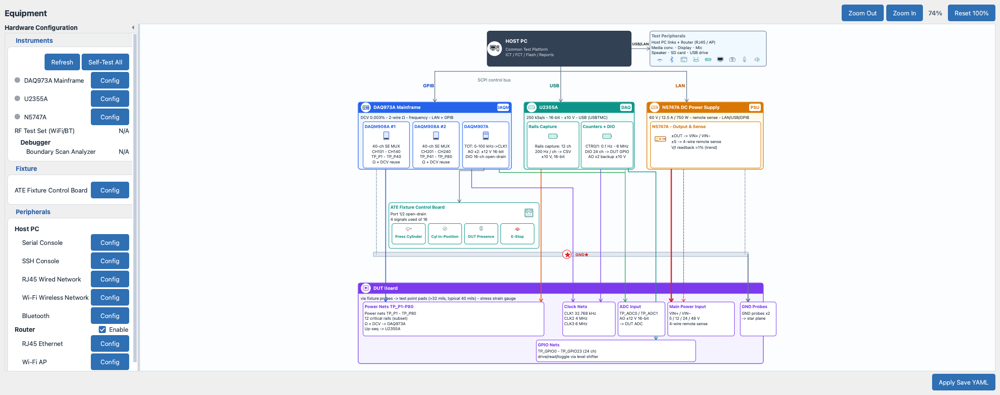

# Windows Build, Deployment and Station Rollout

This chapter is the short path: build the package on a Windows PC, verify it,
and put it on a station. The exhaustive version - every driver, port budget and
locale caveat - is `WINDOWS_DEPLOY_EN.md` in the repository root; when the two
disagree, that file wins and this chapter is the bug.

Two machines, two jobs:

| Machine | Job | Result |
|---|---|---|
| **Build PC** | clone, install dependencies, package | `dist\MTK_GUI\` |
| **Station** | receive that folder and run production | reports, logs, statistics |

Never build on a station. A station has instruments attached and no toolchain,
and the packaging step needs a quiet machine.

## 1. Build PC prerequisites

| Item | Requirement |
|---|---|
| OS | Windows 11 Pro x64 (validated); Windows 10 x64 minimum |
| Locale | **English** - the tool parses English `netsh` / `ping` output |
| Python | 3.12-3.14 with "Add Python to PATH" ticked |
| Git for Windows | clone, pull, tag |
| Disk | SSD, 100 GB free (packaging tree + reports + DAQ CSVs) |
| Display | 1920 x 1080 or wider; the layout assumes at least 1400 px |

## 2. Build it

```powershell
mkdir D:\work ; cd D:\work
git clone git@github.com:Seapol/MTK-GUI.git mtk-gui
cd mtk-gui
git checkout develop
python -m venv .venv
.venv\Scripts\activate
python -m pip install --upgrade pip
pip install -r requirements.txt
pyinstaller --noconfirm MTK_GUI_windows.spec
```

The spec stamps the build: right after `COLLECT` it writes
`dist\MTK_GUI\_build_version.txt` holding the branch, the short commit and
the dirty flag, so the packaged exe can name the commit it was built from
(a frozen bundle has no git checkout beside it). If you rebuild by hand
without the spec, restamp the folder:

```powershell
python scripts\build_stamp.py dist\MTK_GUI
```

Every new terminal needs `.venv\Scripts\activate` again; the prompt then
shows `(.venv)`. The spec file is already correct - do not set `upx=True`
(Defender unpacks and scans compressed DLLs on every launch) and never move
`PySide6.QtWebEngineWidgets` / `QtWebEngineCore` into `excludes` (they carry
`QtWebEngineProcess.exe`, without which the SharePoint sign-in window cannot
open).

## 3. Check the build before it leaves the PC

```powershell
Test-Path dist\MTK_GUI\_internal\QtWebEngineProcess.exe   # True
Select-String -Path mtkgui\__init__.py -Pattern '__version__'
git log --oneline -1
(Get-Item dist\MTK_GUI\MTK_GUI.exe).Length
```

`__version__` must equal the release tag you checked out. If it does not, you
built the wrong ref.

```powershell
Get-Content dist\MTK_GUI\_build_version.txt     # {"version": "...", "branch": "develop", "commit": "...", ...}
```

The Event Log on first launch must print
`Build: v1.0.0.0 (develop @ <commit>) (source: file)` - if it says
`(source: static)`, the stamp is missing beside the exe.

Then launch it once:

1. Double-click `dist\MTK_GUI\MTK_GUI.exe` - no console window appears.
2. Log in as **Supervisor**, mode **Virtual**.
3. `File → Load Yaml…` → `examples\ict_96624\A-96624_ICT_Demo_v1.0.1.yaml`.
4. **Test Work Flow → Run**. Expect `Overall Result: PASS` with 31 enabled
   ICT steps and three rows disabled with a reason.
5. Close through the application's own close path; the event log ends with
   `session ended`.

That single run exercises the loader, the sequence engine, the Virtual rack,
the rails chart and the report writer. If it passes, the package is worth
shipping.

## 4. What the package carries, and what an upgrade costs

```
dist\MTK_GUI\MTK_GUI.exe      the program
dist\MTK_GUI\_internal\       every dependency, including QtWebEngineProcess.exe
```

| Folder | Contents | Survives an upgrade? |
|---|---|---|
| `_internal\config\` | factory defaults (`permissions.json`, `report_paths.json`, `settings.json`, `rules\base.v2.json`) | replaced with the package |
| `config\` (next to the exe) | the writable copies, seeded on first launch | **NO - replaced** |
| `..\work\` | per-project data and `DUT Report\` output | yes |
| `..\logs\event\` | one event log per GUI session | yes |

**An upgrade is a factory reset.** Permissions, theme, timing switches, report
folders and the event-log level all return to defaults, by design; there is no
migration path. Do not merge or copy an old `config\` into a new build. Project
data and reports live outside the package and are unaffected.

Close the GUI normally before replacing the folder. If you use
`build_windows.ps1`, its default path force-stops a running `MTK_GUI.exe`;
pass `-KeepRunning` and close it yourself, or exit first. A forced kill mid-run
can leave a partial DAQ CSV.

## 5. Station rollout

1. Copy `dist\MTK_GUI\` to the station, e.g. `D:\MTK\MTK_GUI\`. Keep
   `_internal\` beside the exe.
2. Create `D:\MTK\work\` - project data and reports go there, outside the
   package.
3. Install the instrument stack: Keysight IO Libraries (GPIB for the DAQ973A),
   the USB serial driver of the DUT console (CP210x / FTDI), and the vendor
   tools your FCT rows call (`iperf3`, `lswifi`, the flashing tool).
4. Start the GUI as **Supervisor**, **Real** mode, and open **Equipment**:
   every instrument block must show `connected`. A yellow block is a
   connection that has not been opened yet, not a broken instrument.

   

5. Load the station's project plan, check the COM port and the GPIB address,
   then run one unit. Only a real PASS on real hardware closes a rollout.

Station-side rules that save hours:

- The Supervisor is the only role that configures a station; the operator's
  flow never changes.
- Serial numbers, report folders and the SharePoint site link are per station.
   Reuse the same values across stations of one line so reports stay
   comparable.
- One GUI session per package folder. Two copies launched from the same
  folder fight over `logs\` and the report outbox.

## 6. When it does not work

| Symptom | Cause | Fix |
|---|---|---|
| `python` opens the Microsoft Store | PATH entry missing | reinstall Python with "Add Python to PATH", or disable the Store alias |
| exe starts slowly, Defender scans it | UPX compression enabled | build with `upx=False` (the shipped spec already is) |
| SharePoint sign-in window never appears | `QtWebEngineProcess.exe` missing from `_internal\` | rebuild without touching the QtWebEngine hiddenimports |
| Build fails on a locked folder | the GUI is still running | exit normally, or `-KeepRunning` and close first |
| Real-mode run reports "instrument not connected" | Equipment block never opened | open the block, fix the address/port, Reconnect |
| DAQ reads 0.001 V on every rail | PSU output off or setpoints missing | Equipment → PSU: set `Voltage set (V)` and `Current limit (A)`; a missing value is an Error by design |

## 7. Where the reference material lives

- `WINDOWS_DEPLOY_EN.md` - the exhaustive build and station guide, kept in the
  repository.
- `examples/ict_96624/` - a complete ICT plan plus its README.
- `examples/fct_frdm_imx93/` - the FCT plan that passed on the bench.
- `docs/help/19_sharepoint_and_bitbucket.md` - publishing results and sharing
  code.
