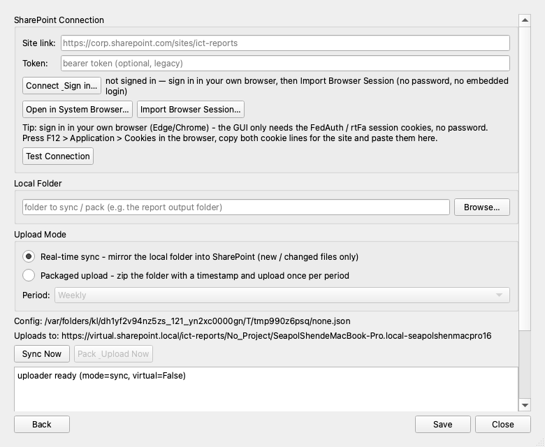
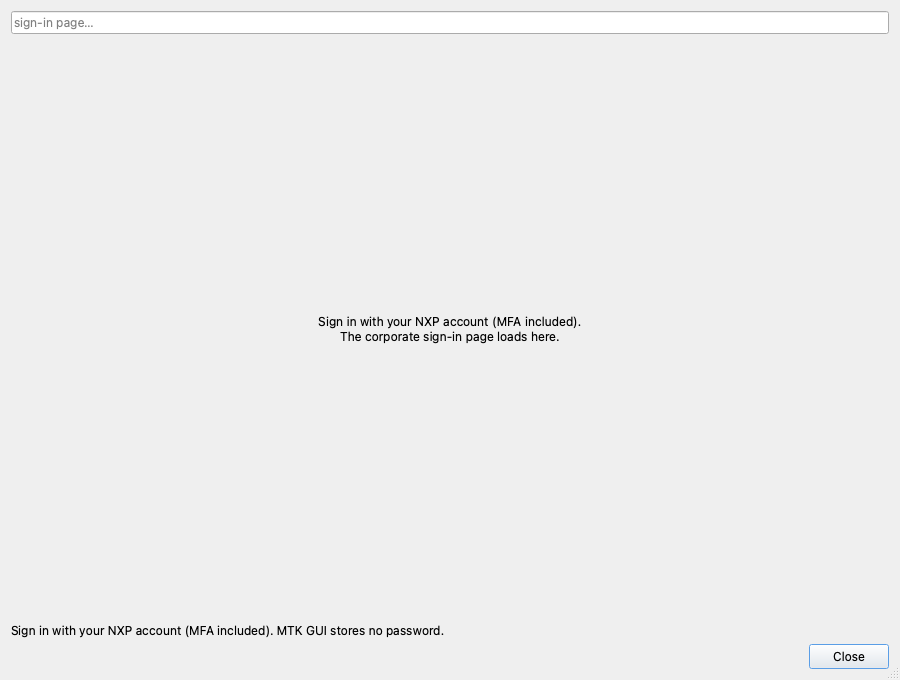

# Publishing Results: SharePoint Upload and the Bitbucket Mirror

Two outward channels, two different jobs:

| Channel | Direction | Carries |
|---|---|---|
| SharePoint upload | GUI → site folder | DUT reports (PDF + CSV), batch summaries |
| Bitbucket mirror | GitHub → Bitbucket | `develop` and release tags, read-only for readers |

Neither channel is a development tool. Results go up, code goes out, and
nothing is edited on the far side.

## Part 1 - SharePoint upload

### What it moves

`Report → SharePoint Upload...` copies the local report folder to a project
SharePoint folder, either as a mirror (new and changed files only) or as a
timestamped zip once per period (day / week / bi-weekly / month / quarter /
half-year / year).

Virtual mode never contacts the site: it uses the built-in `FakeSharePoint`
transport, so a Virtual run cannot prove the SharePoint chain. Use a real
run, or at least one real report folder, when you validate a station.

### One-time setup per station

1. Log in as **Supervisor**. The menu item is disabled for Operator by
   design - a station is configured once and the operator's flow is untouched.
2. `Report → SharePoint Upload...`.
3. Paste the folder share link into **Site link**. A link to a project
   sub-folder is fine: it becomes the upload root.

   The link only names the folder, so the GUI finds the web that owns it
   on its own: REST calls are addressed to that web (`/teams/<site>` or
   a sub-site), never to the tenant root. A probe against the tenant
   root answers `403 access denied` for any folder in another site
   collection - that is a wrong-base error, not a permission problem,
   and it no longer happens.
4. **Connect & Sign in...** opens the embedded sign-in window; complete MFA
   there.

   

5. Sign in with the station account. The tool stores no password, only the
   resulting `FedAuth` / `rtFa` session cookies, under
   `sharepoint_state\webprofile` and `session.json`.

   

6. Press **Test Connection**. Expect
   `Signed in as <name> - SharePoint test-data upload ready`.

### Daily flow

1. Run the unit; the report lands in the local `DUT Report\` folder.
2. Leave the upload dialog open and the 30 s driver picks new files up, or
   press **Sync Now** when you want it now.
3. On a bad network or an expired session, files stay in the local outbox and
   are retried on the next sweep; nothing is lost, and the retry batch goes up
   in one shot when the connection returns.

### Session expiry, honestly reported

The tenant or its MCAS proxy ends the session after a while. The dialog says
`401 / 403 - session expired` and refuses to upload with a stale cookie.
Click **Connect & Sign in...** and sign in again; there is no silent
retry-with-old-cookie path.

### Acceptance - all five must hold

| # | Check | Expected |
|---|---|---|
| 1 | The dialog opens a window | WebEngine window appears; nothing means `QtWebEngineProcess.exe` is missing from `_internal\` |
| 2 | Sign-in completes | the status line names the account |
| 3 | A report lands | file timestamp on the site matches the local file |
| 4 | A second Sync is idempotent | nothing new is uploaded |
| 5 | Expiry is honest | `401/403` message plus a working re-sign-in |

### A 403 that is not a session problem

`Test Connection` may answer `not signed in / access denied (http 403)`
while the sign-in line already names the account. Read the URL in the
message: if `_api` sits on `https://<tenant>/` while the folder is under
`/teams/<site>/...`, REST is being served by the tenant root for a folder
in another site collection, and SharePoint refuses it. The transport
resolves the owning web before the first call, so this is fixed on the
current build; if you still see it, the probe found no web and the
message carries the base it used (`[web ...]`). Report that line, the
link and the account.

### Known tenant limitation

Some tenants front the SharePoint REST API with an MCAS proxy that answers
`contextinfo` with an HTML `Continue` page requiring a browser JavaScript
handshake. The programmatic transport cannot run it, so uploads can stay
blocked even after a valid sign-in. This is a tenant restriction, not a
session bug: sign in, record the response, and escalate with the tenant
owner.

## Part 2 - The Bitbucket mirror

### Why it exists, and what it is not

GitHub is the only development source. Bitbucket is a **read-only share** for
people who read code but do not work in it: factory and supplier engineers
receive packaged software, and anyone who needs to develop clones from GitHub.
Nobody pushes into the mirror; a mirror that accepts pushes is a second
source of truth and the two drift within a week.

### What travels

- the `develop` branch;
- annotated release tags (`v1.0.x.x`).

Nothing else. No feature branches, no history rewrite, no `--mirror`. A history
-carrying mirror publishes every file that was ever committed, including
material that was removed on purpose, and history cannot be unpublished.

### Commands

```bash
# one-time: add the read-only share as a second remote
git remote add bitbucket https://bitbucket.org/<workspace>/<repo>.git
git ls-remote bitbucket        # 403 here means credentials, not code

# publish the branch and the tags - never --mirror, never --all
git push bitbucket develop
git push bitbucket --tags
```

Set the Bitbucket repository's default branch to **develop**. Left on the
retired `main`, readers land on a tree that is months old.

### Verification

```bash
git rev-parse develop                     # local truth
git ls-remote bitbucket refs/heads/develop  # must be the same id
git clone https://bitbucket.org/<workspace>/<repo>.git /tmp/mirror-check
cd /tmp/mirror-check && git log --oneline -3 && git tag | tail -3
```

Three outcomes to record: same commit id, the release tags present, and a
fresh clone that opens and builds without a GitHub credential.

### Rules

- `git push --mirror` is never used on either side.
- Only `develop` plus release tags cross. Feature branches stay on GitHub.
- The mirror is read-only for its readers: no pushes, no pull requests that
  bypass GitHub.
- The owner's release runbook - mirror credentials and permission model - is
  deliberately **outside** this repository: a file here becomes every
  reader's file the moment the mirror exists. This chapter describes the
  contract, not the credentials.

## Part 3 - End-of-day record

Write three lines into the station log and stop:

```text
build: <version> OK | ICT example PASS | FCT example 34 PASS / 0 FAIL
sharepoint: <n> files uploaded, session <valid | re-signed>
mirror: develop=<sha> tags=<n> clone=<ok|fail>
```

A red line goes to the tool owner with the exact error text, not a summary.
