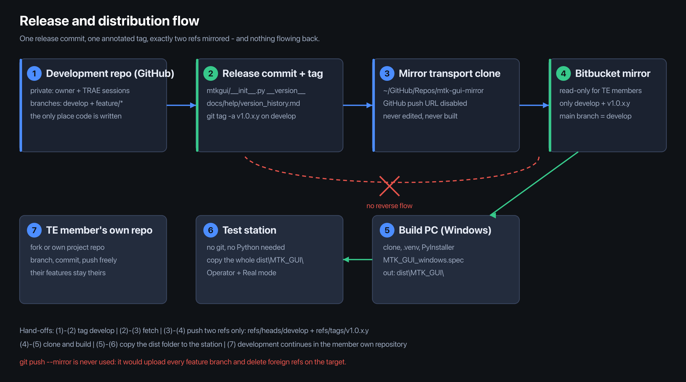

# Release and mirror runbook (owner side, macOS)

Who this is for: the repository owner, on the Mac that holds the working clone. It is the only place where
releases are cut and where the Bitbucket mirror is pushed. TE members never run any of this — they read the
mirror and build from it (see [`../WINDOWS_DEPLOY_EN.md`](../WINDOWS_DEPLOY_EN.md)).

The split between the two documents is deliberate and worth stating plainly:

- **This file** — you, and only you. It turns a finished `develop` into a release tag and a read-only mirror.
- **[`../WINDOWS_DEPLOY_EN.md`](../WINDOWS_DEPLOY_EN.md)** — you and every TE member. It covers installing on a
  Windows PC, building the exe, and deploying a factory station.

All development happens on GitHub. Bitbucket is the company's code repository and serves exactly one purpose: to
publish the shared read-only copy inside the company. Nothing is ever developed there, and nothing ever flows from
it back to GitHub — not by a push, not by a merge, not by a patch copied by hand.

When a TE member asks for push access to the mirror, the answer is no, and the route is section 12 of the shared
guide: they fork into their own repository and develop there. Granting Write "temporarily" is how the mirror stops
being a mirror.

Related documents:

| Document | Audience | What it covers |
|---|---|---|
| `docs/release_and_mirror.md` (this file) | owner only | tagging a release, mirroring to Bitbucket, permission model |
| `../WINDOWS_DEPLOY_EN.md` | every TE member | Windows install, build from source, station deployment |
| `docs/git_workflow.md` | every TE member | day-to-day branch and commit habits |
| `docs/help/version_history.md` | everyone | what changed in each released version |



---

## 0. Current state

| Item | Value |
|---|---|
| Working clone | `~/GitHub/Repos/mtk-gui`, branch `develop` |
| GitHub (development source) | `git@github.com:Seapol/MTK-GUI.git`, private, the single `origin` |
| Published head | `174000c` (`develop`), 27 commits published, 0 pending |
| Mirror clone | `~/GitHub/Repos/mtk-gui-mirror` — **not created yet** |
| Bitbucket repository | the **company** code repository, under the workspace `BB_URL` will point at. **Not created yet.** Mirror target only |
| First release tag | **none yet** — the first release will be `v1.0.0.1` |
| App version today | `v1.0.0.0` (`mtkgui/__init__.py`) |

Everything in sections 3 and 4 up to A5 has to happen once, in this order, before the first release.

---

## 1. Ground rules

These four rules are not preferences; each one has a failure it prevents.

| # | Rule | Why |
|---|---|---|
| **R1** | GitHub is the only development source. The working clone keeps exactly one remote, `origin`. | Two writable sources drift, and then nobody can say which line is real. |
| **R2** | Bitbucket is a read-only showcase. TE members get Read on it and nothing else — enforced in A5. | A mirror that accepts pushes becomes a second source within a week. |
| **R3** | There is no reverse flow. The mirror clone's GitHub push URL is set to `DISABLED-GITHUB-PUSH-MUST-NEVER-HAPPEN` (A3). | One accidental push from the transport clone lands untested code on `develop`. |
| **R4** | Releases are manual: a human writes the tag. There is no CI and no automatic mirror. | Every published tag must correspond to a commit somebody built and checked. |

**`git push --mirror` is forbidden.** It would upload all 24 feature branches and, worse, delete every ref on the
target that does not exist locally. Exactly two refs travel per release: `refs/heads/develop` and one
`refs/tags/v1.0.x.y`.

---

## 2. The version line

- `mtkgui/__init__.py` → `__version__` is the **single source of truth**. Format `v1.0.x.y`.
- `develop` commits **never** change it. Only a Release commit bumps it, and that same commit updates
  `docs/help/version_history.md`.
- The git tag must be **byte-identical** to `__version__`, including the leading `v`. No `1.0.0.1`, no `V1.0.0.1`.
- `v2.0-p2-production` and `v3.0-p3-platform` are **milestone markers**, not release tags. They are never
  mirrored and never counted in the release sequence.

---

## 3. One-time setup (A1–A5)

### A1. Create an empty repository in the company workspace

Create it with **no** README, **no** `.gitignore`, no licence template. A repository with an initial commit makes
the first push a non-fast-forward and forces a `--force` on day one — which is exactly the habit this runbook
exists to prevent.

Then set the URL in the shell that will push:

```bash
export BB_URL='git@bitbucket.org:<workspace>/<repo>.git'
```

### A2. Create the transport clone

Keep it out of the working tree. It is a pure transport directory: never edit, never build, never run tests in it.

```bash
mkdir -p "$HOME/GitHub/Repos"
git clone --no-local "$HOME/GitHub/Repos/mtk-gui" "$HOME/GitHub/Repos/mtk-gui-mirror"
```

### A3. Disable GitHub push in the transport clone

```bash
cd "$HOME/GitHub/Repos/mtk-gui-mirror"
git remote set-url --push origin 'DISABLED-GITHUB-PUSH-MUST-NEVER-HAPPEN'
git remote add bitbucket "$BB_URL"
git remote -v          # origin  fetches from GitHub, pushes nowhere. bitbucket is the only push target.
```

A deliberately invalid URL is used instead of removing the push URL: `git push` then fails loudly with a readable
message instead of silently picking another remote.

### A4. First push

```bash
cd "$HOME/GitHub/Repos/mtk-gui-mirror"
git fetch origin --prune
git push bitbucket develop:develop
git push bitbucket v1.0.0.1:refs/tags/v1.0.0.1     # after the first release exists
```

### A5. Lock permissions (do this before telling anyone the URL)

| Setting | Value | Reason |
|---|---|---|
| Repository access | TE members = **Read**; nobody else has Write except the owner | R2 |
| Branch permission on `develop` | no direct pushes, no force pushes, no deletion | the mirror must remain a faithful copy |
| Tag permission on `v*` | no creation, no update, no deletion | a rewritten release tag breaks every pinned link |
| Main branch | `develop` | GitHub's `main` is 500+ commits behind; showing it would hand TE members three-month-old code |

---

## 4. Per-release procedure (P0–P7)

Roughly ten minutes, and every step is checkable.

### P0 — Pre-flight

```bash
cd "$HOME/GitHub/Repos/mtk-gui"
git status --short                 # must print nothing
git rev-list --count origin/develop..HEAD   # must print 0
git log --oneline -1
```

If either check fails, publish first (`git push origin develop`) and re-run. Never tag a dirty tree.

### P1 — Bump the version and write the history entry

Edit `mtkgui/__init__.py` (`__version__ = "v1.0.0.1"`) and add a new section at the **top** of
`docs/help/version_history.md` with the same number. Both edits go into one commit.

### P2 — Commit and tag

```bash
git add mtkgui/__init__.py docs/help/version_history.md
git commit -m "Release v1.0.0.1"
git tag -a v1.0.0.1 -m "Release v1.0.0.1"
```

Annotated tag (`-a`), not lightweight: the tag carries a date and an author, which is what makes it auditable later.

### P3 — Publish to GitHub

```bash
git push origin develop --follow-tags
```

`--follow-tags` pushes annotated tags reachable from the pushed branch. It never pushes branches you did not name.

### P4 — Refresh the transport clone

```bash
cd "$HOME/GitHub/Repos/mtk-gui-mirror"
git remote update --prune
git log --oneline -1 origin/develop
```

`--prune` drops refs whose upstream is gone. Confirm the head is the commit you just tagged.

### P5 — Push exactly two refs

```bash
git push bitbucket origin/develop:refs/heads/develop
git push bitbucket refs/tags/v1.0.0.1:refs/tags/v1.0.0.1
```

Two commands, two refs. No `--mirror`, no `--all`, no `--tags`.

### P6 — Verify both sides

```bash
git ls-remote origin develop refs/tags/v1.0.0.1
git ls-remote bitbucket develop refs/tags/v1.0.0.1
```

The two outputs must be identical, hash for hash. If they are, the mirror is correct — say `MIRROR OK` and move on.

```bash
for r in origin bitbucket; do git ls-remote "$r" | sort > "/tmp/$r.refs"; done
diff /tmp/origin.refs /tmp/bitbucket.refs && echo "MIRROR OK"
```

### P7 — Eyes on the web page

Open the Bitbucket repository: the latest commit on `develop` is the Release commit, the tag `v1.0.0.1` exists
under Tags, `develop` is marked as the main branch, and the file list has no stray build output.

---

## 5. Recovery

| Situation | What to do |
|---|---|
| Tagged the wrong commit, nothing pushed yet | `git tag -d v1.0.0.1`, fix, re-tag. Only safe before P3. |
| Tagged the wrong commit, already on GitHub | Bump to the next patch version and release again. Never move a published tag. |
| Pushed the tag, forgot to push `develop` | Run the P5 `develop` line; the tag stays valid. |
| Bitbucket rejects the push as non-fast-forward | The target was not empty (A1 violated). Recreate the repository empty; do not `--force`. |
| `git push` in the transport clone fails with the `DISABLED-…` URL | Correct behaviour. Push to `bitbucket`, never to `origin`. |
| Mirror and GitHub disagree after P6 | Re-run P4, then P5. If it persists, the transport clone is damaged — delete it and redo A2–A3. |

---

## 6. Do-not list

- `git push --mirror`, `--all`, `--tags` — the first deletes foreign refs, the other two publish work in progress.
- Any remote named `upstream`, `bitbucket` or anything else in the working clone. One remote, `origin`, forever.
- Editing, building or running tests inside `~/GitHub/Repos/mtk-gui-mirror`.
- Re-pointing a published tag, or editing `__version__` on a `develop` commit.
- Committing a build output (`dist/`, `build/`, `.build_tmp/`) or a `.venv` into either repository.
- Giving a TE member Write on Bitbucket "just to test something".
